# I&D Quality Demand Planning — User guide

This guide shows how to use the app day to day: how to get started, find your way around, write your time, keep the backlog tidy, read the reports, build On-Demand pages and charts, and look after the shared setup. Each chapter is a set of short tasks with the steps to follow.

Every screenshot and clip in this guide was made from **synthetic data** — the app's built-in sample dataset and made-up pages, people and numbers (Ana Costa, Ben Okafor, Chen Wei and so on, all `@example.com`). None of it is real team data. The pictures are regenerated from the app itself, so they match the build you are reading this in; your own screen will show your team's data and may differ in details.

The clips have no sound. Every clip repeats steps that are written out in full next to it, so you never need to watch one to follow a task.

## Contents

1. [What's new](#whats-new)
2. [Before you start](#before-you-start)
3. [Getting started](#getting-started)
4. [Finding your way around](#finding-your-way-around)
5. [Roles and rights](#roles-and-rights)
6. [Daily work](#daily-work)
7. [Reports](#reports)
8. [Release Details](#release-details)
9. [On-Demand pages](#on-demand-pages)
10. [Insights: charts, KPI cards and narratives](#insights-charts-kpi-cards-and-narratives)
11. [On-Demand Dashboards](#on-demand-dashboards)
12. [Sharing: PDF and interactive HTML](#sharing-pdf-and-interactive-html)
13. [Admin](#admin)
14. [Troubleshooting and FAQ](#troubleshooting-and-faq)
15. [About this guide](#about-this-guide)

## What's new

This chapter covers recent changes by area, with steps and any setup needed. For DemandPlanning version numbers and release history, see the [Release notes](RELEASE-NOTES.md).

**Before you start: everyone updates first.** Several changes below store new values in the team's shared files in Git. An older app version does not know them and can drop them when it saves. Ask everyone to update to the latest DemandPlanning build before the Tool Owner sets up the second Tool Validations query, adds categories or adds tabs. In the desktop app choose **Update now** when **Update available** appears (or **↻ Check for updates** in the footer); in the browser use **Force Update** in the footer.

### New in Tool Validations

**Tool List [TFS] and Validation Documents [TFS] tabs**

The **Azure** tab is gone. In its place, after **Master list**, there are two tabs, each with one table of its query's rows and every column the query selects, in the query's order. The **Releases** table and the **Selected month / All months** toggle are no longer on this page: the month's tools are shown on the master list instead.

1. Open **Release Details → Tool Validations**.
2. Choose **Tool List [TFS]** to see the rows of the Tools query.
3. Choose **Validation Documents [TFS]** to see every signed document. This tab shows only when Tool Validations reads two queries (see *Count from two queries* below).
4. Use **Columns** to hide columns you do not need.

If your browser remembered the old Azure tab, the page now opens **Tool List [TFS]**.

*TVL-14, TVL-31*

**New master list columns: ID, Used by, Validated and Type**

The **Master list** shows, next to Tool and Version, the tool's Azure DevOps work item **ID** and three columns of the Tools query: **Used by** (its Source column), **Validated** (its State column) and **Type** (its Type column). Sort and filter them like any column.

One-time setup (Tool Owner or a co-owner of the list):

1. Open **Setup** and, under **Sources**, choose **Edit mapping…** on the Tool Validations query.
2. Check the four new fields. The app guesses the work item ID and the columns named Source, State and Type. Choose **None** to leave one out.
3. Choose **Save to Git**.

The values come back at the next fetch (**↻**) of the Tools query.

*TVL-34*

**Current Month Status, and counts from the master list**

Each tool on the **Master list** and the **Expiry list** has a **Current Month Status** for the month in the header:

- **Completed** — the tool's completion date is in the month.
- **Supported** — one of its documents has a Quality signature in the month.
- **Completed, Supported** — both, shown as two pills.
- Empty — neither.

The month's cards, Pulse Check, the Monthly pack and the cumulative chart now count the master list's tools by this status. Pulse Check's Tool Validations quadrant lists the counted tools with name, version, ID and status. For example, in November 2026 a tool "Example Analyzer 2.1" that was completed on 12 November shows **Completed** and counts once under Completed.

*TVL-22, TVL-35, TVL-36*

**The count cards are on the Master list tab**

The month's cards no longer sit above every tab. Open the **Master list** tab to see **Validations in {Month}**, **Completed validations** and **Supported validations**, with **What was counted**. The other Release pages are unchanged.

*TVL-23*

**Count from two queries: Tool List and Validation Documents**

Tool Validations can read two Azure DevOps queries: the **Tool List** query (one row per tool; it feeds the master list and **Completed**) and the **Validation Documents** query (one row per signed document, its Parent the tool; it gives **Supported**). Every document the Validation Documents query returns counts, whatever its work item type. With one query only, the counts stay as before.

One-time setup (Tool Owner):

1. Make sure everyone has updated the app. An older version reads one query only and may count differently.
2. Open **Admin → Streams → Stream mapping**.
3. On the row **Tool Validations · Validation Documents**, choose **Add query**. Enter the server, the project and the documents query.
4. **Add query** asks the **Category**: **Tool List** or **Validation Documents**. It is pre-selected from the query's name or columns. Check it, then choose **Save and refresh data**.
5. Under **Tool Validations queries**, check that one connection shows **Tool List** and the other **Validation Documents**. If the app took the wrong one, choose the **Validation Documents query** yourself. **None — one query** counts as before.
6. Choose the **Completion date (Completed)**. **Changed Date** is the default, but it moves whenever someone edits the tool. Pick a date column of the Tools query that is set once, if there is one.
7. Save the change to Git with the bar above.

Then open **Release Details → Tool Validations → Master list** to see the counts.

*TVL-19, TVL-20, TVL-21, TVL-33*

**Validation Documents: every document, with its tool's name**

The **Validation Documents [TFS]** table lists one row per document, also documents whose Parent is not in the Tools query (for example a retired tool). It starts with:

- **Tool** — the name of the Parent: the tool's name and version from the Tools query, or else the Parent's title read from Azure DevOps by its ID.
- **Parent ID**.
- **Tool List (Azure)** — **Listed**, or **Not in Tool List (Azure)**.

A document marked **Not in Tool List (Azure)** is listed, but not counted and not added to the master list. **↻** fetches both queries and then reads the missing Parent names (read only, with the same connection and PAT). A name that cannot be read shows as **#ID**, for example **#1234**: point at it, or open ⓘ on the table, for the reason.

*TVL-31*

**Tools from Azure DevOps are dated by their completion date**

A tool from an Azure DevOps query now takes its **completion date** as its validation date (the field chosen under **Tool Validations queries → Completion date**, Changed Date by default). Its due date is that date **+ 24 months**, unless the query gives a validity period or a due date. The Master list and the Expiry list show **(completion date)** and "completion date + 24 months (default)".

One-time setup, only if your source's mapping was saved before with Author Approval Date (Tool Owner or a co-owner of the list):

1. Open **Setup**, and under **Sources** choose **Edit mapping…** on the source.
2. For **Validation date**, pick **Completion date** (or **None — the completion date**).
3. Choose **Save to Git**.

A mapping that names another Validation date field keeps it.

*TVL-29*

**Tools from Azure DevOps are changed in Azure DevOps**

On the **Master list**, **Edit** and **Remove** are greyed out for a tool that comes from Azure DevOps; hover them for the reason. To add a note:

1. Choose **Edit notes…** on the tool's row.
2. Type the note and save it to Git.

Once Azure DevOps no longer returns the tool, it is marked **Not in source now** and you can **Remove** it. Dates you entered by hand on such a tool are replaced by Azure DevOps' at the next fetch. Adding by hand a tool with the same name and version as one from Azure DevOps is refused, with the reason. Tools added by hand, or from a Windchill export or a table page, work as before.

*TVL-30*

**A category for every source**

Each source is either a **Tool List** (one row per tool; its tools go into the master list) or **Validation Documents** (documents of the validations; listed on its own tab, never added to the master list).

1. Open **Setup** and, under **Sources**, choose **＋ Add source…**.
2. Choose the source as before, and answer **Category**: **Tool List** or **Validation Documents**. Nothing is chosen until you pick.
3. For a Tool List, check **Edit mapping…** and then **Merge into master list…**. A Validation Documents source needs no mapping and has no Merge.

To change the category of a source later, open its **Edit mapping…**. Changed to Validation Documents, the source stops feeding the master list; the tools it brought stay, marked **Not in source now**. Sources added before this change are Tool Lists, so they behave as before.

*TVL-32*

**24 months by default**

A tool with a validation date but no validity period and no due date is now valid for **24 months**. Its period shows as **24 (default)** and its due date as "validation date + 24 months (default)". Such a tool is now **Overdue**, due soon or later, instead of having no due date. For example, a tool validated on 1 December 2024 is due on 1 December 2026.

To use another period, enter it (or a due date) with **Edit** or in the source. The Add / Edit tool pop-up says "Leave empty for 24 months (default)" and shows the due date it will use. A source's own tab now shows the same due date as the master list.

*TVL-06, TVL-08, TVL-10*

**Rows highlighted by due date**

The **Master list** and the **Expiry list** tint each tool's row by how soon it is due, and name the band in the **Due date** cell (for example **≤ 30 days** or **Overdue / today**). A legend above the table lists the bands. Until the team saves its own bands, the defaults apply: overdue or due today red, within 30 days amber, within 90 days yellow.

To set the team's bands (Tool Owner or a co-owner of the list):

1. Open **Setup**. **Due date highlights** shows the bands and how many tools fall in each.
2. Choose **Edit…**. Each band has **Due within (days)** (0 = overdue or due today) and a **Colour**. **＋ Add band** adds one (up to 10); **Remove** takes one away.
3. Choose **Save to Git**. Everyone sees the same bands. Removing every band turns the highlighting off.

*TVL-27, TVL-28*

**Bring back a hidden page as a tab**

A tab page that was hidden — kept when its tab was removed, or left behind when an older app version dropped the tabs — can be made a tab again, with its data.

1. Open **Setup** and, under **Tabs**, choose **＋ Add existing page as tab…**.
2. Pick the page, keep or change its name, and choose **Add tab**.

The rights are the same as for **＋ Add tab…**.

*TVL-24*

**The list's co-owners edit the tab pages**

The co-owners of the list (**Setup → Team settings**) are now written as co-owners of each tab's page. They can set up and edit the page also when it is opened from **Admin → Pages & menu**. Co-owners added to a page by hand stay. Nothing to do: it happens when a tab is added and whenever the list's co-owners are saved. If a page is out of line, **Setup → Tabs** says so with **Write the co-owners to the tab pages**; choose it to fix it.

*TVL-25*

**Hide the expiry status on a dashboard block**

A dashboard block over the **Tool Validations master list** or **Tool Validations expiry list** (On-Demand Dashboards and My dashboard) can leave out Status and Days left.

1. Open the block's pop-up.
2. Under the data source, untick **Show expiry status**.
3. Save the block as usual. It counts the same tools, without Status and Days left.

The switch is on by default.

*TVL-26*

### New on the Release pages

**A slimmer source bar**

On every Release page the bar above the counts now shows only the period toggle, **↻** and **⋯**, on the right. Warnings about the data stay below it.

1. Open **⋯**. Its first line says where the data comes from and when it was fetched or imported.
2. Choose **⋯ → About this source…** for the details that used to be behind ⓘ Info: the month filter, the items fetched, DP's milestone names and the Git copy.

*QV-62, QV-70*

**Selected month / All months**

DP, IOCC, Content, S&S IT, ECP, the Windchill pages and custom streams show the period as a toggle **Selected month | All months**, instead of a drop-down that repeated the month already shown in the top bar.

1. Choose the month in the top bar, as before.
2. Choose **Selected month** for that month's releases, or **All months** for every release.

Point at **Selected month** to see which month it is. Tool Validations no longer has the toggle (see above); CP has it too (see below).

*QV-71*

### New in Bulk creation Epics and Admin

**A shared bulk creation Epic is saved straight to Git**

**Save to Git** on a shared Epic now commits it to Git at once; there is no separate save step.

1. Open **Admin → Stream options → Bulk creation Epics**.
2. In the **Shared** column of the stream (DP, IOCC or Content), enter the Epic ID, for example 1234.
3. Choose **Save to Git**. A message below the table says it is saved, or why it failed.

Without a writable Git connection (not connected, a read-only token, or the synthetic sample loaded) the **Shared** field is greyed out and says why. Your own Epic under **Mine** works as before, with **Save**.

*QV-59*

**A missing bulk creation Epic needs attention**

**Admin → Overview** now lists *{stream} bulk creation Epic is not set* (for example *DP bulk creation Epic is not set*) under **Attention** instead of Optional, because that stream's **Create Features** stays greyed out until an Epic is mapped. Its link opens **Bulk creation Epics**.

*ADM-05*

### New for Windchill export pages

**⋯ → Upload latest export…**

An existing Windchill export page (S&S IT, ECP and the other Windchill pages) takes a newer CSV export from its **⋯** menu. The page, its name and its setup stay.

1. Open the Windchill export page under **Release Details**.
2. Choose **⋯ → Upload latest export…**.
3. Pick the newer CSV file. The import is listed in **Background jobs**.

**↻** still does the same.

*CON-108*

### New on the CP Release page

**Selected month / All months on CP**

The **CP** Release page now has the same toggle as the other Release pages.

1. Open **Release Details → CP**.
2. Choose **All months** to list every release container with a QA/QE signature in any month, or **Selected month** for the month in the top bar.

The counts, Pulse Check and the Monthly pack still use the header month.

*QV-72*

### New in PI Review

Open **Data Insights → PI Review**, choose a PI and select a Feature to read its Azure DevOps Discussion. **Read all Discussions** runs in the background. The page keeps comments for the current page load. See [PI Review](#pi-review) for the filters and the bulk-read steps.

*PIR-01…PIR-06*

## Before you start

### What the app is for

I&D Quality Demand Planning brings the team's demand, capacity and releases into one place. It reads the Time Writing backlog (QMS-0025) and the release streams from Azure DevOps, adds the team's own tables (On-Demand pages such as CoNQ), and keeps what the team shares — the setup, roles, pages and charts — in a private Git repository. It runs in a browser and as a desktop app for Windows and macOS.

### Three things to know

- **Your tokens stay with you.** Your Azure DevOps PAT and your GitHub token are kept only in your browser or desktop app. They are never saved to Git, to a backup or to SharePoint, and nobody else gets them.
- **Writes go to the cloud only.** The app writes work items only to Azure DevOps in the cloud (dev.azure.com). The on-premises Azure DevOps Server is always read only.
- **What you see depends on your role.** Your roles decide which pages you see and which buttons work. A greyed-out button always says why.

## Getting started

### Open the app

**In a browser.** Open the address your team uses for the app. The first time, each page loads for a moment ("Loading the page…"); after that it opens at once.

**As a desktop app.**

1. In the app (in a browser), press **⬇ Desktop app** at the bottom left of any page. The download for your computer is highlighted.
2. **Windows:** run `Demand-Planning-Hub-Setup.exe`. Windows SmartScreen may warn that the installer is not signed: choose **More info → Run anyway**.
3. **macOS:** open `Demand-Planning-Hub-mac.dmg` and drag the app into Applications. The first time, right-click the app and choose **Open**.

The desktop app keeps your data and tokens in your user profile. It checks for a newer version when it starts and every four hours — see [Updates of the desktop app](#updates-of-the-desktop-app).

### The Get started pop-up

A new user sees **Get started**, a short list of what to set up, in order. Each step shows whether it is done, and you can fill in what it needs right there.


1. **Connect the shared Git storage.** Paste your GitHub token and press **Connect & load**. This brings in the team's connections, Feature setup, holidays and roles.
2. **Check the Time Writing connection** and **your work email**. **Detect from my token** reads your email from a work item assigned to, created or changed by you; confirm it with **Save email**.
3. **Enter your Azure DevOps PAT.**
4. **Fetch your data** with **Fetch now**.

The pop-up opens by itself while a required step is open, until you tick *Don't show again automatically*. The **Setup · n/4** button in the top bar opens it again at any time.

### Connect Azure DevOps: one PAT per server

Your Azure DevOps personal access token (PAT) is entered once per **server** and used by every connection on that server.

1. Click your initial at the top right and choose **My settings**.
2. Open **Servers and PATs**.
3. Paste the PAT of each server you use, and save. **＋ Add server** adds another server with its own PAT.


- The PAT stays on this computer, in this browser or desktop app. It is never saved to Git or to a backup. Each person uses their own.
- The Time Writing PAT needs **Work Items (Read & Write)** to save hours and create work, and **Project and Team (Read)** to read the team.
- The on-premises server is read only: its PAT only needs read access.

### Connect Git storage

What the team shares lives in a private GitHub repository: the planning data, the connection setup, roles, On-Demand pages, dashboards and the menu.

1. Open **Admin → Data & sharing → Git storage** (or use step 1 of Get started).
2. The form starts with the team's repository and branch. Add your **GitHub token** and connect.


- Use a **fine-grained GitHub token** for that one repository: **Contents: Read-only** if you only read, **Read and write** if you save (for example rows, charts, baselines or people).
- With a read-only token the app shows the shared data, but saving buttons are greyed out with the reason.
- The token stays in your browser, like the PAT.
- **The team's data moved** to `philips-internal/InD_DemandPlanningStorage`. If you connected before the move, a notice at the top of every page says so: press **Switch to philips-internal/InD_DemandPlanningStorage**. Your token must be allowed on the new repository; if it is not, ask for a new fine-grained token for it.
- **"… was not found, or the token cannot access it."** means your token cannot read the repository (or the branch is wrong). The app then keeps everything you had — your streams, connections and PATs — and changes nothing until the token works; ask for access to the repository. After you change the repository, your connections are kept: the first start only adds the new repository's connections and Admin → Data & sharing (Git storage, and Shared setup in Git) tells you what differs.

### Your work email

The app recognises you by **your work email**, as Azure DevOps shows it. It finds your work on My Tasks [Board], drives your Time Writing prompts and your roles, and is assigned to the Features you create.

1. Open **My settings → Your work email** (click your initial at the top right, or your name at the bottom of the menu).
2. Type your email, or use **Detect from my token**, and save.

The email stays on your computer: it is not part of the shared setup, so updates, a sync from Git or a change to a connection never change it.

### Try it with the synthetic sample

You can look around before anything is connected.

1. Press **Load synthetic sample** (on a page with no data, or in **Admin → Data & sharing → Synthetic sample**).
2. The banner "Showing a synthetic sample dataset, not Azure DevOps data" stays on every page while the sample is loaded.

- Nothing is written to Azure DevOps while the sample is loaded: every write is refused with "Synthetic sample data is loaded: nothing is written to Azure DevOps. Fetch your data first."
- On-Demand pages are read only while the sample is loaded.
- **↻ Refresh** in the top bar fetches your real data and replaces the sample.

## Finding your way around

### Home and the menu

The app opens on **Home**: one tile per area. Click a tile to open the area, or one of its small buttons to go straight to a page. **+n more** shows the rest; the search box at the top filters tiles and pages as you type. You only see what your roles may open; My Work shows how many open items you have.

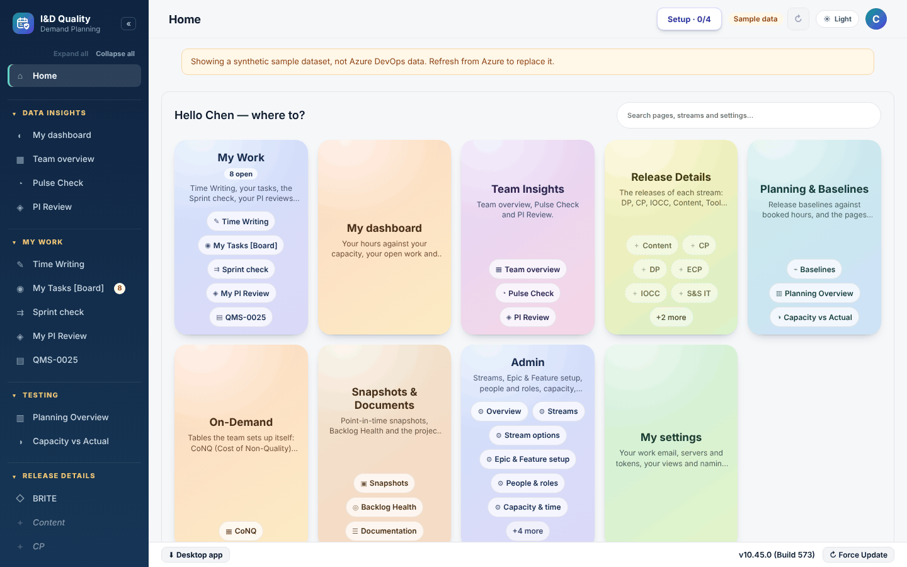

The menu on the left groups the pages: **Data Insights**, **My Work** (ending with the QMS-0025 backlog), **Release Details**, **On-Demand**, **Data & governance** (with **Backlog Health** before Documentation) and **Admin** (and **Testing** for Admins). QMS-0025 and Backlog Health were under **I&D Board** in earlier versions; that heading is gone, and who may open them has not changed.


- **Release Details** is one list: **BRITE**, then every stream — Azure DevOps and Windchill exports alike — from A to Z, then **＋ ECP export** and **Import Windchill export**.
- Click a group heading to fold or unfold it; **Expand all** / **Collapse all** do every group at once. The app remembers your choice.
- **«** in the menu header folds the menu to icons; **»** shows the names again.
- **Customize menu** (profile menu) pins or hides pages in your own menu.
- **Classic view** (profile menu) opens the app on My dashboard instead of Home; **Tile view** switches back.

On a phone the menu is behind **☰** at the top left; it closes when you choose a page.

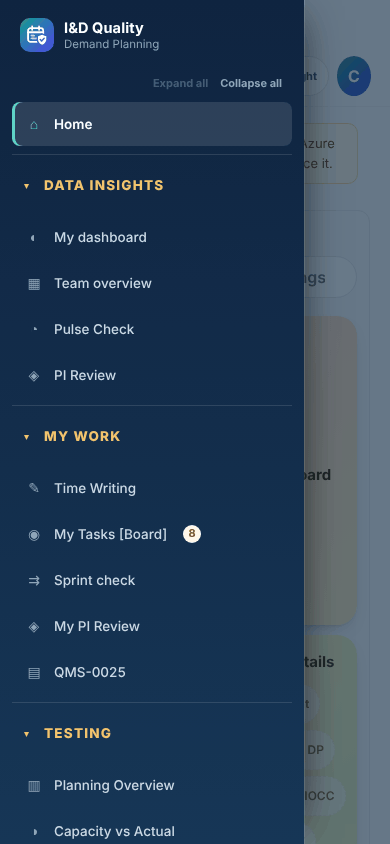

### The top bar

- The **page title** (hover it for what the page is for).
- **Setup · n/4** while Get started has open steps.
- **⟳ n running** while background jobs run (see below).
- The **data status** chip with **↻ Refresh**, which fetches every connection again.
- The **month** for pages that show one month.
- The **theme** button: **Auto → Light → Dark**.
- Your **profile** (your initial): My settings, Look & feel, Classic / Tile view, View as… (Admins), Search settings (**Ctrl K**, **⌘ K** on a Mac), Customize menu and **User guide**.

### Theme and zoom

- The theme button cycles **Auto** (follows your computer), **Light** and **Dark**. **Look & feel → Theme and zoom** sets the same.
- In the desktop app the profile menu also has the **zoom**.

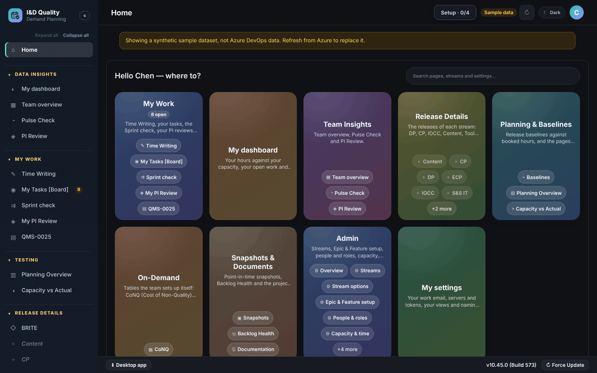

### Background jobs

Long actions run in the background so you can keep working: saving a New Feature, Sprint check moves, saving Time Writing, every save to Git, and the Refresh and Import of the Release pages.

- The top bar shows **⟳ n running** while they run. Click it to see each job's progress and its result: ✓ done, or ⚠ what failed and what was still created.
- Pressing the same button again while its job runs does nothing. Closing or reloading the page while a job runs asks first.
- Jobs belong to this page load; they are not stored.

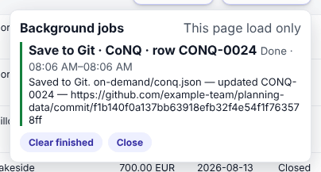

### "Newer data in Git"

When someone else saves data that the page you are on uses, a notice appears on that page only, saying who saved it and when.

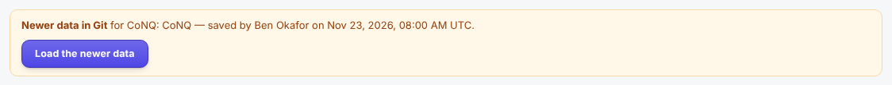

- Press **Load the newer data** to read it. The page updates in place; the app is not reloaded.
- Your own saves never raise the notice.
- The app checks every few minutes, so the notice can take a moment to appear.

## Roles and rights

### What each role can do

Your app roles are set in **Admin → People & roles**. Someone with several roles gets everything any of them allows — unless one of their roles **denies** it: a denial always wins. Everyone without a role gets the **Everyone else** role.

| Role | Sees | May |
|---|---|---|
| Tool Owner | everything | everything, including the stream mapping, Pages & menu and building On-Demand Dashboards |
| Admin | everything, plus the Testing pages | everything except the stream mapping, Pages & menu and building dashboards |
| Product Owner | Dashboard, I&D Board, Backlog Health, Release Details, Baselines, QE Mapping, Documentation, On-Demand | work items (also bulk create and for others), baselines, QE Mapping, export, Monthly pack text |
| People Manager | Dashboard, team insights, My Work, I&D Board, Release Details, Baselines, QE Mapping, Snapshots, Documentation, On-Demand | the same as Product Owner |
| Scrum Master | Dashboard, My Work, I&D Board, Backlog Health, Release Details, Documentation, On-Demand | work items (also for others), export, the shared Feature setup |
| Team Member | Dashboard, My Work, I&D Board, Release Details, Documentation, On-Demand | their own work items, export |

These are the starting rights. Your team may have changed them in **Role rights** (see [People & roles](#people--roles)).

The roles decide what the app shows and does. What you can actually read or change is still decided by your own Azure DevOps PAT and GitHub token.

### Why is a button greyed out?

A greyed-out button always comes with a **reason line** next to it (above the table for row buttons). Typical reasons:

- Your role does not allow the action — the line names the right and where an Admin changes it.
- The roles have not been loaded yet (see below).
- Git storage is not connected, or your GitHub token can only read.
- The synthetic sample is loaded.
- On an On-Demand page, someone else is editing that row.


### Read only until the roles are loaded

Until the roles file (`access.json`) has been read from Git, the app is **read only** for everyone: every page shows, but nothing can be changed, and a notice says so. Connect Git storage to load the roles.


If Git storage has no roles file yet, the first person may press **Set up roles**: it starts from the table above with that person as Admin.

### View as (Admins)

An Admin can see the app as a chosen person or as a role — their menu, their pages, their own My dashboard — to check what someone else sees.

1. Open the profile menu and choose **View as…**.
2. Choose **A person** (and the person) or **A role** (and the role), then **View as**.
3. A banner shows whom you are viewing as. Press **Exit View as** to go back.


View as is read only: nothing is saved to Azure DevOps or Git while it is on. Reloading the page ends it.


## Daily work

### Write your time (Time Writing)

**My Work → Time Writing** is your month on one page: your month Tasks with planned and actual hours, and what is still missing.

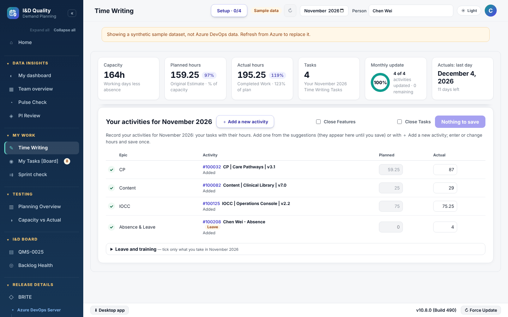

1. Check the month in the top bar.
2. In **Your activities**, enter **Planned** (Original Estimate) and **Actual** (Completed Work) hours for each activity.
3. Features without a Task this month are offered as **suggestions** on the right. Press **Add** (or **Add all**) to put them in your list; nothing is added unless you choose it.
4. Press **Save**. The save runs in the background; the top bar shows its result.

- **＋ Add a new activity** adds your month Task under a Feature (choose an Active Epic, then one of its Features), a **User Story**, a work **Task**, or opens **New Feature**.
- The cards at the top show your Capacity, Planned and Actual hours with their share of capacity, your Tasks, and the **last day** to update the month. When you are not counted for capacity, the Capacity card says why.
- **Close Features** and **Close Tasks** (next to Save) let you tick items and close your own open work after one confirmation.
- Each month has a last day for the plan and one for the actuals (by default the 5th of the month and the 4th of the next month). After the plan's last day the Planned hours are greyed out and only Actual can be changed; after the actuals' last day the month is locked.

### My Tasks [Board]

**My Work → My Tasks [Board]** lists your open Azure DevOps items: Features, User Stories, Bugs and Tasks, with a count in the menu.

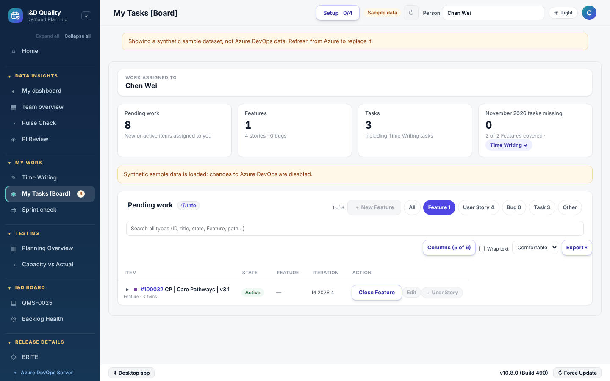

- Filter by type with the buttons above the table.
- **Edit** opens the item in place; **Close Feature** / **Close** finishes it (see below); **＋ User Story** adds a story under a Feature.
- **Person** in the top bar shows someone else's board (if your role allows).

### The QMS-0025 backlog

**My Work → QMS-0025** is the Time Writing backlog as a tree: Epic → Feature → User Story → Task.

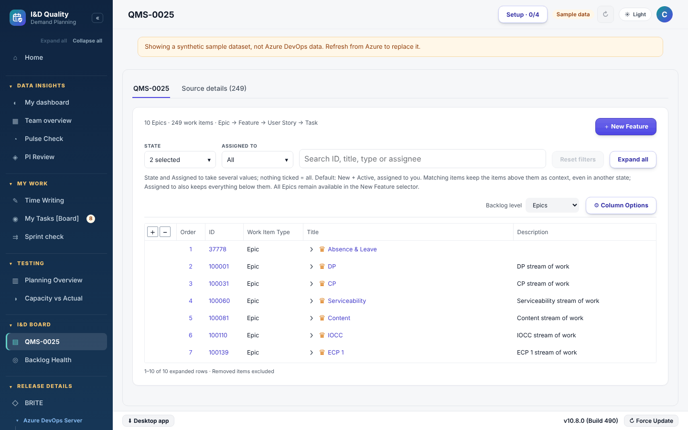

- **Filters**: Assigned to (you, by default), State and more; **Reset filters** clears them. **Expand all** opens every level; **›** opens one row.
- **⚙ Column Options** chooses the columns.
- **Source details** lists every fetched work item with its fields.
- On a row: **Edit**, **Close**, **＋ Feature**, **＋ User Story**, **＋ Task** and **＋ Time Writing Task**, as your role allows.

### Create a Feature

Every page creates a Feature with the same **New Feature** form: QMS-0025, My Tasks [Board], Time Writing and Create Feature on a Release page.

1. Press **＋ New Feature**.
2. **1 Feature** — choose the **Parent Epic** first, then fill in the title (or the title fields of that Epic), Assigned to, PI → Sprint, Start date and Target date.
3. **2 Definition of Done** — the Feature DoD is required. Check it and press **Continue**.
4. **3 User Stories** — tick the stories to create, add your own, and press **Continue**.
5. **4 Estimates for the month** — the hours of each month's Time Writing Task.
6. Press **Save**. The Feature and its children are created in the background.


- A Target date in a later month creates one Time Writing Task per month up to that date, and asks the hours of each.
- A new Feature stays **New** until one of its User Stories is Active.
- New work is always assigned — to the person chosen, else to you.

### Edit and close work

- **Edit** on a row opens the item's fields; save to write them to Azure DevOps.
- **Close** (on a Feature or User Story) lists what would close, each with a tick box: your items start ticked, others' do not, and a parent closes only with everything below it. Closing a Time Writing Task first asks you to confirm its hours are up to date.
- Closing a Feature before its last Time Writing month also sets the later months' Tasks to 0 h and Removed.

### Sprint check

**My Work → Sprint check** tidies up your Sprints.

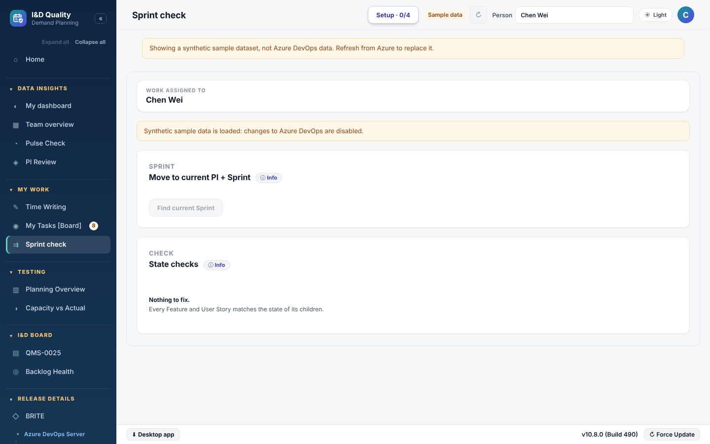

1. **Find current Sprint** works out today's PI and Sprint from the team's iteration dates.
2. **Move to current PI + Sprint** lists your User Stories still in a past Sprint, in the states you choose (**New**, **Active** or **Both**). Confirm to move them.
3. **State checks** list your Features and User Stories whose state does not match their children. Open a row (**›**) to set a New User Story **Active** right there; an Active Feature in an older PI than its stories offers **Move Feature to <PI>**.

### My dashboard

**Data Insights → My dashboard** is your own month: your hours against your capacity, your open work, your streams and releases, the release counts and what you signed.


- Each section links to the page where you act on it (Time Writing, My Tasks [Board]).
- My dashboard is **yours**: nobody else sees your blocks or your layout. An Admin's **View as** shows the default My dashboard of the viewed role, not yours.

#### Edit My dashboard

Its built-in sections — My hours, My open work, My streams and releases, Release counts and Signed by me — are its **default blocks**. You can add up to 20 blocks of your own and arrange everything.

**Add a block**

1. Press **＋ Add block…**.
2. On **Data**, type a **Title**, choose the type — KPI tile, Bar chart, Line chart, Pie chart, Pareto, Pivot table or Narrative (text) — and the **Data source**.
3. Choose **Categories by** (or, for a Pivot table, **Rows** and **Columns** with **＋ then by**), the **Measure** and its column, and, when the source has dates, **Period filter on**.
4. Set the other tabs if you need them (**Filters**, **Format**, **Elements**; see [Add a chart or table](#add-a-chart-or-table)) and press **Add block**.


The data sources are what the app has already loaded:

- **Azure DevOps work** — Features, User Stories and Tasks by type, state, assignee, area, Epic, Feature, PI, Sprint, dates, hours and tags. A click on a bar lists the items with their #ID links. With only *My Tasks [Board]* you see your own items.
- **Releases per stream** — a row per release as Pulse Check counts it.
- **Completed releases per stream per month** — each stream's Completed releases in each month up to this one, as Pulse Check's Month tabs count them, with **Counted in Pulse Check** (Yes / No, from your own Streams not counted). A line chart by Month, split by Stream, with **Running total** is Pulse Check's Year chart.
- **Capacity and utilization** — Team overview's figures per person and month.
- **The On-Demand table pages**, the **Time Writing hours**, the **QE Mapping** sheets, the **KPI tracker** values, the **historical hours** and each **Windchill export**.

A source your role may not see is offered as "(not available)", and a block over it says "Not available for your role." A source whose data is not loaded yet offers the action that loads it (for example **Load the KPI tracker**).

**Arrange it**

1. Press **Customize**. It lists every section and block.
2. Tick or untick an item to show or hide it; **↑ ↓** move it; set its **width** and **height**; **Edit…** and **Remove…** change a block of your own.
3. Press **Done**.

A block's **⋯** also has Move up, Move down, Edit… and Remove…; drag its bottom-right corner to resize it. **Reset to the default My dashboard** (in Customize) removes your blocks, order and sizes.

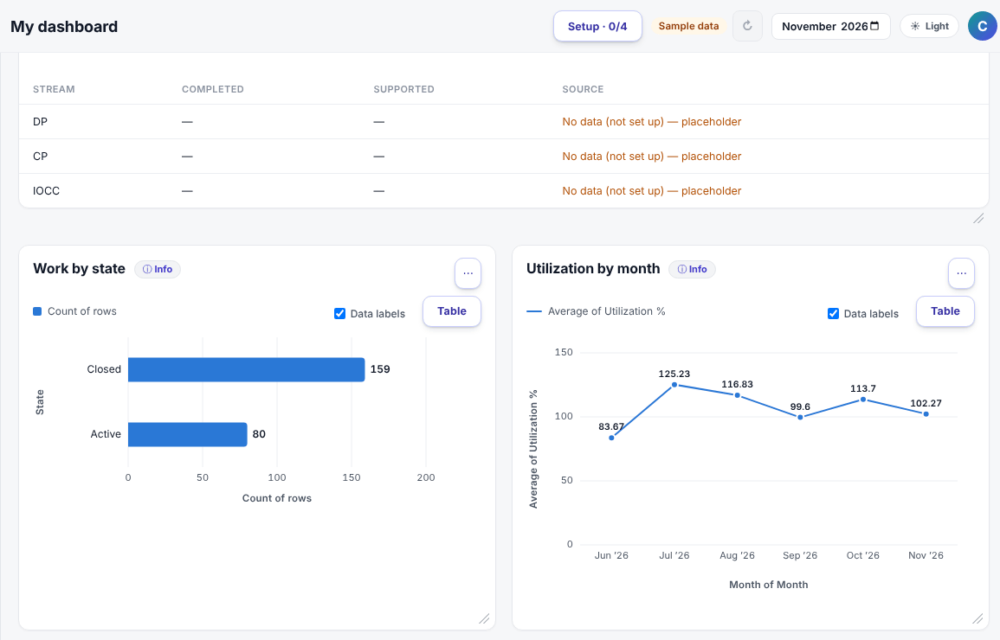


- Your blocks have a **period** (Year / Quarter / Month, nothing ticked: the current year) with **Reset filters**; the built-in sections keep the header month.
- The layout is kept with your personal views: in this browser at once, and on every computer once Git storage and your work email are set.
- PDF export and interactive HTML are not offered for My dashboard: it is personal.

## Reports

### Team overview

**Data Insights → Team overview** shows the team at a glance for a period and a group of people.

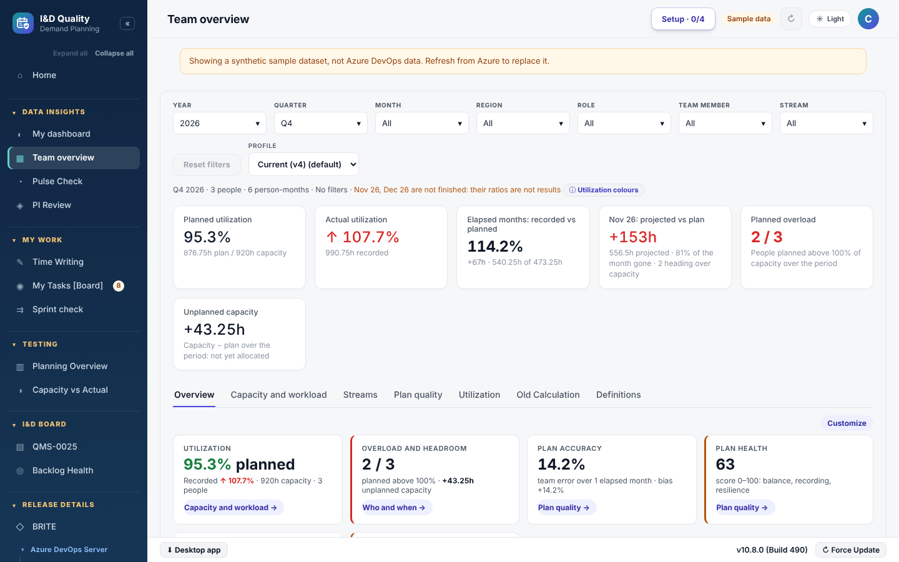

1. Choose the period with **Year**, **Quarter** and **Month** (nothing ticked: the current year and all its quarters and months).
2. Narrow by **Region**, **Role**, **Team member** and **Stream**. **Reset filters** goes back to the start.
3. Read the six tiles — Utilization, Overload and headroom, Plan accuracy, Plan health, Delivery and Forecast — and click one to open the tab that explains it.

The tabs: **Capacity and workload**, **Streams**, **Plan quality**, **Utilization**, **Old Calculation** and **Definitions** (every formula and threshold). Utilization is red at or above the overloaded threshold, blue below the available one, green in between.

### Pulse Check

**Data Insights → Pulse Check** is the monthly look back:

- **Releases · <last month>** — the releases of each stream in the month before the header month.
- **Last month** — utilization, who has capacity, Features and User Stories opened and closed per stream, and that month's Time Writing gaps. **Team / Individual** switches between everyone and one person; Region and Role narrow the team.
- **Ongoing activities** — work in progress per stream, with Target dates flagged when passed.
- **Current month releases**.
- **Monthly pack** (below).

**Streams not counted.** To leave a few streams out of the counts, tick them in **Streams not counted** in the filter bar (next to Period). They stay on the page, greyed and marked **Not counted**, and every release total, the Supported total and — for a quarter, half-year or year — the **Releases** and **Change** tiles leave them out (both periods, so the Change compares like with like). The ⓘ of each panel names them, and the Windchill exports export has a **Counted** column. A stream added later is counted. **Reset filters** counts every stream again. The **Work closed and opened** tables count every Epic, and the Monthly pack and other pages count every stream.

**Completed releases over the year.** With **Period** set to **Year**, the panel **Completed releases · {year}, cumulative** shows how the year's Completed releases add up month by month:

- one **line per stream**, adding up its Completed releases from January (**Per stream**);
- the **All streams** line, adding up all of them (**All streams**, off at first);
- a grey **column per month** with that month's sum (**Month sum**).

Tick or untick the three switches above the chart; your choice is kept for you. Point at a month to read each stream's total so far and the month's count (+n); **Data labels** writes each line's total at the current month and each column's sum. A month counts exactly as its Month tab counts it, so the totals agree with the monthly Pulse Check. The **Releases** row of the Year table above counts each release once over the year: a release counted in two months (for example an S&S IT release with documents dated in September and October) counts twice in the chart, so December can be higher than that row — the panel's ⓘ says so. Months still to come are empty. The table under the chart lists each month's Completed releases per stream with the **Month total** and the **Cumulative total**; **Export** saves it. Streams you left out with **Streams not counted** have no line and are not in the sums.

To chart the same numbers on **My dashboard**, add a block over **Completed releases per stream per month** ([Edit My dashboard](#edit-my-dashboard)): a **line** chart by Month, split by Stream, with **Running total** on.

The Tool Owner (and the Admin) can **Save view for everyone** beside the filter: that is the team default, kept in Git. Your own change is kept for you on every computer; **Use the view for everyone** goes back to the team default.

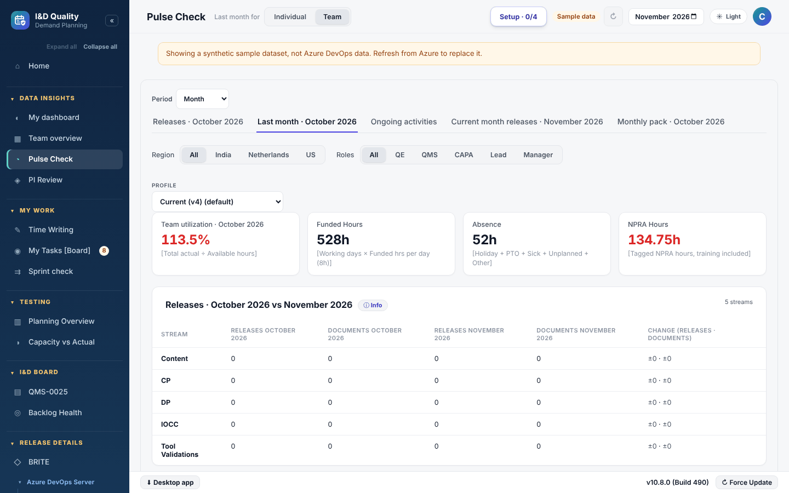

### Monthly pack

**Pulse Check → Monthly pack** prepares the two slides of the monthly call — the **2x2** and the **Performance Pulse** — for the month before the header month.


1. Check the generated lines: releases per slide line, utilisation, the year-on-year change and the KPI rows.
2. Type the rest as bullets: **+** next to a bullet adds one below it, **+ Add bullet** adds one at the end, **Enter** adds the next, **✕** removes one.
3. Press **Save to Git** so the team sees the same text. Nothing is saved until you do.
4. **Copy** a box or a slide into the PowerPoint template, or **Download .pptx** (both slides, 16:9).

What feeds each line and KPI row is set in **Admin → Reports → Monthly pack**.

### PI Review

**Data Insights → PI Review** shows the Features of a PI and what was discussed on them in Azure DevOps — the starting point for the PI Review meeting. It writes nothing to Git; the only thing it writes to Azure DevOps is a review you post with **Write review…** (below), as a new comment.

1. **Choose the PI.** The **PI** list in the table's filter bar holds the PIs of your Time Writing connection and of the fetched data, newest first. The **current PI** (its Sprint's dates cover today, in UTC) is chosen for you and marked **Current PI**. If two PIs are current at the same time nothing is chosen: pick one. If the iterations cannot be read, the latest PI with Features is shown and a warning says why. Your choice is remembered in this browser.
2. **Look at the Features.** The table lists the Features whose Iteration is in the PI (not Removed ones, not those under the absence Epic), by ID. Tick **Also Features with User Stories in this PI** to add Features that stayed in an older PI while their stories moved on. Filter by **Epic**, **State** and **Assigned to**, search (the search looks in every column shown and the whole latest comment), **Reset filters**, and **Export** (with the Export data right).
3. **Read a Discussion.** Click a Feature: a drawer opens with its details and its **Discussion** — every comment (up to the newest 1,000), newest first, as plain text. Formatting is not kept: a mention shows as **@Name** and an image as **[image]**. Use **↻ Read again** after new comments, ‹ › to go to the next Feature, and **Open in Azure DevOps →** to see the work item.
4. **Read them all.** **↻ Read all Discussions** reads every Feature's Discussion in the background (the top bar shows "Reading Discussions · x of n"). If Azure DevOps asks the app to slow down it waits and tries again once; if it keeps asking, the job stops with "x of n read" — click again later to read the rest. The **Comments** column shows each Feature's count.
5. **See the latest review comment in columns.** Once a Feature's Discussion is read (in the drawer or with Read all), the columns **Date and Time of Comment**, **Comment**, **Struggles**, **Learnings** and **Move to Next PI** show its **latest comment** — the newest by date and time, whoever wrote it. The date and time are in your time zone; a long text is cut in the cell, and pointing at it shows the whole text. Before the Discussion is read the cells show "—". Sort by any of them, search the comment text, filter with **Move to next PI** (Yes, No, Partly, Other text, Not given, Discussion not read) and **Review mode** (Discuss during Meeting, Offline Review, …), and **Export** them. **Review mode** shows the answer to "Advise to discuss the Feature during the Review meeting" and **Additional Remarks** the remarks. The drawer shows the same split under **Latest comment**, above the Discussion.

**How to write the review comment so it is split.** Write the three headings, each followed by a colon — on their own lines or in one line — as the **newest** comment of the Feature (a later reply, even "Thanks!", becomes the latest comment):

```
Struggles: the test rig arrived two Sprints late
Learnings: book the rig at PI planning
- share the lab calendar with the team
Move to next PI: Yes - waiting for the vendor's fix
```

The Feature then shows **Struggles** "the test rig arrived two Sprints late", **Learnings** "book the rig at PI planning · share the lab calendar with the team" (each line break shown as " · ") and **Move to Next PI** "Yes — waiting for the vendor's fix".

- Letter case does not matter, and these headings count too:

  | Column | Accepted headings |
  |---|---|
  | **Struggles** | Struggles, Struggle, Struggles of the Feature, Challenges, Issues, Problems, Blockers, Impediments, Risks (each also singular), Pain points, What went wrong, What didn't go well |
  | **Learnings** | Learnings, Learning, Learnings of the Feature, Lessons, Lesson, Lessons learnt, Lessons learned, Takeaways, What went well, Improvements, and at the start of a line Went well, Improve, Next time |
  | **Move to Next PI** | Whether the feature needs to be shifted to PI 26.4 (any PI number; also *moved* / *carried over*, and *Does the feature need to be …*), Move to next PI, Moved to next PI, Move to the next PI, Moving to next PI, Continue in next PI, Spill over, Spillover, Spill-over, Carry over, Carryover, Carry-over, and at the start of a line Next PI |

  Two headings of the same column (e.g. *Issues* and *Risks*) are joined.
- **The team's two formats both work** (sub-points as bullets, numbers or one per line):
  ```
  Learnings :                                    Learnings of the Feature
  - Start reviews earlier                        • Early alignment helped
  Struggles :                                    Struggles of the Feature
  1. Waiting for vendor documents                • Lab access delayed
  Whether the feature needs to be shifted to PI 26.4
  Yes - two stories left                         Whether the feature needs to be shifted to PI 26.4 : No
  ```
  The answer may follow on the next line, after a colon, a dash (also "Feature- Nil") or a "?", or after a space when it starts with Yes / No / Partly. The PI may be written "PI 26.4", "PI26.4", "PI-26.4" or "PI.26.4". "Nil" (or N/A) alone reads as none, like "None". The short form "Learning-good exposure, Struggle-long list CRs" counts when both are there. The PI named in the question is read from the comment (any number, so it works for every PI review) and shown after the answer, e.g. "Yes — two stories left · to PI 26.4".
- A heading counts at the **start of a line** (a bullet, number, # or bold before it is fine) followed by a colon, a dash (- – —) and a space, or nothing; **inside a line** when a colon follows it ("… Lesson: share the calendar"), and for *Struggle*, *Learning* and *Lesson* also a dash and a space ("… a learning – book the rig early"). "We had struggles with the rig" or "there were issues" is not a heading.
- Start the Move text with **Yes**, **No** or **Partly** (or Y / N) to use the filter; anything else (e.g. "N/A", "to be decided") is shown as written under Other text.
- **No heading at all? Suggested values.** When the newest comment has none of the headings, the app looks for **keywords** sentence by sentence (a sentence ends at a line break or after ". ", "! ", "? "): *blocked, blocker, delay(ed), issue, problem, risk, escalated, dependency, waiting, rework, missed, slipped, could not, unable, late, impediment, struggle, challenge* go to **Struggles**; *learned, learnt, lesson, next time, improve, went well, worked well, better to, recommend, should have, takeaway, learning* to **Learnings**; *carry over, next PI, spill over, move to, moving to, continue in* to **Move to Next PI**. A sentence with words of two columns goes to both; "no blockers", "not blocked" or "wasn't late" are not taken. These texts are only a guess: the cell shows **(suggested)** before them in italics (pointing at it says "Suggested from keywords, not headings"), the drawer's Latest comment says **Suggested from keywords**, and Export has a column **Split from** (Headings, Keywords or None). A suggested Move gets Yes / No / Partly only when the sentence says so right after the phrase, e.g. "Carry over to next PI — partly, the docs" → "Partly — the docs". Write the headings to be sure.
- A comment with neither headings nor keywords shows only its date and the whole comment. The whole comment is always shown next to the split, so check it when a section looks wrong.

The Discussions are read with your own PAT (Work Items, Read) and kept only until you reload the page. Tagging struggles and learnings in the app, saving them to Git and recording the Move to next PI decision come in later releases.

**PI Review starts from 21 September 2026.** PI Review and My PI Review offer only the PIs that had not ended by that date (PI 26.4 is the first), and they ignore comments written before it: the Discussion drawer shows only the later comments and says how many older ones were left out, and the columns, **Reviewed** in My PI Review and the review form's prefill use only the later ones. If a PI you chose before is older, the page opens on the current PI. The Scrum Master or the Tool Owner can move the date on **Admin → PI Review Setup** (see below).

#### Write the PI review in the app (from PI 26.4)

Instead of typing the headings yourself, fill in the review form; the app writes the comment in the standard format for you.

1. **Open the form.** Click **Write review…** in the Feature's drawer (bottom right) or in the **Actions** column of its row — or open **My Work → My PI Review**, which lists only your Features of the PI with **My review** (Reviewed / Not reviewed) and its date. **Reviewed** means your review counts **for the PI chosen in the PI filter**: its headings name that PI ("Learnings of PI 26.4:"), or — for an older review without a PI in its headings — it is dated within that PI's dates in Azure DevOps (the PI's own dates, else its Sprints'; compared in UTC), or the Feature is **Closed** and your review is dated on or after its Closed Date (the review you answer when closing it; shown "At close"). A review written for another PI shows **Not reviewed** with "Last review 12 June 2026 (PI 2026.3)" under it, so you see why — write the review for this PI. Choosing another PI in the filter recomputes the column. When the chosen PI has no dates in Azure DevOps (or they cannot be read, e.g. without the PAT), every review counts as before and a line above the table says so. Its filter row has **PI** (the current PI first) and **Person** (**Me** first) and **Reset filters** (back to Me and the current PI). A lead with "PI Review: post the review of a Feature" can choose another person in Person: the page then shows only that person's Features (their Assigned To, by work email where known) with **Their review** and its date, and Write review… still follows the posting rights below. For everyone else Person is greyed out and the line under it says why.
2. **Who can post.** The Feature's **assignee** (your work email on the Time Writing connection is the Feature's Assigned To) and the **leads** (Tool Owner, Admin, People Manager — the right "PI Review: post the review of a Feature"). For anyone else the button is greyed out and says why; it is also greyed out with sample data, in View as, without the PAT, or on an on-premises connection (reviews go to dev.azure.com only).
3. **Fill in the paragraphs.** The form keeps its help behind **ⓘ How to fill in** (above the fields: what posting does, which answer is pre-selected and each field's help) and the **ⓘ** next to Preview; point at it or tab to it to read it. One point per line — each line becomes a bullet under its heading; a leading **-**, ***** or **•** is dropped, and numbered lines (**1.**, **2)**) become a numbered list.
   - **Learnings** and **Struggles** — required (write "None" if there are none). **No learnings or struggles** (above them, not ticked) writes "None" in both and greys them out; untick it to get back what you typed. If the form setup has only one of the two, the tick box sets that one and its label says so; with neither there is no tick box.
   - **Move to next PI** — **Yes** or **No** (**No** is pre-selected). With **No**, nothing more is asked: Moves to and Reason are hidden, and a reason you typed is kept but not posted (the comment still names the next PI: "Whether the feature needs to be shifted to PI 27.1 : No"). With **Yes**, **Moves to** and **Reason** (optional) appear. Moves to is filled in with the PI after **today's PI** — whatever PI you are reviewing: the app finds the PI whose dates in Azure DevOps hold today (its own dates, else its Sprints'), then the PI that **starts next** (when two overlap, the one starting next). A Feature of PI 26.4 reviewed on 10 January 2027, during PI 27.1, gets PI 27.2; reviewed during PI 26.4, PI 27.1. Every PI in the iteration tree counts, also future ones, and names are read as typed in Azure DevOps — "PI 25.1", "PI.25.1", "PI 25.1 (Jan–Mar)", under a year folder, or in each team's subtree (one PI). When no later PI has dates, the next PI **by number** in the tree; when no PI has dates over today (or two have), the app says the dates are missing and uses the next PI by number after the last PI that ended, else the year rollover — the last PI of a year moves to the next year's first (**PI 26.4 → PI 27.1**, PI 2026.4 → PI 2027.1), any other adds one; a year has 4 PIs unless a higher number is seen (PI 25.6 means 6). Under Moves to one short line says **From the Azure DevOps dates.**, or shows a **warning** when the dates were missing ("PI dates missing in Azure DevOps — check this PI."); the **ⓘ** beside it gives the details ("today (25 Nov 2026) is in PI 2026.4 (…); the next PI is PI 2027.1, starting …") and names up to five iteration names without a PI number ("PI Planning"). Change Moves to if needed.
   - **Advise to discuss the Feature during the Review meeting?** — **Discuss during Meeting** or **Offline Review** (required, no default).
   - **Additional Remarks** — optional.
   If the Feature already has a review, the form starts from it, so a correction only changes what is wrong. When that review was written for another PI, the line at the top says so ("written for PI 2026.3: check it before posting").
4. **Check the Preview.** It shows the comment as it will look in Azure DevOps — a bulleted list — for example:

   - Learnings of PI 26.4:
     - Book the rig early
     - share the lab calendar
   - Struggles of PI 26.4:
     - None
   - Whether the feature needs to be shifted to PI 26.5 : Yes
     - two stories left
   - Advise to discuss the Feature during the Review meeting : Discuss during Meeting
   - Additional Remarks:
     - Thanks to the lab team

   — posted from Demand Planning (PI Review)

   The headings name the **reviewed PI** — the PI chosen on the page (in the Close pop-up, the Feature's own PI) — so the reviews of a PI can be collected; PI Review shows it in its **Reviewed PI** column. Without a known PI the headings are just "Learnings:" and "Struggles:". The last line marks it as posted from the app; PI Review ignores it (the ⓘ next to Preview says so too). What you type is sent as text (a "<b>" stays "<b>"), never as formatting. If a line of yours looks like a heading (e.g. "Issues: …" inside Learnings), the form asks you to reword it, so the columns stay right.
5. **Post.** **Post to Azure DevOps** asks you to confirm, then posts the comment as you (your PAT). The result is under **Background jobs** ("Post review · #id"); the Discussion is read again and the columns show the new values. A posted comment cannot be deleted from the app: to correct it, write the review again — the newest comment counts.

**Edit your review (My PI Review, PI Review).** When your newest review of a Feature counts for the chosen PI, its row in **My Work → My PI Review** and on **PI Review** (and the Feature's drawer there, once its Discussion is read) has **Edit review…** in place of Write review…. It opens the same form, filled in from that review ("Editing your review comment of …"). Change what you need and click **Save to Azure DevOps**, then confirm: the app **replaces that same comment** in the Discussion — Azure DevOps marks it edited and keeps its date, so it still counts for the same PI. The result is under **Background jobs** ("Edit review · #id") and the table shows the new values. Only your own review can be edited (Azure DevOps allows only the author); a lead looking at another person's Features uses Write review…. If the edit fails, the form opens again with your text, the reason and **Post as a new review instead**.

**When you close a Feature** (Close in My Tasks [Board], Sprint check or Time Writing), the Close pop-up asks the same questions for that Feature (Learnings and Struggles optional, **Move to next PI = No** pre-selected — Moves to and Reason appear with Yes — the Review meeting advice required, the explanations behind ⓘ How to fill in) and **posts the review first, then closes**. If the review cannot be posted nothing is closed: choose **Close without the review** or **Cancel**. When several Features are closed at once, write their reviews in PI Review or My PI Review.

#### Change the review form (Scrum Master, Tool Owner)

The fields of the review form are a shared setup: when the review changes, the Scrum Master or the Tool Owner changes the form in the app, and everyone's next review uses it.

1. **Open it.** **Admin → PI Review Setup** in the menu, or the **⚙** button (PI Review Setup) at the top right of **My PI Review** or **PI Review**. Both are shown only to people with the right "PI Review: set up the review form" (Scrum Master and Tool Owner by default; an Admin can change who has it in Role rights); everyone else's reviews simply follow the form. You see the form in use: each field with the heading it writes in the comment, its type, options, whether it is required and its default. Without a setup in Git it says *The built-in form*.
2. **Edit form…** opens the editor — the same column editor as **Set up columns…** on the On-Demand pages. For each field: **Name** (the label in the form), **Type** (**Long text** for a paragraph, **Dropdown (one value)** for a choice), **Required**, ↑ ↓ to reorder, ✕ to remove, the **Heading in the comment**, the **Default** of a Dropdown, a **Help text**, and the **options** of a Dropdown. **＋ Add field** adds one (at most 15); **Use the built-in form** starts again from the built-in fields. The **Comment preview** shows what a review written with the form looks like.
3. **Move to next PI** keeps its behaviour — Yes / No, the PI it moves to and the reason — so its name, type, options and Required are locked and it cannot be removed; its heading (with **{PI}** where the next PI is written), its default (No unless you change it) and its help can be changed. The other built-in fields keep their type. **{REVIEWED PI}** in any heading (at most once) is where the reviewed PI is written — the built-in Learnings and Struggles headings are "Learnings of {REVIEWED PI}" and "Struggles of {REVIEWED PI}"; a form saved before keeps its headings as saved.
4. **Save to Git.** The form is checked first: a heading that is empty, used twice, or already read as another field (for example "Issues" or "What went wrong" is read as Struggles, so older reviews would land in the wrong column) is refused, and a review written with every field must read back exactly. The result is in **Background jobs** ("PI Review form · Save to Git").

**PI Review starts from.** The panel above the form shows the date PI Review starts from (21 September 2026 unless changed). **Edit start date…** opens a pop-up with the date; **Save to Git** saves it for everyone. PIs that ended before the date are not offered, and comments written before it are ignored.

PI Review reads your headings and still the built-in ones and the earlier formats, so older reviews keep their columns; each field you add is a column of its own in PI Review. **Edit form…** is greyed out, with the reason next to it, in View as (an Admin viewing as a Scrum Master sees the ⚙ and the page, read only), with the synthetic sample and without Git storage.

### Planning Overview and Capacity vs Actual (Testing)

Admins see a **Testing** group with pages that are being tried out:

- **Planning Overview** — the team's month: tiles for planned utilization, delivery, baseline exceptions and capacity risk; 12 months of hours against capacity; one exception queue with links; delivery health per Epic; and **Generate Monthly Pack**.
- **Capacity vs Actual** — capacity after leave and holidays against the hours booked: tiles, 12 months (red where the team booked more than it had), each person with % used and a status, and where the hours went per Epic.


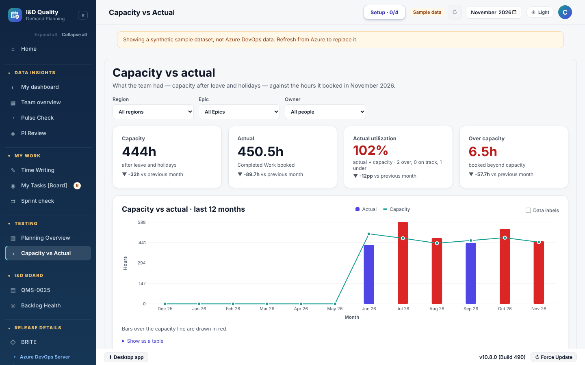

### Backlog Health

**Data & governance → Backlog Health** lists what needs attention in the backlog, for everyone:

- **In older Sprints** — open work whose Sprint has ended.
- **Features without DoD** — Features whose Description does not mention a DoD.
- **Unassigned** — open work nobody is assigned to.

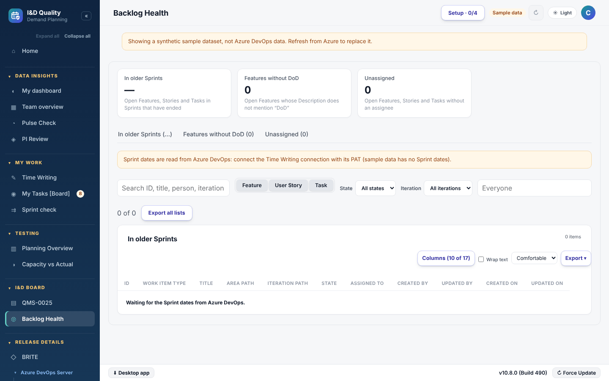

Each tab has its own **Columns**, sorting by a column heading, filters for State, Iteration Path and person, and **Export**. **Export all lists** writes all three into one file.

### KPI tracker

The **KPI tracker** (from the Team Insights tile on Home) shows the team's KPI workbook from SharePoint, read only. The desktop app reads it live; everyone else sees the copy kept in Git.

## Release Details

### Release pages per stream

**Release Details** has one page per stream: **DP**, **CP**, **IOCC**, **Content** and **Tool Validations** from Azure DevOps Server, and **S&S IT** and **ECP** from Windchill exports. The menu lists them in one list from A to Z. A stream that is not set up yet shows **＋** in the menu and leads to its setup.

Every Release page looks the same, top to bottom:

1. The **source bar** — on the right, **Show: Selected month / All months**, **↻** to refresh or import, and **⋯**. The first line of **⋯** says where the data comes from and when it was fetched or imported; then Load from Git, Connection settings, Remove, and **About this source…** for the details of the data (month filter, items fetched, DP's milestone names).
2. The **counts** of the header month — **Releases in <month>**, **Completed**, **Supported** — with **What was counted**.
3. Two tabs: **Releases** and **Source data** (the raw rows, with search and Export).
4. The **Releases** table: Release name (▸ opens its documents), Release, the date, Documents, the stream's own columns, the Time Writing Feature with its planned and booked hours, and the **QMS-0025 match**.

**Create Feature** on a release without a match opens the New Feature form, titled for that release. Load the QMS-0025 board first.

**Create Features** (DP, IOCC and Content) ticks several releases and creates a Feature for each under the stream's **bulk creation Epic**. No Epic is built in: until one is mapped, the button is disabled and says *"No DP bulk creation Epic is set: map it in Admin → Stream options → Bulk creation Epics."* **Open Bulk creation Epics** next to it takes you there. The Tool Owner enters the Epic ID under **Shared** and saves it to Git for everyone; anyone can enter their own under **Mine**, which is kept in this browser and used for them instead.

**Release Classification from the release number** (DP and IOCC). The Releases table of DP and IOCC starts with **Release name**, **Version** and **Release Classification (detected)** — the value of the bulk Epic's Release Classification list that its rules give for the version (— without a bulk Epic or a value). The Create Features pop-up shows the same three columns first and pre-fills each row's Release Classification, with *"detected from 5.2.1"* under it; change any row before creating. To set the rules (roles allowed *Edit the Epic setup*): **Admin → Epic & Feature setup → Setup per Epic**, choose the bulk Epic, and under its **Release Classification** field tick, for each value, the part of the release number that changes for it — **x.0** (first number only: 5.0, 5.0.0), **x.y** (second number: 5.2), **x.y.z** (third: 5.2.1), **x.y.z.w** (fourth: 5.2.1.3); the deepest non-zero part decides. For example Release ← x.0 and x.y, MLD ← x.y.z, PU ← x.y.z.w. A part can belong to one value only (the screen names a part ticked twice and does not save). **Fill with the usual rules** proposes Major, Minor, MLD and Platform Update (or PU) where your values are named so. Save to Git. Until rules are saved, the value named like the release type (Major, Minor, MLD, Platform Update) is pre-filled, as before. The fields of an Epic are listed Release name, Version, Release Classification first.

### Windchill exports

A Windchill search exported to CSV becomes a Release page.

1. Choose **Import Windchill export** (or **＋ S&S IT** / **＋ ECP** for a stream without its export yet).
2. Choose the CSV file. The page lists the unique releases read from the **Location** folders (or else the document names), each with its documents.
3. Use **All months** (next to ↻) to see every release, not only those of the header month.
4. To update the page with a newer export, choose **⋯ → Upload latest export…** (or ↻) and pick the new CSV: the same page keeps its name and setup.

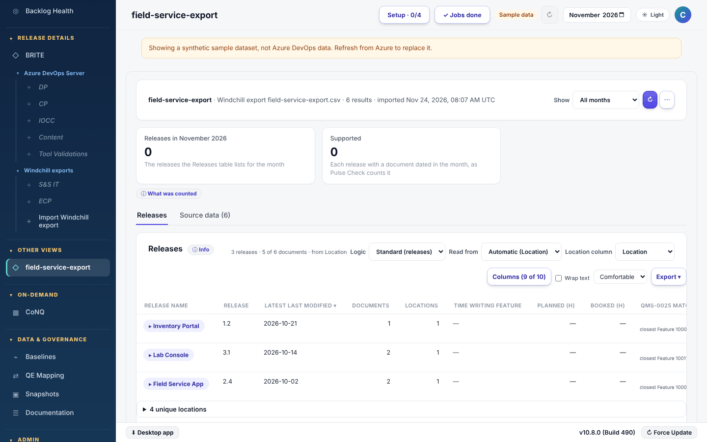

The import is saved to Git so the team sees it; **Load from Git** reads the team's latest one. Pulse Check counts the releases per stream.

### Tool Validations: master list and expiry

The **Tool Validations** page has these tabs:

- **Expiry list** — opens first: the tiles (**Overdue**, **Due in the next N days**, **No due date**) on top, then **Expiring in the next … days** and the table of the tools that are overdue, due soon or without a due date.
- **Master list** — the month's count cards, then the master list of every tool, with **＋ Add tool…**, its filters and **Export**. Next to Tool and Version: **ID** (the tool's Azure DevOps work item ID), **Used by** (the query's Source column), **Validated** (its State column), **Type** (its Type column) and **Current Month Status** for the month in the header — **Completed** (the tool's completion date is in the month), **Supported** (one of its documents has a Quality signature in the month), both as two pills (**Completed, Supported**), or empty. Only the tools of the Tool Validations query have these values; sort and filter them like any column.
- **Tool List [TFS]** — the Tool Validations query's rows, with every column the query selects, in its order. Before a fetch it says to fetch the query with **↻**.
- **Validation Documents [TFS]** — only when Tool Validations reads two queries (see *Tool Validations from two queries* below): every signed document.
- **One tab per other source** — every source added under **Setup → Sources** (another Azure DevOps query, a Windchill export, a Table page) gets a tab named after it, in the order added: its rows as the app reads them with the source's field mapping, with **Edit mapping…** and **Merge into master list…**. When its data is not in this browser, the tab says how to load it. Removing the source removes its tab.
- **Your team's own tabs** — tabs the Tool Owner and the list's co-owners add under **Setup → Tabs**: a Table, a Table + Insights or an On-Demand Dashboard, in the order they set.
- **Setup** — last: **Sources** (**＋ Add source…**, and per source **Edit mapping…**, **Merge into master list…** and **Remove**), **Tabs** (**＋ Add tab…**, and per tab **←**, **→**, **Rename…** and **Remove…**), **Team settings** (**Edit…**) and **Due date highlights** (**Edit…**). Everyone sees it; those who may not change it see the buttons greyed out with the reason.

There is no Releases table: the month's tools are the master list's Current Month Status. The page remembers the last tab you chose in this browser tab (a tab kept from the former **Azure** tab opens **Tool List [TFS]**).

The master list keeps every tool the team has validated in Git; a tool stays listed after it leaves its source and is marked **Not in source now**.

**See what is due**

1. Open **Release Details → Tool Validations**: the **Expiry list** tab opens first.
2. The tiles count the tools **Overdue**, **Due in the next N days** and with **No due date**. The table lists them in that order, with the days left.
3. Change **Expiring in the next … days** to look further or nearer. The window is yours and is kept for you; **Use the team default** goes back to the team's window (60 days unless changed). The Tool Owner and the list's co-owners can make the window shown the team's with **Set … days as team default** (saved to Git); for everyone else the button is greyed out with the reason.
4. **Export** writes the list to Excel or CSV.

The due date is the source's own due date (or one entered by hand) when there is one; otherwise the validation date plus the validity period in months. A tool with a validation date but no validity period is taken as valid for **24 months** (2 years): its period shows as **24 (default)** and its due date as "validation date + 24 months (default)". Enter a period or a due date (Edit, or in the source) to replace the default; only a tool without a validation date has **No due date**.

A tool from **Azure DevOps** (the Tool Validations query or another Azure DevOps query) is validated on its **completion date** — the field chosen in **Admin → Streams → Stream mapping → Tool Validations queries → Completion date**, **Changed Date** by default — unless its source's mapping names another **Validation date** field. A mapping saved earlier with **Author Approval Date** keeps it: to use the completion date, pick **Completion date** in **Setup → Edit mapping…** and save. Its validation date shows **(completion date)** and its due date "completion date + 24 months (default)", unless the query gives a validity period or a due date. With Changed Date, any later edit of the tool's work item moves both dates at the next fetch; choose a date field that is set once to avoid that.

**Keep the master list (Tool Owner and the list's co-owners)**

1. Fetch the Tool Validations query (**↻**): its tools are added to the master list by themselves.
2. On **Master list**, **＋ Add tool…** adds a tool validated elsewhere; **Edit** corrects its dates or notes — a date changed by hand is kept when the sources are read again; **Remove** takes it off the list. A tool that comes from **Azure DevOps** is changed there: its **Edit** and **Remove** are greyed out (hover them for the reason), and **Edit notes…** changes only its notes. Once Azure DevOps no longer returns it (**Not in source now**) you can **Remove** it; Edit stays greyed out. Dates you entered by hand on such a tool are replaced by Azure DevOps' at the next fetch. Adding by hand a tool with the same name and version as one from Azure DevOps is refused with the reason.
3. On **Setup**, under **Sources**, **＋ Add source…** adds another Azure DevOps query, a Windchill export or a Table page you keep by hand (add one with **＋ Add page…**, with columns such as Tool, Version, Validation date, Validity period and Due date). Answer **Category**: **Tool List** (one row per tool — its tools go into the master list) or **Validation Documents** (documents of the validations — listed on its own tab with every column, never added to the master list); nothing is chosen until you pick. The source's tab appears at once, before Setup, and Setup → Sources shows its category.
4. For a Tool List, check **Edit mapping…** (on Setup or on the source's tab): which column gives the tool name, version and dates. The app's guesses are marked **Guessed** until you save the mapping. A Validation Documents source needs no mapping. **Edit mapping…** is also where you change the category: changed to Validation Documents, the source stops feeding the master list and the tools it brought stay, marked **Not in source now** (nothing is deleted); changed back to Tool List, merge it again to link them.
5. Open the source's own tab to see its rows as read; for a Tool List, **Merge into master list…** (on that tab or under **Setup → Sources**) shows what changes, then saves it to Git. A Validation Documents tab lists its rows with every column and has no Merge.
6. **Setup → Team settings → Edit…** sets the team's window (also possible on the Expiry list, see above) and names the list's co-owners (a Tool Owner names them).

**Highlight tools by due date**

The **Master list** and the **Expiry list** tint each tool's row by how soon it is due, and name the band in the **Due date** cell (for example **≤ 30 days** or **Overdue / today**); the legend above the table lists the bands. An overdue tool is in the first band; a tool with no due date is not highlighted. Until the team saves its own bands the defaults apply: overdue or due today red, within 30 days amber, within 90 days yellow.

1. Open **Setup**: **Due date highlights** shows the bands and how many tools fall in each now.
2. Choose **Edit…** (Tool Owner and the list's co-owners). Each band has **Due within (days)** (0 = overdue or due today) and a **Colour**; **Remove** takes a band away and **＋ Add band** adds one (up to 10). When a tool fits several bands, the one with the fewest days wins.
3. Choose **Save to Git**. Everyone sees the same bands. Removing every band turns the highlighting off.

**Add a tab of your own (Tool Owner and the list's co-owners)**

1. Open **Setup** and, under **Tabs**, choose **＋ Add tab…**.
2. Choose the **Page type** — **Table** (a table you set up yourself), **Table + Insights** (the table and an Insights tab of charts) or **On-Demand Dashboard** (tiles and charts over table pages, the master list and the expiry list) — give it a name and choose **Add tab**. The tab appears before Setup.
3. Open the tab: set up the table (**Set up columns…**, **＋ Add row**) or the dashboard (**＋ Add block…**) as on any other On-Demand page. For a chart of the tools, choose the data source **Tool Validations master list** or **Tool Validations expiry list** — for example a bar chart of the tools by **Status** (Overdue, Due soon, No due date, OK; due soon is within the team default window).
4. Under **Setup → Tabs**, **←** and **→** move a tab, **Rename…** renames it, and **Remove…** asks first: the page is **kept in Git, hidden** — or, for a Tool Owner, **deleted with its data**.
5. To bring back a page that is hidden — one kept when its tab was removed, or one left behind when an older app version dropped the tabs — choose **＋ Add existing page as tab…** under **Setup → Tabs**, pick the page, keep or change its name and choose **Add tab**. Its rows or blocks are there again.

**Who may edit the tab pages.** The list's co-owners (Setup → Team settings) are written as **co-owners of each tab's page**, so they can set up and edit the page also when it is opened from Admin → Pages & menu. Co-owners someone added to a page by hand stay; the ones that came from the list are taken off again when they leave the list or when the tab is removed. The **Tabs** panel shows per tab how many co-owners came from the list and how many were added by hand; if a page is not in line with the list, it says so with **Write the co-owners to the tab pages**.

**Status on a dashboard.** Status (Overdue, Due soon, No due date, OK) and Days left on a dashboard use the **team default window**, the same for everyone. To leave them out of a block, untick **Show expiry status** in the block's pop-up (under the data source); the block then counts the same tools without them.

These tabs are pages of their own in Git, but they are not in the menu, on Home or in search: they live on the Tool Validations page only (Admin → Pages & menu lists them as hidden, **Tab of Tool Validations**). Everyone else reads them.

Everyone else sees every tab read only; the buttons say why they are greyed out. The month's cards on the Master list tab, Pulse Check (its Tool Validations quadrant lists the tools with ID and status), the Monthly pack and the cumulative chart count the master list's tools by their Current Month Status. **ID**, **Used by**, **Validated** and **Type** are read with the source's field mapping: check them in **Setup → Edit mapping…** of the Tool Validations query (the app guesses System.Id and the columns named Source, State and Type; choose None to leave one out).

**Count tool validations from two queries (Tool Owner)**

Tool Validations can read two Azure DevOps queries: the **Tool List** query (the Tools query: one row per tool — the only one that feeds the master list) and the **Validation Documents** query (the Signed documents query: (one row per document, with a **Parent** column holding the tool's work item ID and the approver slots, as CP's documents have).

1. Open **Admin → Streams → Stream mapping**. The **Tool Validations** row is the Tool List query; on the row **Tool Validations · Validation Documents** choose **Add query**, enter the server, project and the documents query. **Add query** asks the **Category** — Tool List or Validation Documents —, pre-selected from the query's name or columns: check it (a category another connection already has is greyed out), then **Save and refresh data**. Your choice is kept in Tool Validations queries.
2. Under **Tool Validations queries** check that one connection shows **Tool List** and the other **Validation Documents**. If the app took the wrong one, choose the **Validation Documents query** yourself; **None — one query** counts as before.
3. Choose the **Completion date (Completed)**: **Changed Date** (the last updated date) is the default, but it moves whenever someone edits the tool, so pick a date column of the Tools query that is set once, if there is one. Save the change to Git with the bar above.
4. Open **Release Details → Tool Validations → Master list** for the month's cards (**Validations in {Month}**, **Completed validations**, **Supported validations**; they are on the Master list tab only), with the **Current Month Status** of each tool: **Completed** counts the tools whose completion date is in the header month, **Supported** the tools with a document signed by a Quality role (QA, QE, QAQE for Software, …) in the month; a tool with both shows **Completed, Supported** and counts in both. The tab **Tool List [TFS]** shows the Tools query and **Validation Documents [TFS]** every document of the Signed documents query — each with every column the query selects, in the query's order (use **Columns** to hide some). Validation Documents starts with **Tool**, the name of the document's Parent, **Parent ID** and **Tool List (Azure)**: a document whose Parent is not in the Tools query (for example a retired tool) is marked **Not in Tool List (Azure)** — it is listed, not counted, and not added to the master list. **↻** fetches both queries and then reads the names of those Parents from Azure DevOps by their ID (read only, with the same connection and PAT); they are kept with the data. A name that cannot be read shows as **#ID**: point at it, or open ⓘ on the table, for the reason.

Pulse Check, the Monthly pack and the cumulative chart show the same numbers, counted from the master list; Pulse Check's Tool Validations quadrant lists the tools with their ID and status. With only one Tool Validations connection there is no Validation Documents [TFS] tab, and a tool is Supported when it has a document in the month.

## On-Demand pages

On-Demand pages are tables the team sets up itself, without a new release of the app. **CoNQ** (Cost of Non-Quality) is there from the start; the Tool Owner and the pages' co-owners add more (see [Pages & menu](#pages--menu)). Each page has a **Data** tab (the table) and, for *Table + Insights* pages, an **Insights** tab (charts).


- Search, sort by a heading, choose **Columns**, and **Export** to Excel or CSV.
- **Group by** and **Filter by column** (see below) narrow and organise the rows.
- Every row gets a **key** when it is added (for example `CONQ-261124-K7Q2`) and a readable **ID** (`CONQ-0001`) when it is saved.
- **Every save goes straight to Git**, as its own commit. There is no separate save step; progress and results are in Background jobs.

### Group by and Filter by column

The row under the search box groups and filters the table.

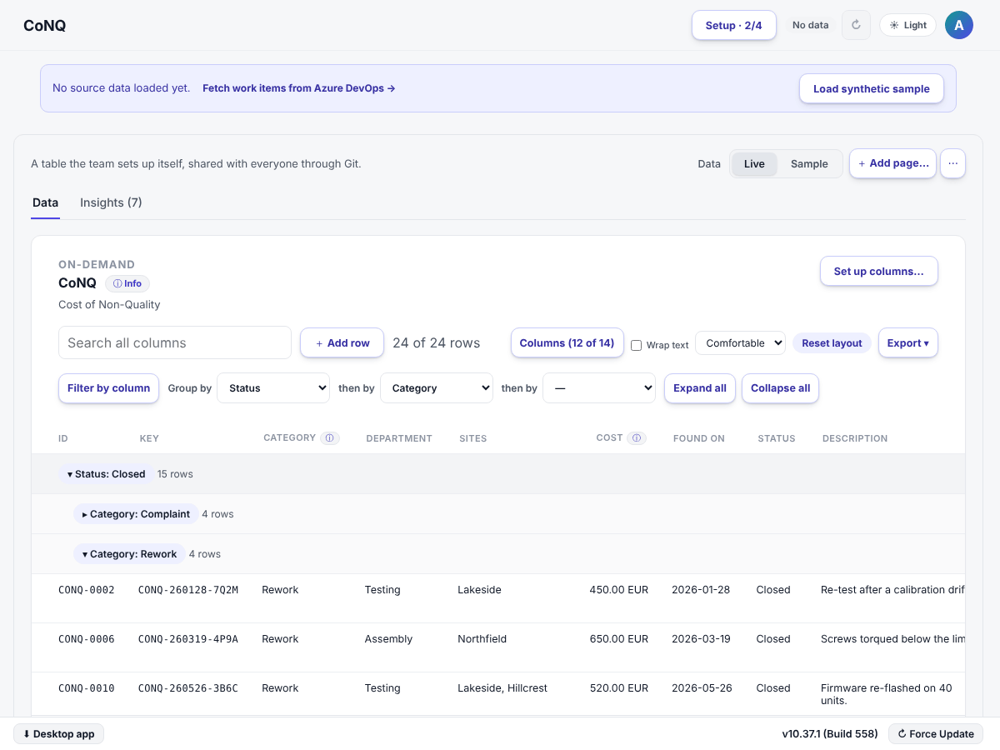

1. Choose a column in **Group by**. Each group row shows ▸ / ▾, the column, the value and how many rows it has; "(blank)" comes last.
2. Choose another column in **then by** for a second level (up to four). The rows inside a group keep the table's sort.
3. Click a group row to close or open it. **Collapse all** leaves only the outermost groups; **Expand all** opens every level. A button is greyed out when there is nothing to do.
4. Press **Filter by column**. A field appears under each heading: type part of a value (any case), or pick a value for a Dropdown or Multi-select column. The filters work together with the search, and the count shows how many rows are left.

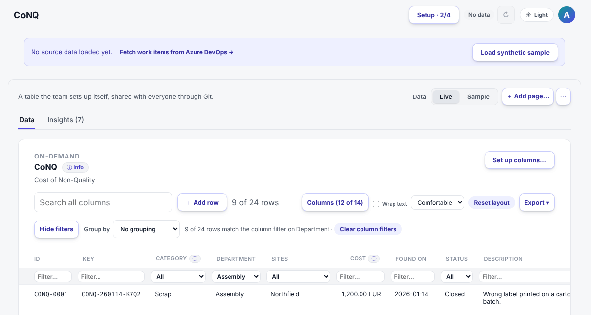

- A **Multi-select** row appears under **each** of its options, so the counts of one level can add up to more than the rows. It is still one row: the count, the selection and Export hold it once.
- Dates and amounts are grouped as shown, so "1,200.00 EUR" and "1,200.00 USD" are two groups. The ID and Key are not offered in Group by (one group per row) but can be filtered.
- While a filter is set, a line says how many rows match and on which columns, also a column you have hidden. **Clear column filters** removes them; **Hide filters** too.
- **Export** writes the rows you see, in the order of the groups: rows in a **closed group are left out**, and Export says so ("Exports the 4 rows shown (3 rows in closed groups left out)"). Open the group to include them. A grouped-by column is in the file even when it is hidden.
- The drawer's **‹ ›** (Previous / Next) — also after **Edit** — and **Select every row shown** work on the rows you see as well; the row count above the table still counts every matching row.
- Your grouping and filters are part of **your own view** and kept in your browser. Which groups are open is for this visit only.
- The Tool Owner can save the grouping and filters **for everyone** (see [Save view for everyone](#save-view-for-everyone)), with **Start collapsed** if the page should open with only the outermost groups.

### Set up columns

People who may set up the page use **Set up columns…** to add, rename, reorder and remove columns.

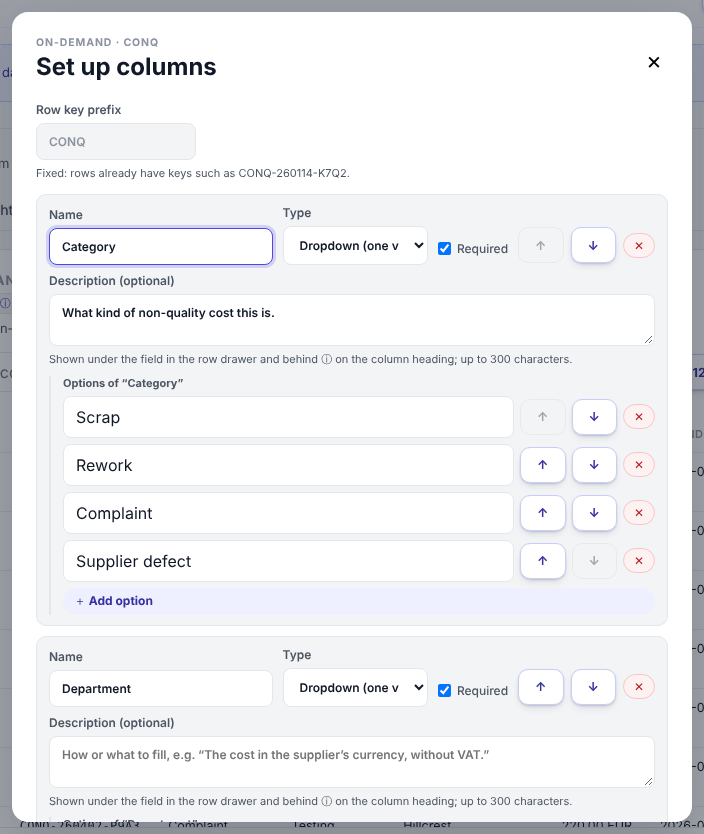

1. **＋ Add column**, then give it a name and a **type**: Text, Long text, Number, Currency, Date, Dropdown (one value), Multi-select, Dropdown (built-in list) or Multi-select (built-in list) (see *Built-in lists* below).
2. For a Dropdown or Multi-select, add its **options**. For a Currency, choose its default currency.
3. Tick **Required** where a value must be given, and add a **Description** — how or what to fill. It shows under the field and behind ⓘ on the column heading.
4. Press **Save**. If the change touches values already in the rows, the pop-up first lists what happens and asks.

Nothing is lost silently: values that no longer fit are kept and marked (for example *not in the list*) until someone changes them.

### Built-in lists: the QE list from Azure DevOps

A column can pick from a list the team shares instead of options of its own — for example the **QE list**, the members of your Azure DevOps team.

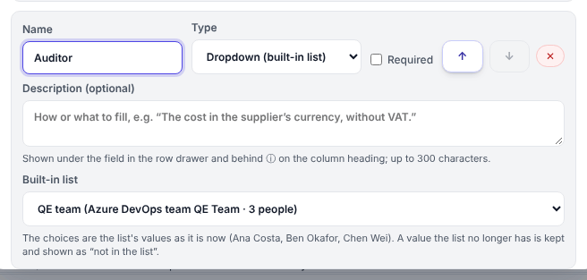

1. In **Admin → Epic & Feature setup → Value lists**, under the Value lists, the panel **Team lists from Azure DevOps** lists the team lists. **＋ New list…**: give the list a name (e.g. *QE team*), check the server and project (your Time Writing connection's to start with), type the team and press **↻ Read the team**. The members are listed (with their emails as a hint); **Save to Git** saves the list for everyone — names and Azure DevOps ids only, no emails.
2. In **Set up columns…** choose the type **Dropdown (built-in list)** (one person) or **Multi-select (built-in list)** (several), then the list in **Built-in list**. The Epic setup's Value lists can be chosen here too.
3. The row form offers the list's names. The row keeps the name and, for a person, their Azure DevOps id. Two people with the same name are offered as, for example, *Sam Lee (#3f2a)* and *Sam Lee (#9c1b)* — the name and the start of their id.
4. When people join or leave the team, open the list and press **↻ Refresh…**. You see who is **added**, **removed** and **renamed** (the same person in Azure DevOps, a new name), and how many rows use a removed person, before you **Save to Git**. **Log** shows every change of the list.

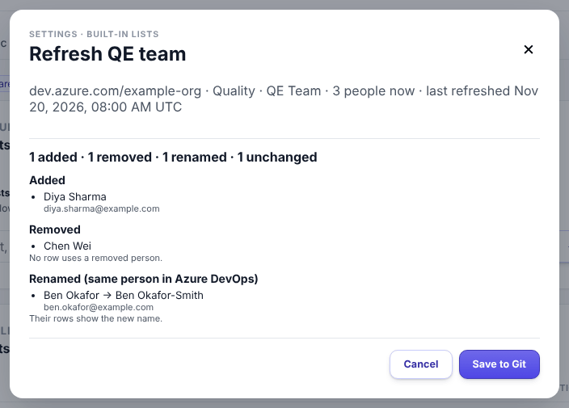

A person who left the team stays in the rows that name them, marked *not in the list*; a renamed person keeps their rows under the new name. Replace… takes only a name of the list, and the Excel template's drop-down is the list as it is now.

Who may change the lists: the Tool Owner, the Admin and the Scrum Master (*Manage built-in lists*), and the co-owners of an On-Demand page (they cannot remove a list). Everyone else sees the lists read only, with the reason next to the buttons. Nothing is written to Azure DevOps: the team is only read, with your own PAT.

### Open, edit and save a row

1. Click a row (or Tab to it and press Enter). It opens in a **drawer** on the right with its ID, key, who added it and when, every value, and its **History**.
2. Press **Edit**. The values become fields.
3. Change what you need and press **Save to Git**. A new row gets its ID.
4. **‹ ›** go to the previous or next row; Escape or × closes the drawer. Leaving with unsaved changes asks first.


<video controls muted preload="none" src="user-guide/media/clip-conq-row.webm" poster="user-guide/media/clip-conq-row.png" title="Edit a CoNQ row in the drawer and save it to Git"></video>

*Clip: a CoNQ row opened in the drawer, set to Closed with a note, saved to Git, and the result in Background jobs.*

- **＋ Add row** opens an empty drawer.
- Every saved change is logged in the row's **History**: who, when and what changed. The last 100 changes are kept.
- If two people change the same row at the same time, the later save wins for the values and both changes stay in its History.

### Row locks and timeouts

Large pages can be converted to **row files** (see below). On such a page **Edit** takes the row's **lock**:

- Others see ✎ and your email on the row, and "Being edited by … since …" in its drawer. They cannot edit or hide it until you save or cancel. Viewing, other rows, adding rows and charts never wait.
- After **15 minutes** without activity (an Admin can change this) a warning comes two minutes before: press **Keep editing**. Otherwise the edit closes and the row is free again.
- What you typed is kept **as a draft in this browser for one day**. Your next **Edit** of that row offers **Restore your draft from …** and says what changed in Git meanwhile.
- The Tool Owner or a co-owner can **Release lock** on a row whose editor left without saving.

### Hide and delete rows

- **Hide row** (in the drawer, or **Hide** in the table) takes a row out of the table, the charts, the exports and the dashboards for everyone. It stays in Git with its ID and a History entry.
- Tick **Show hidden rows (n)** to see them greyed; **Show row** brings one back.
- Only the **Tool Owner** deletes a hidden row for good, with **Delete row…**. Its ID is never given again.

### The page menu (⋯)

The **⋯** next to the page's main action holds **Rename page…**, **Hide page**, **Delete page…** (Tool Owner), **Download Excel template…**, **Upload Excel…**, **Replace…**, **Convert to row files…** (Tool Owner), **Publish interactive HTML…** and **↻ Reload from Git**.

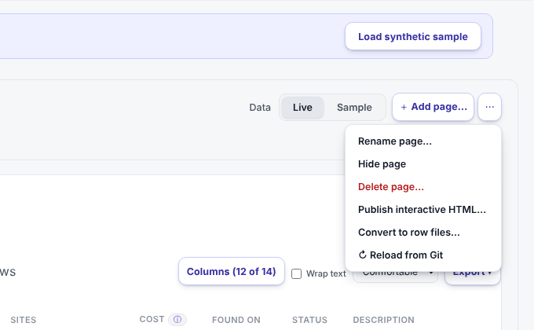

### Replace a value in a column

When one person hands their work over to another — a QE leaves and their releases go to a colleague — **Replace…** changes the name in every row at once. It is in the page's **⋯** menu on a Table or Table + Insights page, and in the toolbar of **QE Mapping**.

1. Choose the **Column** (on QE Mapping the QE column of the Epic & Feature setup is already chosen).
2. Choose the value in **Find** — each value shows how many rows hold it — or **Another value (type it)…**. A cell matches only as a whole; upper and lower case and spaces around it do not matter.
3. Type the new value in **Replace with** (the column's values are suggested). In a Dropdown or Multi-select column it must be one of the column's options.
4. Check the preview — **"N rows will change"** and the first rows with the old and new value — and choose **Replace**.

The change is saved to Git at once. On an On-Demand page each changed row gets an entry in its **History** ("Replaced “Alex Example” with “Sam Example” in QE") and the result is in **Background jobs**; hidden rows are not changed, and rows someone else is editing are skipped (the preview says how many). On QE Mapping every row of the tab is changed, also rows a search or filter hides; the commit names the change. Without the right to edit the page or QE Mapping, without Git storage that can save, with sample data, or while viewing as someone else, **Replace…** is greyed out with the reason.

### Add and update many rows from Excel (bulk upload)

To add or change many rows at once, fill the page's Excel template and upload it. Both are in the page's **⋯** menu on a Table or Table + Insights page (and CoNQ).

1. Choose **⋯ → Download Excel template…**. Pick **With the N rows shown** (the rows the table shows now, each with its Row ID — to change them) or **Empty template** (only the header row — to add rows), then **Download template**.
2. Open "{page} - upload template.xlsx" in Excel. The sheet has the page's columns in order; **Row ID** is the first column (grey) — **do not change it**: it finds the row to update. Required columns are highlighted. Click a header or cell to see what to fill.
3. Fill the rows:
   - **Change a value** in a row with a Row ID to update that row. An emptied cell clears the value.
   - **Add a row** below without a Row ID to add a new row.
   - **Dropdown** columns: pick a value from the list. **Multi-select** columns: pick one value, or type several separated by **;** (for example `Customer; Audit`). **Dates** as dates (2026-11-25), **numbers** as numbers, **Currency** as an amount with its code (`1200.50 EUR`).
   - Delete rows you do not change, or leave them: unchanged rows are only counted.
4. Save the file as .xlsx (or CSV) and choose **⋯ → Upload Excel…**, then the file.
5. Check the preview: **"N added · N updated · N unchanged · N with errors"**, the columns that were ignored or are missing, and the first rows with what happens to each (rows with errors first, with the reason). **Download error report (CSV)** lists every row with an error.
6. Choose **Save to Git**. Only the valid rows are saved; rows with errors are left out — fix them in the file and upload it again (rows already saved then count as unchanged).

The result is in **Background jobs**, and each added or changed row's **History** says "Bulk upload from {file}". Rows someone else is editing are skipped and counted; a hidden row can be updated by its Row ID; a Row ID that is not on the page gives **Row not found**. An upload reads at most 10 MB and 5,000 rows and adds or updates up to 2,000 rows. Text starting with = + - or @ is saved with an apostrophe first, so it never runs as a formula. Without the right to edit the page's rows, without Git storage that can save, with sample data or while viewing as someone else, **Upload Excel…** is greyed out with the reason; in Sample the template is too.

### Convert to row files

When many people add rows at the same time, the Tool Owner converts the page to **one file per row** with **Convert to row files…** (it asks first). Afterwards several people can add rows at once and Edit uses row locks. A page past 500 rows (or 600 KB) shows a line suggesting it.

Ask everyone to update before converting a page. An app version without support for row files cannot open a converted page.

### Live and Sample

**Data: Live | Sample** at the top of every table page switches your own view:

- **Live** (the default) shows the page's rows from Git.
- **Sample** shows **50 made-up rows** generated from the page's own columns, only for you, under the banner "Sample data — nothing is saved." Every change is disabled and exports are named "Sample-…".

Use Sample to try charts and filters before the real rows are there.


### Save view for everyone

Every table has a **Columns** panel: tick columns on or off, move them with ↑ ↓, drag a heading's edge to resize, choose **Wrap text** and **Compact / Comfortable**, and click a heading to sort. What you change is **your own view**, kept in your browser.

The Tool Owner (and anyone with the right *Table, chart and page defaults*, such as the Admin) can make a table look the same **the first time** for everyone:

1. Set the table up as it should look: the columns, their order and widths, Wrap text, the density and the sort.
2. Open **Columns** and press **Save view for everyone**. The view is saved to Git; Background jobs shows the result, and the panel says who saved it and when.
3. On an On-Demand Table page a pop-up first lists what is saved — also **Group by** and the **column filters** — and offers **Start collapsed**: tick it to open the page with only the outermost groups (off: the groups open expanded). Press **Save view for everyone**.
4. To remove it again, press **Clear the view for everyone** and confirm.

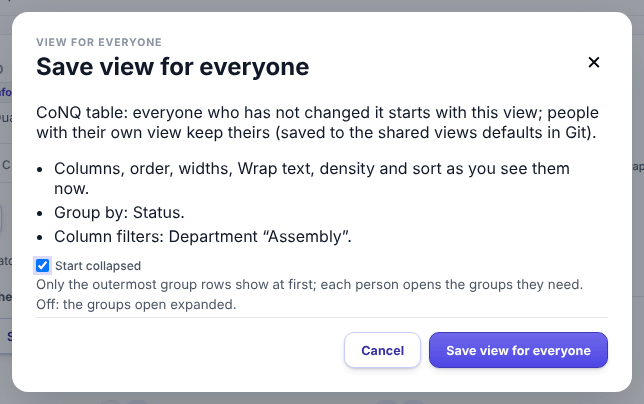


Which view you see:

- Your own view when you changed the table, else the **view for everyone**, else the table's built-in view.
- With your own view the panel reads "Your own view · **Use the view for everyone**". When a newer view for everyone has been saved since, it reads "A new view for everyone is available — **Use it**". **Reset layout** also goes back to the view for everyone.
- Columns that no longer exist are ignored; columns added later come at the end and are shown.
- Grouping and column filters: your own choice wins, also "no grouping". **Start collapsed** always comes from the view for everyone; you open and close groups as you like during your visit. A view saved before grouping existed keeps working.

Without the right, with a read-only Git token, with the synthetic sample or in View as, the Save and Clear actions are not shown.

**Page filters** work the same way: the Team overview (period, filters and tab), an On-Demand Dashboard (period, filters and tab), an Insights filter row and the People list's filters (Region, Role, Access role, Status) have **Save view for everyone** / **Clear the view for everyone** beside the filters. The QMS-0025 board's **⚙ Column Options** use the same wording.

## Insights: charts, KPI cards and narratives

The **Insights** tab of a table page holds charts, KPI cards, summary tables and narratives built from the page's rows — the same for everyone.

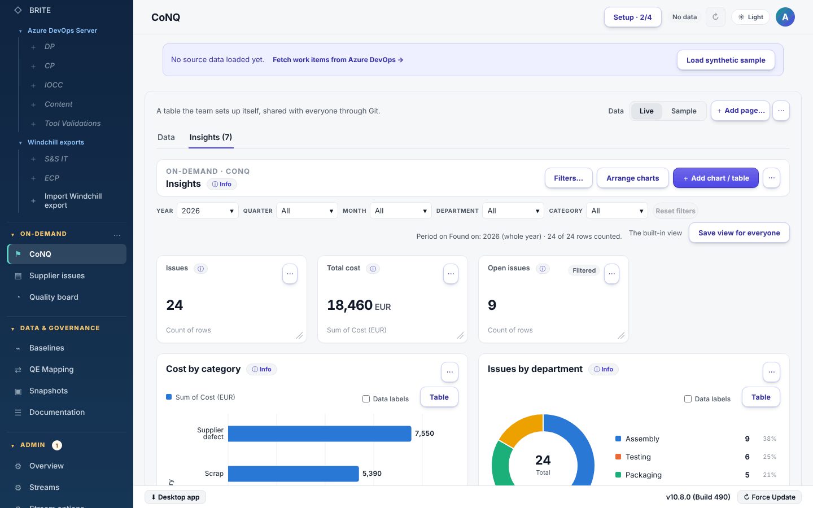

### Filter the charts

When the page's owners have given the tab a **filter row**, everyone can narrow every chart and table on it:

1. Choose the **period** (Year → Quarter → Month on one Date column; nothing ticked is the current year).
2. Tick values in the filters (up to six: Dropdown or Multi-select values, a date range, "contains" text, a number range, or a currency and amount range).
3. The line under the row names what applies and how many rows are counted. **Reset filters** goes back.


Your filter choice is yours: it is remembered for you and never changes what others see. A chart narrowed by its own filters or the filter row shows a small **Filtered** tag.

The owners set up the filter row with **Filters…** next to ＋ Add chart / table.

### See the rows behind a chart

Click a bar, a slice or a point — or move to it with the arrow keys and press **Enter** — to list the rows counted there, with Export.


<video controls muted preload="none" src="user-guide/media/clip-filter-drill.webm" poster="user-guide/media/clip-filter-drill.png" title="Narrow the Insights with the filter row, then list the rows behind a bar"></video>

*Clip: the Department filter narrows every chart; a click on a bar lists its rows; Reset filters goes back.*

Each chart also has **Data labels** (your own choice) and **Table** (the numbers behind it).

### Add a chart or table

People who may set up the page add charts with **＋ Add chart / table**. The pop-up holds its fields in **tabs**, with a live **Preview** beside them (under them in a narrow window). **Cancel** and the main button always stay in view.

1. On **Data**: type a **Title**, choose the **Type** — Bar / column, Line over time, Pie / donut, Pareto, KPI (one number), Pivot table or Narrative (text) — then **Categories by** (the column to group by; for a bar chart an optional **Stacked by**), the **Measure** — Count of rows, Sum, Average, Minimum, Maximum (of a Number or Currency column) or Distinct count — and **Group dates by**, **Show** and the sort.
2. On **Filters**: **＋ Add filter** narrows this chart only (values of a Dropdown or Multi-select, or a range of months).
3. On **Format**: the look of the chart — see [Chart options](#chart-options).
4. On **Elements**: the chart elements and the axis names — see [Chart elements](#chart-elements).
5. Press **Add chart** (**Save** when you edit one). It is saved to Git at once, for everyone.

**A Pivot table with nested rows and columns**

1. Choose the type **Pivot table**. Under **Rows**, pick the outer field in **Rows by** (for example Epic), then **＋ then by** for the next one (Feature, then State) — up to three.
2. Under **Columns (optional)**, pick **Columns by** (for example Stream) and **＋ then by** (Month) — up to two.
3. **↑ ↓** change the order of the fields, **✕** removes one. Date fields follow **Group dates by**.
4. Every group shows its **subtotal** on its own line, every outer column a **Subtotal** column, and the table its **Total** row and column. An average or a distinct count of a group is worked out from its rows, not by adding up the cells.
5. On the table, **▸ / ▾** closes or opens a group; **Collapse all** and **Expand all** do it for all. This is only for you and only until you leave the page.
6. Click any number to see the **rows behind** it. **Export** gives a flat table (a column per row field, the Line column marking Subtotal and Total).

The first 10 outer rows are shown, with **Show all**. A very large table draws at most 2,000 numbers at once and says so; Export always has everything.

**Name the value**: by default the chart calls its value after the measure ("Count of rows"). Type a **Value name** on Data (for example "Services") — or give the value axis a title on Elements — and the legend, the Table view, tooltips, data labels, table headings, Rows behind and Export all use it.


- A tab shows how many of its settings you changed, for example **Elements (2)**. Data shows no count.
- Only the tabs that fit the type are shown: a KPI has Data, Filters and Format; a **Narrative** has **Narrative** instead of Format and Elements.
- If a field is not right when you press Add chart or Save, its tab gets a **red marker** with the reason (point at it, or a screen reader reads it), and the pop-up opens that tab and says what to fix above the buttons.
- The arrow keys move between the tabs when one has the focus.

<video controls muted preload="none" src="user-guide/media/clip-add-chart.webm" poster="user-guide/media/clip-add-chart.png" title="Add a bar chart with data labels and gridlines"></video>

*Clip: a bar chart of cost by department built on Data, with data labels and gridlines turned on on the Elements tab, added to the Insights tab.*

A chart's **⋯** has **Move up**, **Move down**, **Edit…**, **Size…** and **Remove…** (it asks first).

The block pop-up of an On-Demand Dashboard and of My dashboard has the same tabs, with the **Data source**, **Period filter on** and the dashboard tab on Data.

### Chart options

The **Format** tab, showing only the options that fit the type:

- **Orientation** — horizontal bars or vertical columns. **Series** — stacked or grouped side by side.
- **Running total** and **Percent of total**.
- **Target line** — a dashed line at a number, with an optional label.
- **Show as** (KPI) — a compact **Card** in the row above the charts, or a **Panel** among them.
- **Width** and **Height**.
- **Colours** — pin a palette colour or your own colour to a value; every chart of the page uses it.

**Group dates by** (Day, Week, Month, Quarter or Year) and **Show** (the top 5, 10, 15 or 20 and "Other", or all) are on **Data**; the **X axis name** and **Y axis name** on **Elements**.


A currency column is never converted or added up across currencies: a chart shows one currency at a time and says which currencies it found.

### Chart elements

**Chart elements** work like Excel's and are on the **Elements** tab: the page's owners set them for everyone.


- **Chart heading** on or off; **Axes** and **Axis names**, horizontal and vertical.
- **Data labels**: On, Off, or each viewer's choice; **Label position**, **Label contains** (series, category, value, percentage) and **Number format**.
- **Data table** under the chart; **Gridlines**, major and minor; **Legend**: None, Top, Bottom, Left or Right; **Trendline**: Linear.

### KPI cards

A **KPI (one number)** shows one figure: a count, sum or average, optionally filtered (for example *Open issues*). As cards they sit in a row above the charts, four to a row, until the owners move them among the charts.

### Narratives

A **Narrative (text)** writes a few plain sentences about a measure, from the same rows as the charts. It is worked out in the app — no AI, nothing sent anywhere.


1. In ＋ Add chart / table, on **Data**, choose **Narrative (text)**.
2. Choose the **Measure** and, optionally, **Group by**.
3. Open the **Narrative** tab and tick the **automatic sentences**: Total, Highest category, Lowest category, Above / below a threshold, Change vs the previous period, Biggest mover.
4. Add **rules** of your own (up to 20) with **＋ Add rule**: *If* a figure *is* above, below or equal to a number, *then show* your sentence with a **tone** — Info, Good, Warning or Bad. Placeholders such as `{value}`, `{total}` and `{top}` are filled in.
5. Watch the **Preview** and press **Add chart**.

<video controls muted preload="none" src="user-guide/media/clip-narrative.webm" poster="user-guide/media/clip-narrative.png" title="Add a narrative with a warning rule"></video>

*Clip: a narrative of the total cost by category with the rule "If Total > 15000, Warning: CoNQ cost above budget".*

### Sizes, the grid and Arrange charts

Charts sit on a grid of 12 columns. Their sizes read like "6 × 8" (columns × rows).

**Your own size** (everyone, also read-only roles): drag a chart's **bottom-right corner**, or focus it with Tab and use the arrow keys, **Enter** to keep and **Escape** to cancel. Only you see it; **Reset to default** goes back to the owners' size.

**For everyone** (the page's owners):

1. Press **Arrange charts**. The grid lines and each chart's size show.
2. Drag a chart by **⠿** in its header to move it; drag its corner to size it. The others make room.
3. In a chart's **⋯**, **Match heights in this row** makes the charts of its row equally tall.
4. Each change is saved to Git with the page.


<video controls muted preload="none" src="user-guide/media/clip-arrange.webm" poster="user-guide/media/clip-arrange.png" title="Arrange charts: resize a chart and match the heights of its row"></video>

*Clip: in Arrange charts the donut is made larger by its corner, then Match heights in this row lines up its neighbours.*

## On-Demand Dashboards

An **On-Demand Dashboard** is a read-only page of KPI tiles, charts and summary tables built from the rows of one or more table pages, or from the Time Writing hours.


**Reading it.** Use the filter row (Year / Quarter / Month and the owners' filters) and the tabs. **Open <tab> →** on a tile opens its tab. Click a bar to see its rows; **Table** shows the numbers. Your tab, period and filters are remembered for you.

**Building it** (Tool Owner and the dashboard's co-owners):

- **＋ Add block…** — type, title, data source, *Categories by*, the measure, the Date column the period applies to, the tab and filters, with a live preview.
- **Arrange blocks…** — Edit, Copy to…, ↑ ↓, Remove. **⋯ → Arrange on the page** sizes and moves blocks on the grid, as Arrange charts does.
- **Tabs and filters…** — the dashboard's tabs and its filter row.
- **Copy to…** in a block's ⋯ copies it to this or another dashboard.

Each change is saved to Git at once. Blocks over the Time Writing hours show only to people who may see Team overview.

## Sharing: PDF and interactive HTML

### Export PDF

1. Open **⋯** of the Insights heading (or the page ⋯ of a dashboard) and choose **Export PDF…**.
2. Choose the charts (all or some, KPI cards too), whether your filters apply, A4 or Letter, portrait or landscape, and whether the footer shows the date and time.
3. Press **Export PDF**. The desktop app saves the file where you choose; a browser opens its print dialog — choose **Save as PDF**.


### Publish interactive HTML

**Publish interactive HTML…** (page ⋯ of a table page or a dashboard; the Tool Owner and the page's co-owners) writes **one self-contained `.html` file** that works like a small dashboard for colleagues without the app — from a folder, a share or an email attachment, in any current browser, offline.

1. Set the Insights filter row (or the dashboard's period and filters). **Only the rows that pass your filters are published**; hidden rows never are.
2. Open the page **⋯** and choose **Publish interactive HTML…**.
3. Read the warning — "This file contains the n rows of <page> that pass your filters. Anyone who receives it can read them." — and press **Publish now**.
4. Choose where the file goes (the first time). Each later publish overwrites it.

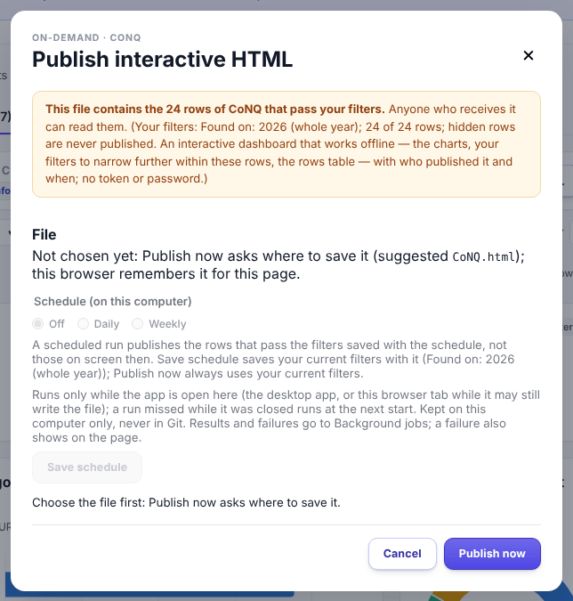

<video controls muted preload="none" src="user-guide/media/clip-publish.webm" poster="user-guide/media/clip-publish.png" title="Publish CoNQ as interactive HTML and open the file"></video>

*Clip: the Category filter narrowed to Scrap and Rework, Publish now, and the published file opened on its own — its header names the filters and the rows, a bar lists its rows, the Rows tab shows the table.*

- The file shows who published it and when, the filters and "n of m rows", the KPI cards and charts as in the app (tooltips, Table view, the rows behind a bar), its own filter row, a **Rows** tab and a Light / Dark switch.
- **Schedule**: Off, Daily or Weekly at a time, saved for this page on your computer only, with your filters at that moment. It runs while the app is open; a missed run runs at the next start.
- The file needs **JavaScript** turned on. It makes no request to the network and holds no token or Git address.
- In a browser, Chrome and Edge remember the file; Firefox and Safari download it instead. Never from Sample.

## Admin

The **Admin** group holds the shared setup, one page per area. You see the pages your roles may change; each section has a chip saying whom a change affects: *Only you · This computer*, *Everyone · Shared in Git*, *Everyone · Tool Owner only* and so on.

### Overview and Search settings

**Admin → Overview** lists what is left to set up (with a link to each setting), the shared changes not yet saved to Git (with **Save to Git**) and the latest changes. **Search settings** (**Ctrl K**) finds any setting by name.


### Pages & menu

**Admin → Pages & menu** (Tool Owner) lists every menu group and every added page.


- **＋ Add page…** — choose the type (**Table**, **Table + Insights** or **On-Demand Dashboard**), a name, an optional description, an icon, the **menu group** (or **＋ New group…**) and optional **co-owners**. The page is created in Git at once and opens.
- **Menu groups** — the built-in groups keep their place; set whether a group **accepts added pages** and its **co-owners**. Your own groups can be renamed, reordered and removed once empty.
- **Pages** — **Edit**, **↑ ↓**, **Hide** / **Show** (a hidden page leaves everyone's menu; dashboards keep reading it) and **Delete** (Tool Owner; it asks first). The **Storage** column shows one file or row files, with **Convert…**.
- **Co-owners** are picked from a searchable list of the people the app knows. A group co-owner looks after the group's pages; a page co-owner sets up that page and edits its rows.
- Page names are unique across the whole menu.


### People & roles

**Admin → People & roles → People** lists the people from Azure DevOps: the Time Writing team and everyone assigned to work. To add someone, add them to the team in Azure DevOps and refresh.

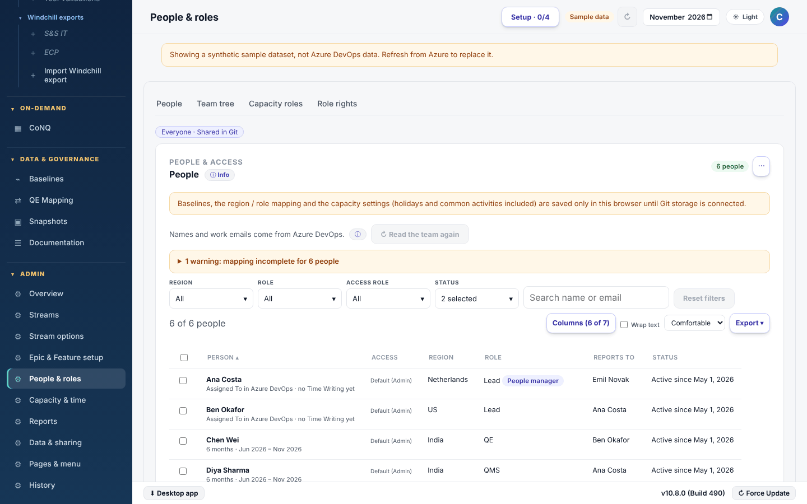

- Filter by **Region**, **Role**, **Access role** and **Status**, search, sort and export.
- **Click a person** to open their drawer: email and status, **Access**, **Profile** and **Employment**. **Edit** turns them into fields — app access roles, region, role, People manager, reports to, Time tracking started and Left on — and **Save** saves what changed. **‹ ›** go through the list.
- **Mark as left…**, **Not part of the team** and **Restore** are at the bottom of the drawer.

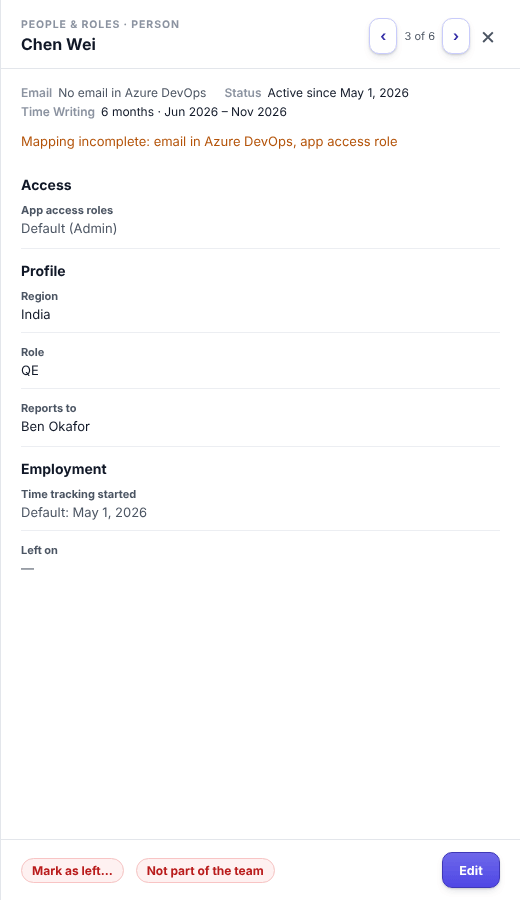

To change several people at once (**bulk edit**):

1. Tick the people (or the heading box for everyone shown).
2. In the bar that appears, choose **Set region…**, **Set role…** or **Set access role…**.
3. Choose the value and press **Save**. It is saved for everyone selected in one go; **Clear selection** ends it.


<video controls muted preload="none" src="user-guide/media/clip-people.webm" poster="user-guide/media/clip-people.png" title="Open a person, then set the region of two people at once"></video>

*Clip: Diya Sharma's drawer, the next person with ›, then Chen Wei and Diya Sharma ticked and their region set to Netherlands with Set region….*

The **Team tree** tab shows the reporting lines. **Capacity roles** sets which team roles count for capacity.

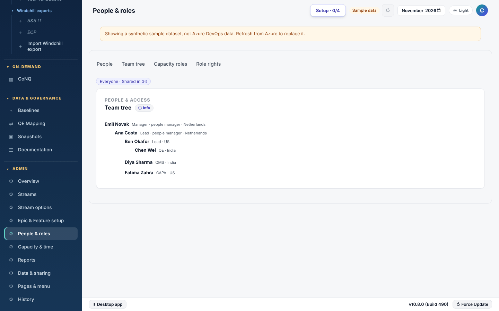

### Role rights

**People & roles → Role rights** is a matrix: every menu area and action is a row, and each role's cell is **Allow**, **Deny** or **Not set**.


- **Members** lists who has each role (choose people by name).
- A **Deny** wins over any Allow from another role. *Not set* means not allowed unless another role allows it.
- **Check access** picks a person and a permission and says whether it is allowed and why.
- The roles are kept in Git as `access.json`, so changing them needs a GitHub token that can write. You cannot remove *Manage access* from yourself.

### Streams and custom streams

**Admin → Streams** (Tool Owner) maps each stream to its server, project and query: **Time Writing** (QMS-0025) and the release streams DP, CP, IOCC, Content, Tool Validations, S&S IT and ECP. **Set up** adds a stream from the team's defaults. The mapping is shared through Git and applied for everyone at their next start; your PAT is never part of it.

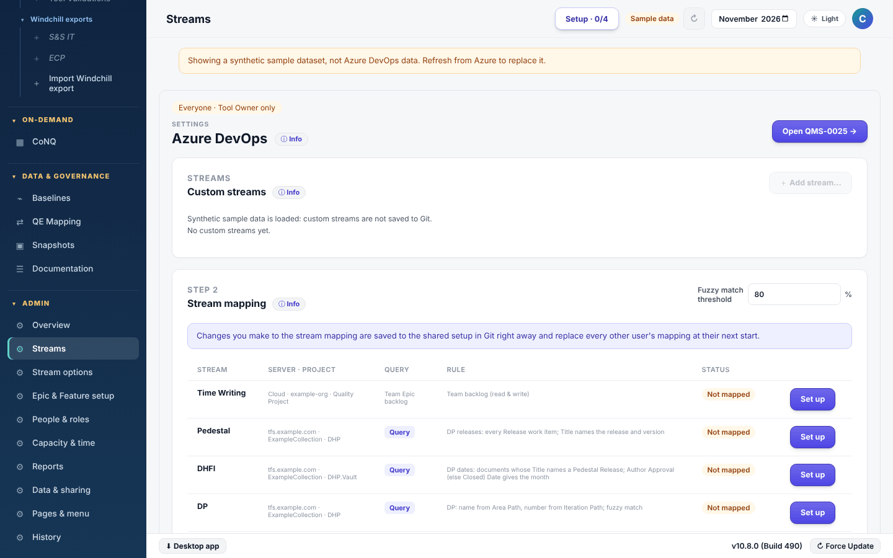

**＋ Add stream…** adds a **custom stream** with its own Release page. **Stream options** sets the Epics Features are matched in, the bulk creation Epics (the Epic each of DP, IOCC and Content creates its Features under — none built in, so map each one the team uses; **Save to Git** on a shared one commits it straight to Git, and Admin → Overview shows a stream without one under Attention) and the release counts.

Your own read-only views are in **My settings → My views**: they appear under **Other views** in your menu only, and never change a stream.

### Capacity & time

**Admin → Capacity & time** holds how capacity is worked out:

- **Capacity and absence** — who counts in the month's capacity, and why not.
- **Calculation profiles** — what counts as utilized and what comes off the capacity, as a sentence you change by ticking terms.
- **Bucket rules** — the words and tags that make an hour Absence, Training or Other NPRA.
- **Insight thresholds**, **Holidays and common activities**, **Period control** (the last day to update each month, and locking a month early) and **Historical hours** (hours from before Time Writing, from Excel).


### Data & sharing

**Admin → Data & sharing** has **Git storage** (connect, change or disconnect; **Load latest**), **Load from Git** (**Load everything from Git**), **Shared setup in Git**, **Other views** and **Synthetic sample**.

**Remove a shared view for everyone (Tool Owner).** **Remove** on a row of **Other views** takes a view out of your own browser only — the shared setup in Git brings it back at your next start. To take a shared view away from everyone:

1. Open **Admin → Data & sharing → Other views** and choose **⋯** on the view's row.
2. Choose **Remove for everyone…** to drop it from the shared setup, or **Delete for everyone…** to also delete its saved data in Git (the pop-up lists the files, e.g. `azure-data/<view>.json`).
3. Read the pop-up — it affects everyone who uses the shared setup in Git; the app cannot tell how many people that is — and confirm.

A backup of the view (never a PAT) is saved to Git first. At their next start every browser and desktop app removes the view with its saved data and shows once: "The Tool Owner removed 1 shared view: …". Each person's own views (**My views**) and PATs stay. To bring it back for everyone, use **Admin → Streams → Removed connections** → **Look in Git history** → **Restore** (removed views are listed first, with who removed them). Without the Tool Owner role, while viewing as someone else, without Git storage, with a read-only Git token or with the sample data, the two items are greyed out and the line above the table says why. An app version from before this change keeps the view until it is updated.

*CON-109…CON-112*

### Look & feel

**Look & feel** (profile menu) has a tab each for **Page layout** (margins and border), **Theme and zoom**, **Start view and menu** and **Table and chart defaults** (the shared table and chart design, for the roles allowed to change it). The first three are yours, on this computer.

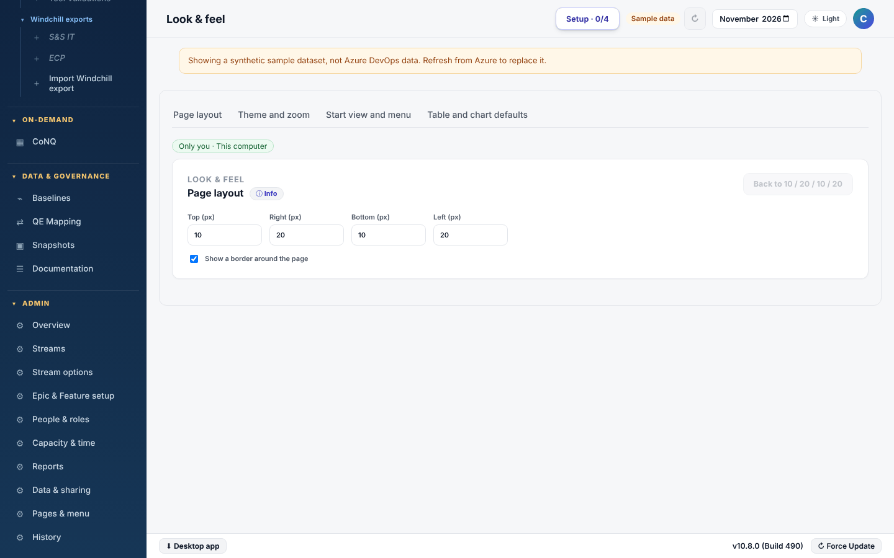

### History

**Admin → History** lists the changes to the shared setup; filter by area and text.


### Save view for everyone (tables)

Tool Owners and Admins set how tables and page filters look the first time for everyone with **Save view for everyone** in a table's **Columns** panel or beside a page's filters. See [Save view for everyone](#save-view-for-everyone).

## Troubleshooting and FAQ

**"Could not fetch from Azure DevOps" or a 401 / 403 error.** Your PAT is missing, wrong, expired or lacks a scope. Get started opens by itself with the reason: paste a new PAT for that server in **My settings → Servers and PATs** and press **Fetch now**. The Time Writing PAT needs Work Items (Read & Write) and Project and Team (Read).

**Every button is greyed out and a notice says the app is read only.** The roles have not been loaded. Connect Git storage (**Admin → Data & sharing**) with your GitHub token. If the repository has no roles yet, **Set up roles**.

**A button is greyed out.** Read the line next to it: it names the missing right, the missing Git storage, a read-only token or the sample data. Ask an Admin to change your role if needed.

**I cannot save to Git.** Your GitHub token is read only or expired, or the sample is loaded. Use a fine-grained token with **Contents: Read and write** for the team's repository.

**My changes are not written to Azure DevOps.** The synthetic sample is loaded (the banner says so): refresh from Azure first. On-premises servers are always read only.

**A row says "Being edited by …".** Someone else has its lock. Wait until they save or cancel, or until the lock times out (15 minutes without activity by default). A Tool Owner or page co-owner can **Release lock**.

**My edit closed and my changes seem gone.** After a lock timeout your text is kept as a draft in this browser for one day: press **Edit** on the same row and **Restore your draft**.

**"Newer data in Git".** A colleague saved data this page uses. Press **Load the newer data**.

**A published HTML file shows a blank page.** The file needs JavaScript: open it in a current browser with JavaScript turned on (some email previews and locked-down viewers block it). Save it to a folder and open it from there.

**The PDF has no page numbers.** Firefox and Safari cannot number pages when printing; use Chrome, Edge or the desktop app.

**Windows warns about the installer.** The installer is not code-signed: choose **More info → Run anyway**. On macOS, right-click the app and choose **Open** the first time.

#### Updates of the desktop app

The desktop app checks for a newer build when it starts and every four hours. When one is published, **Update available** appears at the bottom right: **Update now** opens the update dialog, **Later** hides it until the next build. **↻ Check for updates** in the footer checks at once. **Download and install** fetches only the installer for your computer from the team's fixed release and checks its size and SHA-256 checksum before installing; a mismatch deletes the file and installs nothing. Your data and PATs are kept.

**Force Update** (footer) reloads the newest version of the app's page. It never clears your data, tokens or settings; unfinished work is checked first.

**Where is my data kept?** In this browser or desktop app (the footer's **Force Update** window says where), plus what the team shares in the Git repository. Your tokens and work email are never shared.

## About this guide

This guide is `docs/USER-GUIDE.md`, bundled with every build and shown first on **Data & governance → Documentation** (also **User guide** in the profile menu). Its pictures are in `docs/user-guide/images/` and its clips in `docs/user-guide/media/`.


The screenshots and clips are made by a script from the built app, with synthetic data only:

1. `pnpm build:web`
2. `pnpm docs:shots` — the screenshots (1440 × 900, light theme; a few dark and phone ones).
3. `pnpm docs:videos` — the clips (1280 × 720 WebM). With ffmpeg installed they are trimmed and compressed, and the screenshots reduced to 256 colours.

`node scripts/user-guide-shots.mjs --only home,people` remakes some of them. The script stops if anything other than made-up data — a real server, organisation or repository name, a token or an email outside `example.com` — would be captured.
