# I&D Quality Demand Planning — User guide

This guide shows how to use the app day to day: how to get started, find your way around, write your time, keep the backlog tidy, read the reports, build On-Demand pages and charts, and look after the shared setup. Each chapter is a set of short tasks with the steps to follow.

Every screenshot and clip in this guide was made from **synthetic data** — the app's built-in sample dataset and made-up pages, people and numbers (Ana Costa, Ben Okafor, Chen Wei and so on, all `@example.com`). None of it is real team data. The pictures are regenerated from the app itself, so they match the build you are reading this in; your own screen will show your team's data and may differ in details.

The clips have no sound. Every clip repeats steps that are written out in full next to it, so you never need to watch one to follow a task.

## Contents

1. [Before you start](#before-you-start)
2. [Getting started](#getting-started)
3. [Finding your way around](#finding-your-way-around)
4. [Roles and rights](#roles-and-rights)
5. [Daily work](#daily-work)
6. [Reports](#reports)
7. [Release Details](#release-details)
8. [On-Demand pages](#on-demand-pages)
9. [Insights: charts, KPI cards and narratives](#insights-charts-kpi-cards-and-narratives)
10. [On-Demand Dashboards](#on-demand-dashboards)
11. [Sharing: PDF and interactive HTML](#sharing-pdf-and-interactive-html)
12. [Admin](#admin)
13. [Troubleshooting and FAQ](#troubleshooting-and-faq)
14. [About this guide](#about-this-guide)

## Before you start

### What the app is for

I&D Quality Demand Planning brings the team's demand, capacity and releases into one place. It reads the Time Writing backlog (QMS-0025) and the release streams from Azure DevOps, adds the team's own tables (On-Demand pages such as CoNQ), and keeps what the team shares — the setup, roles, pages and charts — in a private Git repository. It runs in a browser and as a desktop app for Windows and macOS.

### Three things to know

- **Your tokens stay with you.** Your Azure DevOps PAT and your GitHub token are kept only in your browser or desktop app. They are never saved to Git, to a backup or to SharePoint, and nobody else gets them.
- **Writes go to the cloud only.** The app writes work items only to Azure DevOps in the cloud (dev.azure.com). The on-premises Azure DevOps Server is always read only.
- **What you see depends on your role.** Your roles decide which pages you see and which buttons work. A greyed-out button always says why.

## Getting started

### Open the app

**In a browser.** Open the address your team uses for the app. The first time, each page loads for a moment ("Loading the page…"); after that it opens at once.

**As a desktop app.**

1. In the app (in a browser), press **⬇ Desktop app** at the bottom left of any page. The download for your computer is highlighted.
2. **Windows:** run `Demand-Planning-Hub-Setup.exe`. Windows SmartScreen may warn that the installer is not signed: choose **More info → Run anyway**.
3. **macOS:** open `Demand-Planning-Hub-mac.dmg` and drag the app into Applications. The first time, right-click the app and choose **Open**.

The desktop app keeps your data and tokens in your user profile. It checks for a newer version when it starts and every four hours — see [Updates of the desktop app](#updates-of-the-desktop-app).

### The Get started pop-up

A new user sees **Get started**, a short list of what to set up, in order. Each step shows whether it is done, and you can fill in what it needs right there.

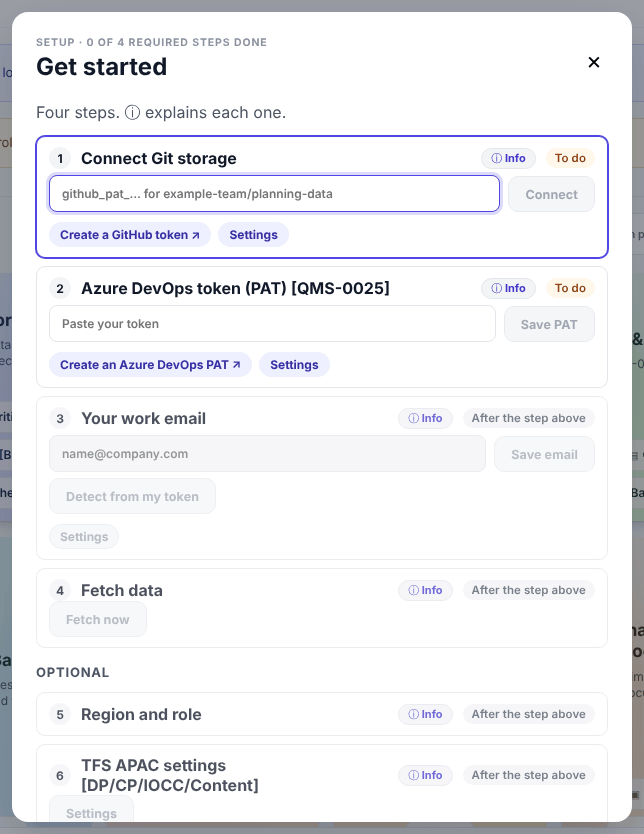

1. **Connect the shared Git storage.** Paste your GitHub token and press **Connect & load**. This brings in the team's connections, Feature setup, holidays and roles.
2. **Check the Time Writing connection** and **your work email**. **Detect from my token** reads your email from a work item assigned to, created or changed by you; confirm it with **Save email**.
3. **Enter your Azure DevOps PAT.**
4. **Fetch your data** with **Fetch now**.

The pop-up opens by itself while a required step is open, until you tick *Don't show again automatically*. The **Setup · n/4** button in the top bar opens it again at any time.

### Connect Azure DevOps: one PAT per server

Your Azure DevOps personal access token (PAT) is entered once per **server** and used by every connection on that server.

1. Click your initial at the top right and choose **My settings**.
2. Open **Servers and PATs**.
3. Paste the PAT of each server you use, and save. **＋ Add server** adds another server with its own PAT.

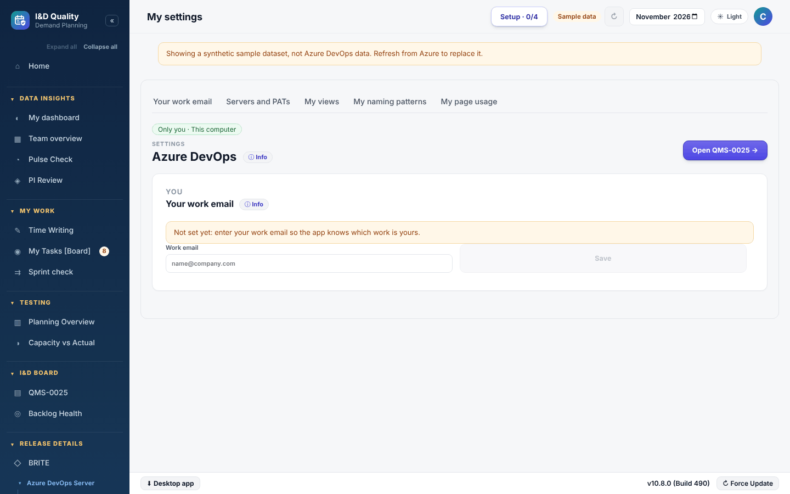

- The PAT stays on this computer, in this browser or desktop app. It is never saved to Git or to a backup. Each person uses their own.
- The Time Writing PAT needs **Work Items (Read & Write)** to save hours and create work, and **Project and Team (Read)** to read the team.
- The on-premises server is read only: its PAT only needs read access.

### Connect Git storage

What the team shares lives in a private GitHub repository: the planning data, the connection setup, roles, On-Demand pages, dashboards and the menu.

1. Open **Admin → Data & sharing → Git storage** (or use step 1 of Get started).
2. The form starts with the team's repository and branch. Add your **GitHub token** and connect.

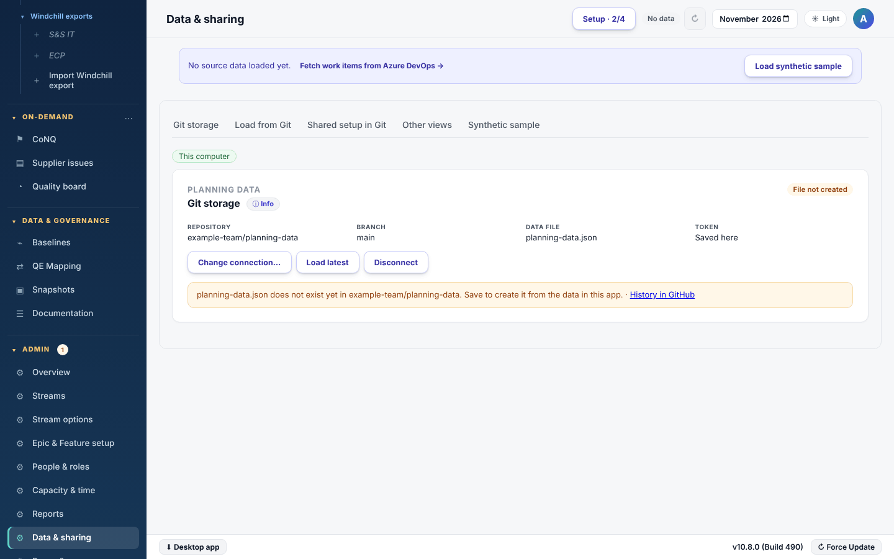

- Use a **fine-grained GitHub token** for that one repository: **Contents: Read-only** if you only read, **Read and write** if you save (for example rows, charts, baselines or people).
- With a read-only token the app shows the shared data, but saving buttons are greyed out with the reason.
- The token stays in your browser, like the PAT.
- **The team's data moved** to `philips-internal/InD_DemandPlanningStorage`. If you connected before the move, a notice at the top of every page says so: press **Switch to philips-internal/InD_DemandPlanningStorage**. Your token must be allowed on the new repository; if it is not, ask for a new fine-grained token for it.

### Your work email

The app recognises you by **your work email**, as Azure DevOps shows it. It finds your work on My Tasks [Board], drives your Time Writing prompts and your roles, and is assigned to the Features you create.

1. Open **My settings → Your work email** (click your initial at the top right, or your name at the bottom of the menu).
2. Type your email, or use **Detect from my token**, and save.

The email stays on your computer: it is not part of the shared setup, so updates, a sync from Git or a change to a connection never change it.

### Try it with the synthetic sample

You can look around before anything is connected.

1. Press **Load synthetic sample** (on a page with no data, or in **Admin → Data & sharing → Synthetic sample**).
2. The banner "Showing a synthetic sample dataset, not Azure DevOps data" stays on every page while the sample is loaded.

- Nothing is written to Azure DevOps while the sample is loaded: every write is refused with "Synthetic sample data is loaded: nothing is written to Azure DevOps. Fetch your data first."
- On-Demand pages are read only while the sample is loaded.
- **↻ Refresh** in the top bar fetches your real data and replaces the sample.

## Finding your way around

### Home and the menu

The app opens on **Home**: one tile per area. Click a tile to open the area, or one of its small buttons to go straight to a page. **+n more** shows the rest; the search box at the top filters tiles and pages as you type. You only see what your roles may open; My Work shows how many open items you have.

The menu on the left groups the pages: **Data Insights**, **My Work**, **I&D Board**, **Release Details**, **On-Demand**, **Data & governance** and **Admin** (and **Testing** for Admins).

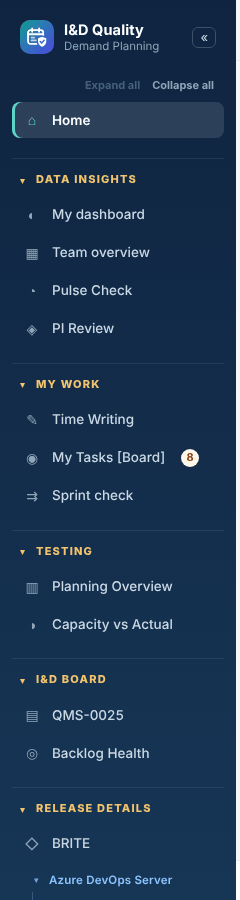

- Click a group heading to fold or unfold it; **Expand all** / **Collapse all** do every group at once. The app remembers your choice.
- **«** in the menu header folds the menu to icons; **»** shows the names again.
- **Customize menu** (profile menu) pins or hides pages in your own menu.
- **Classic view** (profile menu) opens the app on My dashboard instead of Home; **Tile view** switches back.

On a phone the menu is behind **☰** at the top left; it closes when you choose a page.

### The top bar

- The **page title** (hover it for what the page is for).
- **Setup · n/4** while Get started has open steps.
- **⟳ n running** while background jobs run (see below).
- The **data status** chip with **↻ Refresh**, which fetches every connection again.
- The **month** for pages that show one month.
- The **theme** button: **Auto → Light → Dark**.
- Your **profile** (your initial): My settings, Look & feel, Classic / Tile view, View as… (Admins), Search settings (**Ctrl K**, **⌘ K** on a Mac), Customize menu and **User guide**.

### Theme and zoom

- The theme button cycles **Auto** (follows your computer), **Light** and **Dark**. **Look & feel → Theme and zoom** sets the same.
- In the desktop app the profile menu also has the **zoom**.

### Background jobs

Long actions run in the background so you can keep working: saving a New Feature, Sprint check moves, saving Time Writing, every save to Git, and the Refresh and Import of the Release pages.

- The top bar shows **⟳ n running** while they run. Click it to see each job's progress and its result: ✓ done, or ⚠ what failed and what was still created.
- Pressing the same button again while its job runs does nothing. Closing or reloading the page while a job runs asks first.
- Jobs belong to this page load; they are not stored.

### "Newer data in Git"

When someone else saves data that the page you are on uses, a notice appears on that page only, saying who saved it and when.

- Press **Load the newer data** to read it. The page updates in place; the app is not reloaded.
- Your own saves never raise the notice.
- The app checks every few minutes, so the notice can take a moment to appear.

## Roles and rights

### What each role can do

Your app roles are set in **Admin → People & roles**. Someone with several roles gets everything any of them allows — unless one of their roles **denies** it: a denial always wins. Everyone without a role gets the **Everyone else** role.

| Role | Sees | May |
|---|---|---|
| Tool Owner | everything | everything, including the stream mapping, Pages & menu and building On-Demand Dashboards |
| Admin | everything, plus the Testing pages | everything except the stream mapping, Pages & menu and building dashboards |
| Product Owner | Dashboard, I&D Board, Backlog Health, Release Details, Baselines, QE Mapping, Documentation, On-Demand | work items (also bulk create and for others), baselines, QE Mapping, export, Monthly pack text |
| People Manager | Dashboard, team insights, My Work, I&D Board, Release Details, Baselines, QE Mapping, Snapshots, Documentation, On-Demand | the same as Product Owner |
| Scrum Master | Dashboard, My Work, I&D Board, Backlog Health, Release Details, Documentation, On-Demand | work items (also for others), export, the shared Feature setup |
| Team Member | Dashboard, My Work, I&D Board, Release Details, Documentation, On-Demand | their own work items, export |

These are the starting rights. Your team may have changed them in **Role rights** (see [People & roles](#people--roles)).

The roles decide what the app shows and does. What you can actually read or change is still decided by your own Azure DevOps PAT and GitHub token.

### Why is a button greyed out?

A greyed-out button always comes with a **reason line** next to it (above the table for row buttons). Typical reasons:

- Your role does not allow the action — the line names the right and where an Admin changes it.
- The roles have not been loaded yet (see below).
- Git storage is not connected, or your GitHub token can only read.
- The synthetic sample is loaded.
- On an On-Demand page, someone else is editing that row.

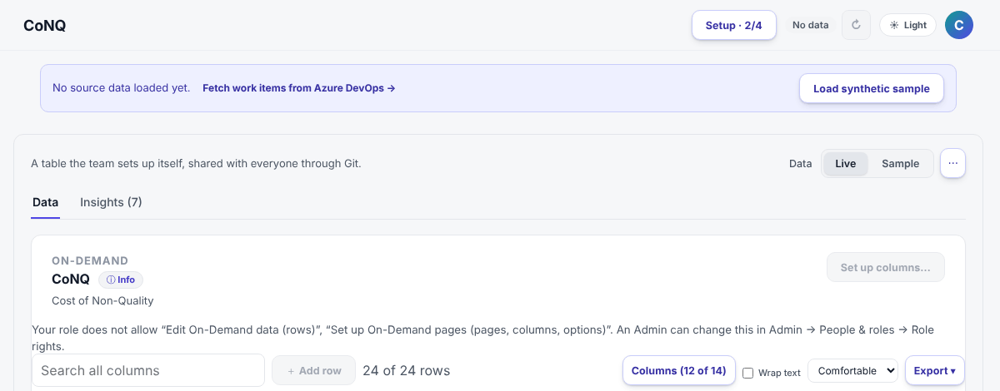

### Read only until the roles are loaded

Until the roles file (`access.json`) has been read from Git, the app is **read only** for everyone: every page shows, but nothing can be changed, and a notice says so. Connect Git storage to load the roles.

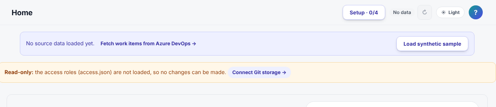

If Git storage has no roles file yet, the first person may press **Set up roles**: it starts from the table above with that person as Admin.

### View as (Admins)

An Admin can see the app as a chosen person or as a role — their menu, their pages, their own My dashboard — to check what someone else sees.

1. Open the profile menu and choose **View as…**.
2. Choose **A person** (and the person) or **A role** (and the role), then **View as**.
3. A banner shows whom you are viewing as. Press **Exit View as** to go back.

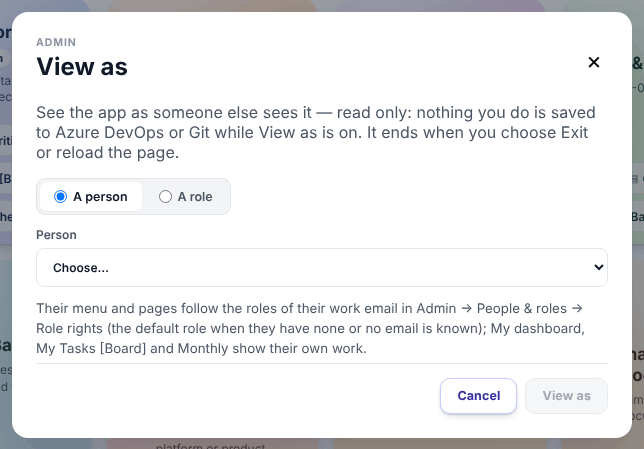

View as is read only: nothing is saved to Azure DevOps or Git while it is on. Reloading the page ends it.

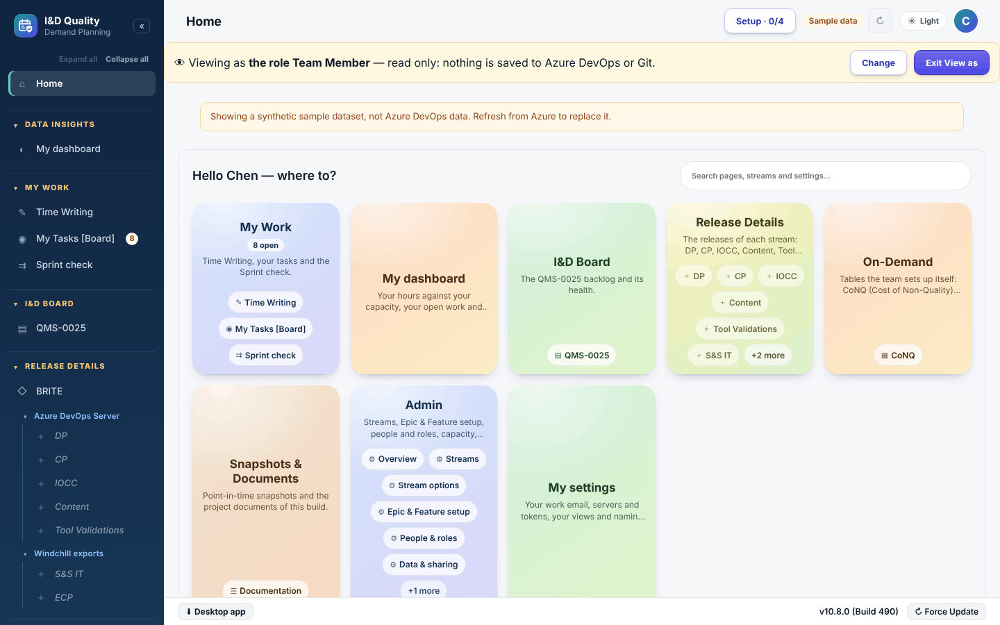

## Daily work

### Write your time (Time Writing)

**My Work → Time Writing** is your month on one page: your month Tasks with planned and actual hours, and what is still missing.

1. Check the month in the top bar.
2. In **Your activities**, enter **Planned** (Original Estimate) and **Actual** (Completed Work) hours for each activity.
3. Features without a Task this month are offered as **suggestions** on the right. Press **Add** (or **Add all**) to put them in your list; nothing is added unless you choose it.
4. Press **Save**. The save runs in the background; the top bar shows its result.

- **＋ Add a new activity** adds your month Task under a Feature (choose an Active Epic, then one of its Features), a **User Story**, a work **Task**, or opens **New Feature**.
- The cards at the top show your Capacity, Planned and Actual hours with their share of capacity, your Tasks, and the **last day** to update the month. When you are not counted for capacity, the Capacity card says why.
- **Close Features** and **Close Tasks** (next to Save) let you tick items and close your own open work after one confirmation.
- Each month has a last day for the plan and one for the actuals (by default the 5th of the month and the 4th of the next month). After the plan's last day the Planned hours are greyed out and only Actual can be changed; after the actuals' last day the month is locked.

### My Tasks [Board]

**My Work → My Tasks [Board]** lists your open Azure DevOps items: Features, User Stories, Bugs and Tasks, with a count in the menu.

- Filter by type with the buttons above the table.
- **Edit** opens the item in place; **Close Feature** / **Close** finishes it (see below); **＋ User Story** adds a story under a Feature.
- **Person** in the top bar shows someone else's board (if your role allows).

### The QMS-0025 backlog

**I&D Board → QMS-0025** is the Time Writing backlog as a tree: Epic → Feature → User Story → Task.

- **Filters**: Assigned to (you, by default), State and more; **Reset filters** clears them. **Expand all** opens every level; **›** opens one row.
- **⚙ Column Options** chooses the columns.
- **Source details** lists every fetched work item with its fields.
- On a row: **Edit**, **Close**, **＋ Feature**, **＋ User Story**, **＋ Task** and **＋ Time Writing Task**, as your role allows.

### Create a Feature

Every page creates a Feature with the same **New Feature** form: QMS-0025, My Tasks [Board], Time Writing and Create Feature on a Release page.

1. Press **＋ New Feature**.
2. **1 Feature** — choose the **Parent Epic** first, then fill in the title (or the title fields of that Epic), Assigned to, PI → Sprint, Start date and Target date.
3. **2 Definition of Done** — the Feature DoD is required. Check it and press **Continue**.
4. **3 User Stories** — tick the stories to create, add your own, and press **Continue**.
5. **4 Estimates for the month** — the hours of each month's Time Writing Task.
6. Press **Save**. The Feature and its children are created in the background.

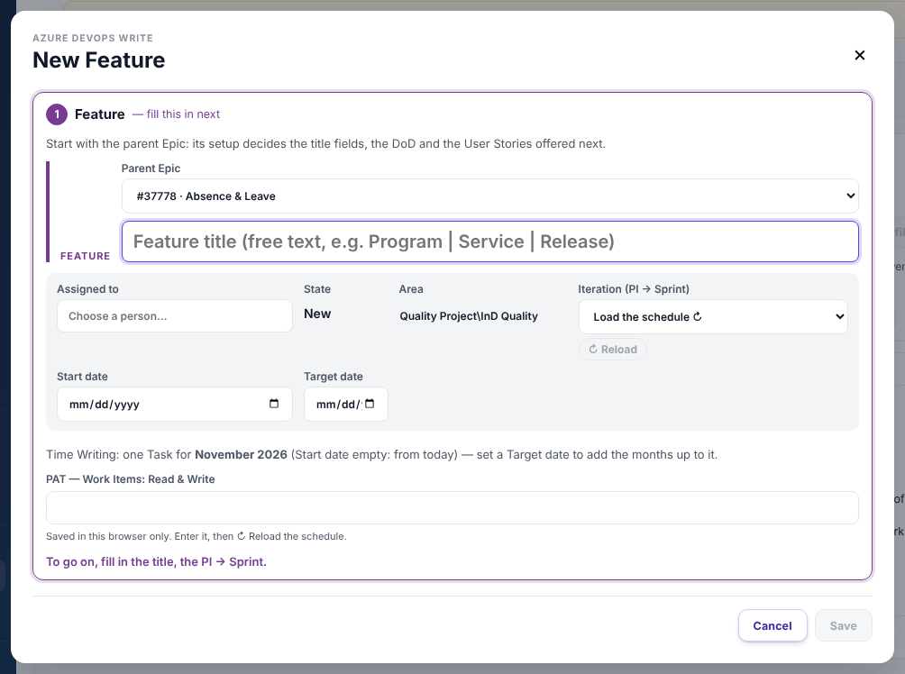

- A Target date in a later month creates one Time Writing Task per month up to that date, and asks the hours of each.
- A new Feature stays **New** until one of its User Stories is Active.
- New work is always assigned — to the person chosen, else to you.

### Edit and close work

- **Edit** on a row opens the item's fields; save to write them to Azure DevOps.
- **Close** (on a Feature or User Story) lists what would close, each with a tick box: your items start ticked, others' do not, and a parent closes only with everything below it. Closing a Time Writing Task first asks you to confirm its hours are up to date.
- Closing a Feature before its last Time Writing month also sets the later months' Tasks to 0 h and Removed.

### Sprint check

**My Work → Sprint check** tidies up your Sprints.

1. **Find current Sprint** works out today's PI and Sprint from the team's iteration dates.
2. **Move to current PI + Sprint** lists your User Stories still in a past Sprint, in the states you choose (**New**, **Active** or **Both**). Confirm to move them.
3. **State checks** list your Features and User Stories whose state does not match their children. Open a row (**›**) to set a New User Story **Active** right there; an Active Feature in an older PI than its stories offers **Move Feature to <PI>**.

### My dashboard

**Data Insights → My dashboard** is your own month: your hours against your capacity, your open work, your streams and releases, the release counts and what you signed.

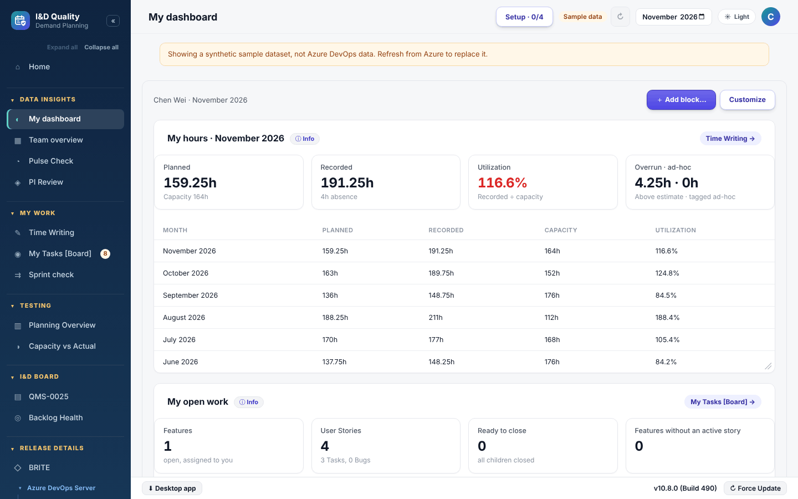

- Each section links to the page where you act on it (Time Writing, My Tasks [Board]).
- My dashboard is **yours**: nobody else sees your blocks or your layout. An Admin's **View as** shows the default My dashboard of the viewed role, not yours.

#### Edit My dashboard

Its built-in sections — My hours, My open work, My streams and releases, Release counts and Signed by me — are its **default blocks**. You can add up to 20 blocks of your own and arrange everything.

**Add a block**

1. Press **＋ Add block…**.
2. On **Data**, type a **Title**, choose the type — KPI tile, Bar chart, Line chart, Pie chart, Pareto, Summary table or Narrative (text) — and the **Data source**.
3. Choose **Categories by** (or **Rows by**), the **Measure** and its column, and, when the source has dates, **Period filter on**.
4. Set the other tabs if you need them (**Filters**, **Format**, **Elements**; see [Add a chart or table](#add-a-chart-or-table)) and press **Add block**.

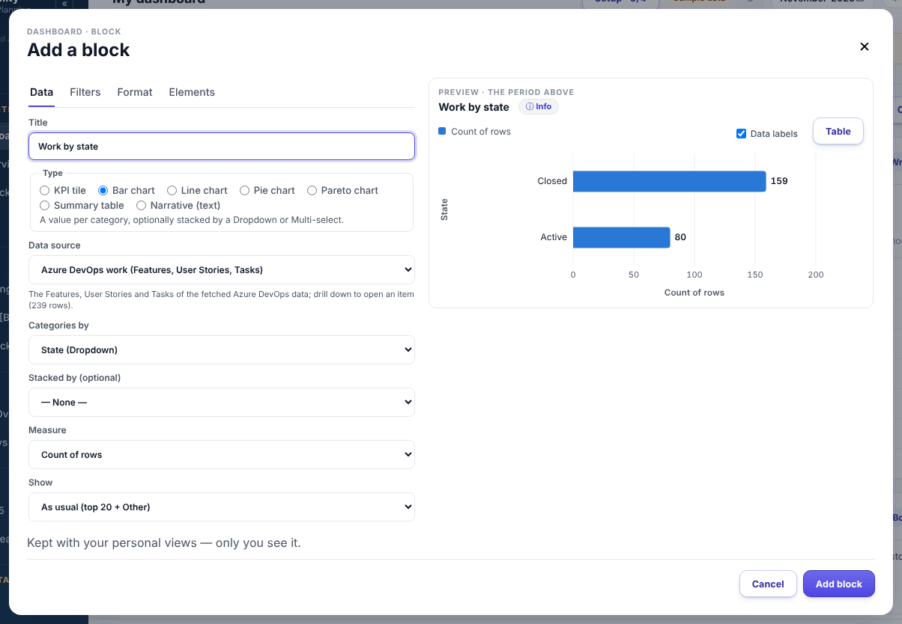

The data sources are what the app has already loaded:

- **Azure DevOps work** — Features, User Stories and Tasks by type, state, assignee, area, Epic, Feature, PI, Sprint, dates, hours and tags. A click on a bar lists the items with their #ID links. With only *My Tasks [Board]* you see your own items.
- **Releases per stream** — a row per release as Pulse Check counts it.
- **Capacity and utilization** — Team overview's figures per person and month.
- **The On-Demand table pages**, the **Time Writing hours**, the **QE Mapping** sheets, the **KPI tracker** values, the **historical hours** and each **Windchill export**.

A source your role may not see is offered as "(not available)", and a block over it says "Not available for your role." A source whose data is not loaded yet offers the action that loads it (for example **Load the KPI tracker**).

**Arrange it**

1. Press **Customize**. It lists every section and block.
2. Tick or untick an item to show or hide it; **↑ ↓** move it; set its **width** and **height**; **Edit…** and **Remove…** change a block of your own.
3. Press **Done**.

A block's **⋯** also has Move up, Move down, Edit… and Remove…; drag its bottom-right corner to resize it. **Reset to the default My dashboard** (in Customize) removes your blocks, order and sizes.

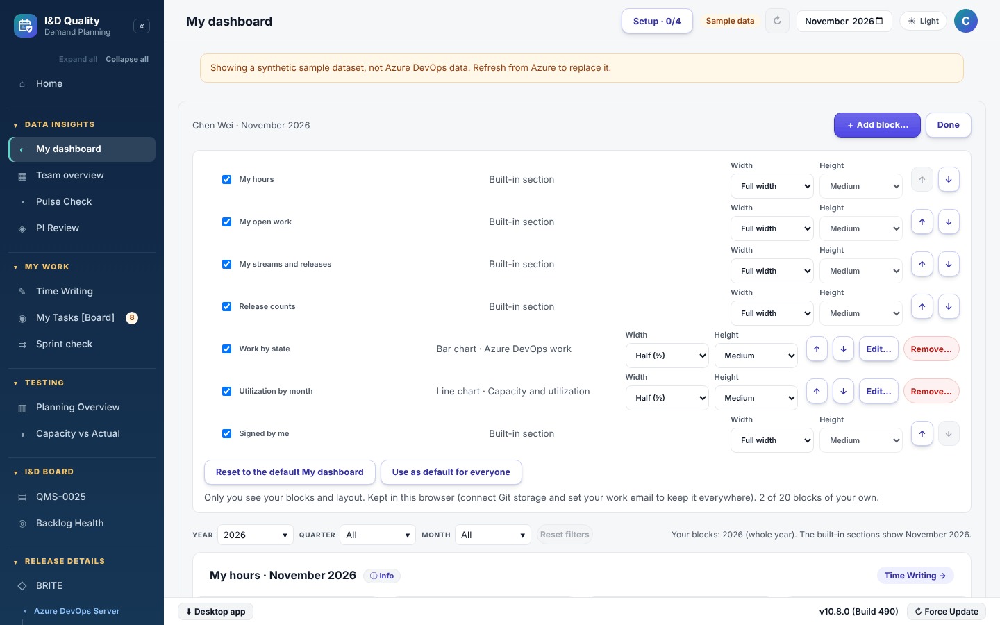

- Your blocks have a **period** (Year / Quarter / Month, nothing ticked: the current year) with **Reset filters**; the built-in sections keep the header month.
- The layout is kept with your personal views: in this browser at once, and on every computer once Git storage and your work email are set.
- PDF export and interactive HTML are not offered for My dashboard: it is personal.

## Reports

### Team overview

**Data Insights → Team overview** shows the team at a glance for a period and a group of people.

1. Choose the period with **Year**, **Quarter** and **Month** (nothing ticked: the current year and all its quarters and months).
2. Narrow by **Region**, **Role**, **Team member** and **Stream**. **Reset filters** goes back to the start.
3. Read the six tiles — Utilization, Overload and headroom, Plan accuracy, Plan health, Delivery and Forecast — and click one to open the tab that explains it.

The tabs: **Capacity and workload**, **Streams**, **Plan quality**, **Utilization**, **Old Calculation** and **Definitions** (every formula and threshold). Utilization is red at or above the overloaded threshold, blue below the available one, green in between.

### Pulse Check

**Data Insights → Pulse Check** is the monthly look back:

- **Releases · <last month>** — the releases of each stream in the month before the header month.
- **Last month** — utilization, who has capacity, Features and User Stories opened and closed per stream, and that month's Time Writing gaps. **Team / Individual** switches between everyone and one person; Region and Role narrow the team.
- **Ongoing activities** — work in progress per stream, with Target dates flagged when passed.
- **Current month releases**.
- **Monthly pack** (below).

### Monthly pack

**Pulse Check → Monthly pack** prepares the two slides of the monthly call — the **2x2** and the **Performance Pulse** — for the month before the header month.

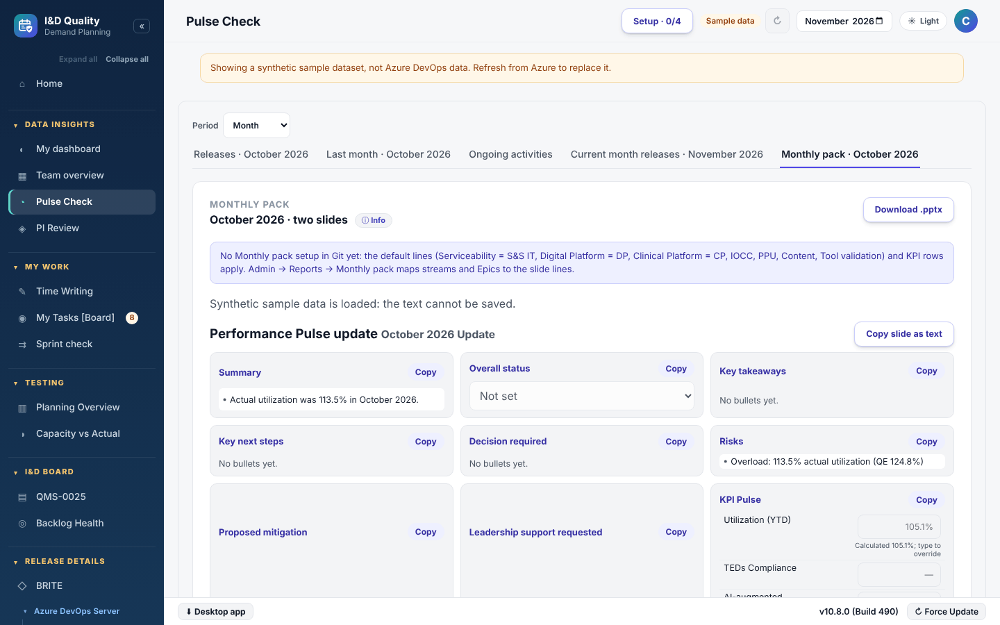

1. Check the generated lines: releases per slide line, utilisation, the year-on-year change and the KPI rows.
2. Type the rest as bullets: **+** next to a bullet adds one below it, **+ Add bullet** adds one at the end, **Enter** adds the next, **✕** removes one.
3. Press **Save to Git** so the team sees the same text. Nothing is saved until you do.
4. **Copy** a box or a slide into the PowerPoint template, or **Download .pptx** (both slides, 16:9).

What feeds each line and KPI row is set in **Admin → Reports → Monthly pack**.

### PI Review

**Data Insights → PI Review** is planned: a PI summary (Features and Stories planned against closed, hours planned against booked, open work in the PI's Sprints). The page holds a placeholder for now.

### Planning Overview and Capacity vs Actual (Testing)

Admins see a **Testing** group with pages that are being tried out:

- **Planning Overview** — the team's month: tiles for planned utilization, delivery, baseline exceptions and capacity risk; 12 months of hours against capacity; one exception queue with links; delivery health per Epic; and **Generate Monthly Pack**.
- **Capacity vs Actual** — capacity after leave and holidays against the hours booked: tiles, 12 months (red where the team booked more than it had), each person with % used and a status, and where the hours went per Epic.

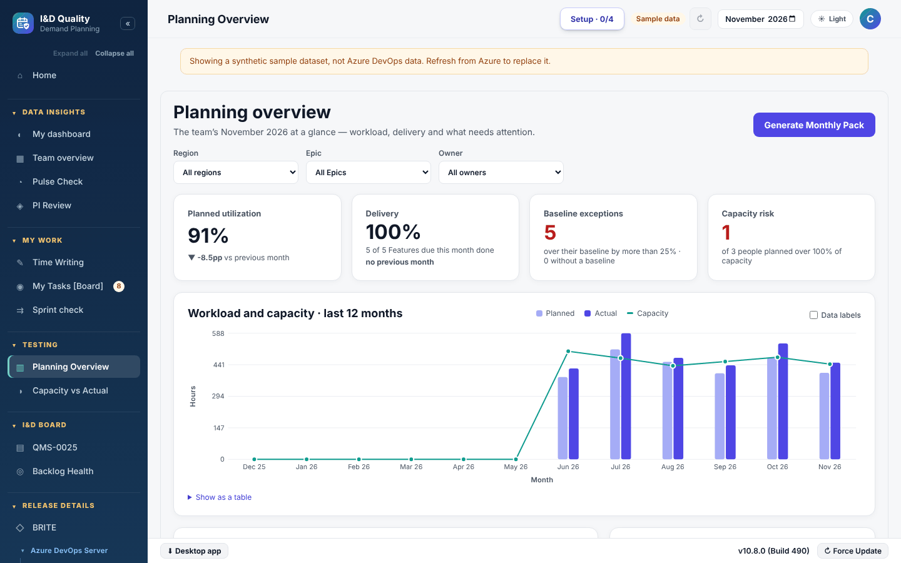

### Backlog Health

**I&D Board → Backlog Health** lists what needs attention in the backlog, for everyone:

- **In older Sprints** — open work whose Sprint has ended.
- **Features without DoD** — Features whose Description does not mention a DoD.
- **Unassigned** — open work nobody is assigned to.

Each tab has its own **Columns**, sorting by a column heading, filters for State, Iteration Path and person, and **Export**. **Export all lists** writes all three into one file.

### KPI tracker

The **KPI tracker** (from the Team Insights tile on Home) shows the team's KPI workbook from SharePoint, read only. The desktop app reads it live; everyone else sees the copy kept in Git.

## Release Details

### Release pages per stream

**Release Details** has one page per stream: **DP**, **CP**, **IOCC**, **Content** and **Tool Validations** from Azure DevOps Server, and **S&S IT** and **ECP** from Windchill exports. A stream that is not set up yet shows **＋** in the menu and leads to its setup.

Every Release page looks the same, top to bottom:

1. The **source bar** — where the data comes from, when it was fetched or imported, **Show: <month> / All months**, **↻** to refresh or import, and **⋯** (Load from Git, Connection settings, Remove).
2. The **counts** of the header month — **Releases in <month>**, **Completed**, **Supported** — with **What was counted**.
3. Two tabs: **Releases** and **Source data** (the raw rows, with search and Export).
4. The **Releases** table: Release name (▸ opens its documents), Release, the date, Documents, the stream's own columns, the Time Writing Feature with its planned and booked hours, and the **QMS-0025 match**.

**Create Feature** on a release without a match opens the New Feature form, titled for that release. Load the QMS-0025 board first.

### Windchill exports

A Windchill search exported to CSV becomes a Release page.

1. Choose **Import Windchill export** (or **＋ S&S IT** / **＋ ECP** for a stream without its export yet).
2. Choose the CSV file. The page lists the unique releases read from the **Location** folders (or else the document names), each with its documents.
3. Use **Show: All months** to see every release, not only those of the header month.

The import is saved to Git so the team sees it; **Load from Git** reads the team's latest one. Pulse Check counts the releases per stream.

## On-Demand pages

On-Demand pages are tables the team sets up itself, without a new release of the app. **CoNQ** (Cost of Non-Quality) is there from the start; the Tool Owner and the pages' co-owners add more (see [Pages & menu](#pages--menu)). Each page has a **Data** tab (the table) and, for *Table + Insights* pages, an **Insights** tab (charts).

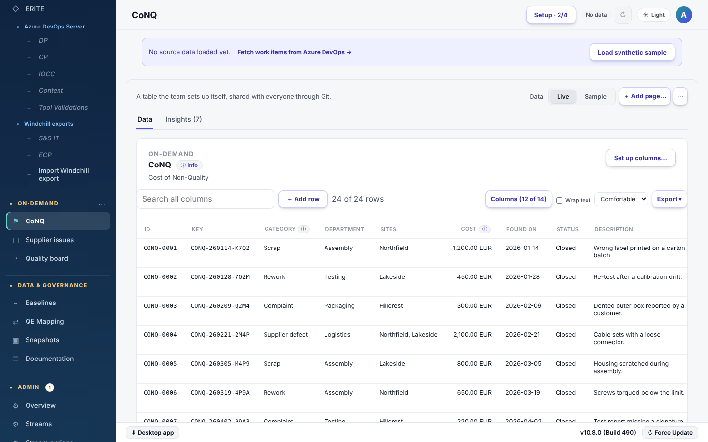

- Search, sort by a heading, choose **Columns**, and **Export** to Excel or CSV.
- Every row gets a **key** when it is added (for example `CONQ-261124-K7Q2`) and a readable **ID** (`CONQ-0001`) when it is saved.
- **Every save goes straight to Git**, as its own commit. There is no separate save step; progress and results are in Background jobs.

### Set up columns

People who may set up the page use **Set up columns…** to add, rename, reorder and remove columns.

1. **＋ Add column**, then give it a name and a **type**: Text, Long text, Number, Currency, Date, Dropdown (one value) or Multi-select.
2. For a Dropdown or Multi-select, add its **options**. For a Currency, choose its default currency.
3. Tick **Required** where a value must be given, and add a **Description** — how or what to fill. It shows under the field and behind ⓘ on the column heading.
4. Press **Save**. If the change touches values already in the rows, the pop-up first lists what happens and asks.

Nothing is lost silently: values that no longer fit are kept and marked (for example *not in the list*) until someone changes them.

### Open, edit and save a row

1. Click a row (or Tab to it and press Enter). It opens in a **drawer** on the right with its ID, key, who added it and when, every value, and its **History**.
2. Press **Edit**. The values become fields.
3. Change what you need and press **Save to Git**. A new row gets its ID.
4. **‹ ›** go to the previous or next row; Escape or × closes the drawer. Leaving with unsaved changes asks first.

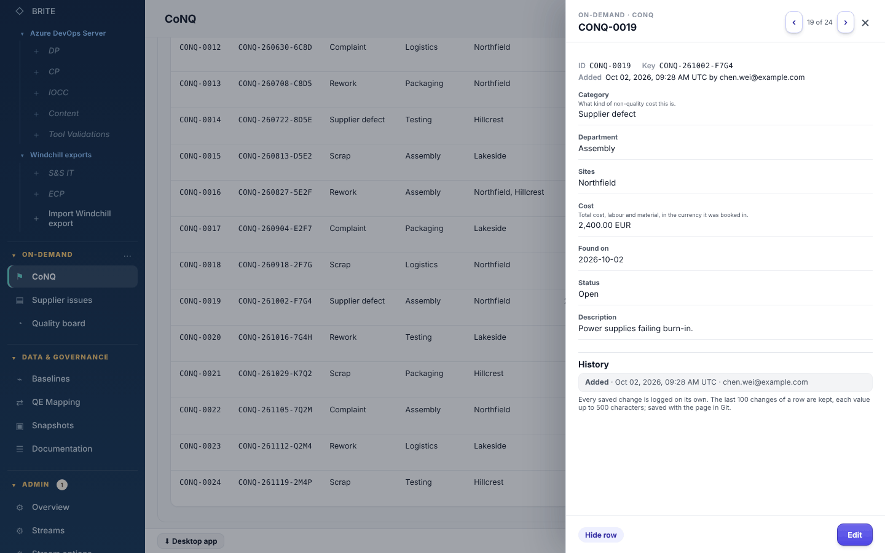

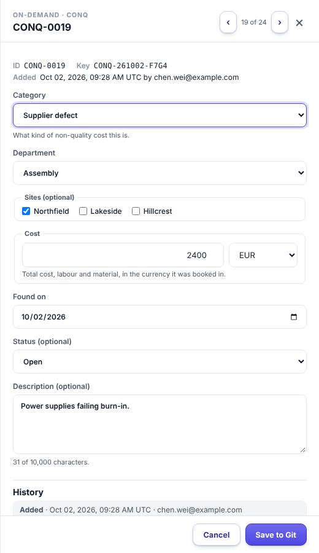

<video controls muted preload="none" src="user-guide/media/clip-conq-row.webm" poster="user-guide/media/clip-conq-row.png" title="Edit a CoNQ row in the drawer and save it to Git"></video>

*Clip: a CoNQ row opened in the drawer, set to Closed with a note, saved to Git, and the result in Background jobs.*

- **＋ Add row** opens an empty drawer.
- Every saved change is logged in the row's **History**: who, when and what changed. The last 100 changes are kept.
- If two people change the same row at the same time, the later save wins for the values and both changes stay in its History.

### Row locks and timeouts

Large pages can be converted to **row files** (see below). On such a page **Edit** takes the row's **lock**:

- Others see ✎ and your email on the row, and "Being edited by … since …" in its drawer. They cannot edit or hide it until you save or cancel. Viewing, other rows, adding rows and charts never wait.
- After **15 minutes** without activity (an Admin can change this) a warning comes two minutes before: press **Keep editing**. Otherwise the edit closes and the row is free again.
- What you typed is kept **as a draft in this browser for one day**. Your next **Edit** of that row offers **Restore your draft from …** and says what changed in Git meanwhile.
- The Tool Owner or a co-owner can **Release lock** on a row whose editor left without saving.

### Hide and delete rows

- **Hide row** (in the drawer, or **Hide** in the table) takes a row out of the table, the charts, the exports and the dashboards for everyone. It stays in Git with its ID and a History entry.
- Tick **Show hidden rows (n)** to see them greyed; **Show row** brings one back.
- Only the **Tool Owner** deletes a hidden row for good, with **Delete row…**. Its ID is never given again.

### The page menu (⋯)

The **⋯** next to the page's main action holds **Rename page…**, **Hide page**, **Delete page…** (Tool Owner), **Convert to row files…** (Tool Owner), **Publish interactive HTML…** and **↻ Reload from Git**.

### Convert to row files

When many people add rows at the same time, the Tool Owner converts the page to **one file per row** with **Convert to row files…** (it asks first). Afterwards several people can add rows at once and Edit uses row locks. A page past 500 rows (or 600 KB) shows a line suggesting it.

Update every app first: versions before 10.0 cannot open a converted page.

### Live and Sample

**Data: Live | Sample** at the top of every table page switches your own view:

- **Live** (the default) shows the page's rows from Git.
- **Sample** shows **50 made-up rows** generated from the page's own columns, only for you, under the banner "Sample data — nothing is saved." Every change is disabled and exports are named "Sample-…".

Use Sample to try charts and filters before the real rows are there.

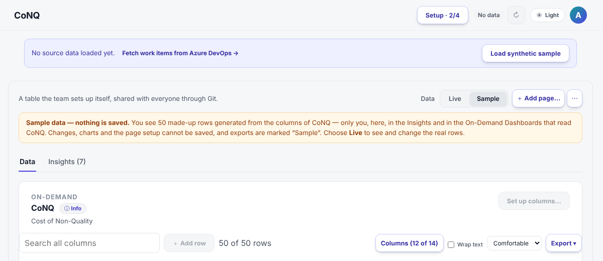

### Save view for everyone

Every table has a **Columns** panel: tick columns on or off, move them with ↑ ↓, drag a heading's edge to resize, choose **Wrap text** and **Compact / Comfortable**, and click a heading to sort. What you change is **your own view**, kept in your browser.

The Tool Owner (and anyone with the right *Table, chart and page defaults*, such as the Admin) can make a table look the same **the first time** for everyone:

1. Set the table up as it should look: the columns, their order and widths, Wrap text, the density and the sort.
2. Open **Columns** and press **Save view for everyone**. The view is saved to Git; Background jobs shows the result, and the panel says who saved it and when.
3. To remove it again, press **Clear the view for everyone** and confirm.

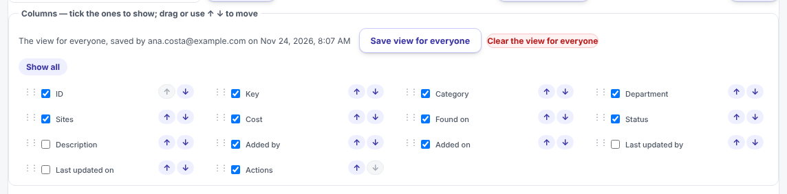

Which view you see:

- Your own view when you changed the table, else the **view for everyone**, else the table's built-in view.
- With your own view the panel reads "Your own view · **Use the view for everyone**". When a newer view for everyone has been saved since, it reads "A new view for everyone is available — **Use it**". **Reset layout** also goes back to the view for everyone.
- Columns that no longer exist are ignored; columns added later come at the end and are shown.

Without the right, with a read-only Git token, with the synthetic sample or in View as, the Save and Clear actions are not shown.

**Page filters** work the same way: the Team overview (period, filters and tab), an On-Demand Dashboard (period, filters and tab), an Insights filter row and the People list's filters (Region, Role, Access role, Status) have **Save view for everyone** / **Clear the view for everyone** beside the filters. The QMS-0025 board's **⚙ Column Options** use the same wording.

## Insights: charts, KPI cards and narratives

The **Insights** tab of a table page holds charts, KPI cards, summary tables and narratives built from the page's rows — the same for everyone.

### Filter the charts

When the page's owners have given the tab a **filter row**, everyone can narrow every chart and table on it:

1. Choose the **period** (Year → Quarter → Month on one Date column; nothing ticked is the current year).
2. Tick values in the filters (up to six: Dropdown or Multi-select values, a date range, "contains" text, a number range, or a currency and amount range).
3. The line under the row names what applies and how many rows are counted. **Reset filters** goes back.

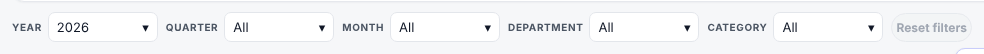

Your filter choice is yours: it is remembered for you and never changes what others see. A chart narrowed by its own filters or the filter row shows a small **Filtered** tag.

The owners set up the filter row with **Filters…** next to ＋ Add chart / table.

### See the rows behind a chart

Click a bar, a slice or a point — or move to it with the arrow keys and press **Enter** — to list the rows counted there, with Export.

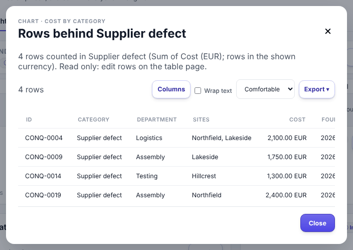

<video controls muted preload="none" src="user-guide/media/clip-filter-drill.webm" poster="user-guide/media/clip-filter-drill.png" title="Narrow the Insights with the filter row, then list the rows behind a bar"></video>

*Clip: the Department filter narrows every chart; a click on a bar lists its rows; Reset filters goes back.*

Each chart also has **Data labels** (your own choice) and **Table** (the numbers behind it).

### Add a chart or table

People who may set up the page add charts with **＋ Add chart / table**. The pop-up holds its fields in **tabs**, with a live **Preview** beside them (under them in a narrow window). **Cancel** and the main button always stay in view.

1. On **Data**: type a **Title**, choose the **Type** — Bar / column, Line over time, Pie / donut, Pareto, KPI (one number), Summary table or Narrative (text) — then **Categories by** (the column to group by; for a bar chart an optional **Stacked by**), the **Measure** — Count of rows, Sum, Average, Minimum, Maximum (of a Number or Currency column) or Distinct count — and **Group dates by**, **Show** and the sort.
2. On **Filters**: **＋ Add filter** narrows this chart only (values of a Dropdown or Multi-select, or a range of months).
3. On **Format**: the look of the chart — see [Chart options](#chart-options).
4. On **Elements**: the chart elements and the axis names — see [Chart elements](#chart-elements).
5. Press **Add chart** (**Save** when you edit one). It is saved to Git at once, for everyone.

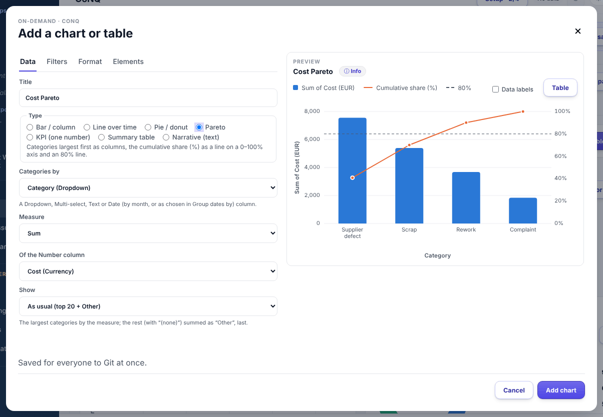

- A tab shows how many of its settings you changed, for example **Elements (2)**. Data shows no count.
- Only the tabs that fit the type are shown: a KPI has Data, Filters and Format; a **Narrative** has **Narrative** instead of Format and Elements.
- If a field is not right when you press Add chart or Save, its tab gets a **red marker** with the reason (point at it, or a screen reader reads it), and the pop-up opens that tab and says what to fix above the buttons.
- The arrow keys move between the tabs when one has the focus.

<video controls muted preload="none" src="user-guide/media/clip-add-chart.webm" poster="user-guide/media/clip-add-chart.png" title="Add a bar chart with data labels and gridlines"></video>

*Clip: a bar chart of cost by department built on Data, with data labels and gridlines turned on on the Elements tab, added to the Insights tab.*

A chart's **⋯** has **Move up**, **Move down**, **Edit…**, **Size…** and **Remove…** (it asks first).

The block pop-up of an On-Demand Dashboard and of My dashboard has the same tabs, with the **Data source**, **Period filter on** and the dashboard tab on Data.

### Chart options

The **Format** tab, showing only the options that fit the type:

- **Orientation** — horizontal bars or vertical columns. **Series** — stacked or grouped side by side.
- **Running total** and **Percent of total**.
- **Target line** — a dashed line at a number, with an optional label.
- **Show as** (KPI) — a compact **Card** in the row above the charts, or a **Panel** among them.
- **Width** and **Height**.
- **Colours** — pin a palette colour or your own colour to a value; every chart of the page uses it.

**Group dates by** (Day, Week, Month, Quarter or Year) and **Show** (the top 5, 10, 15 or 20 and "Other", or all) are on **Data**; the **X axis name** and **Y axis name** on **Elements**.

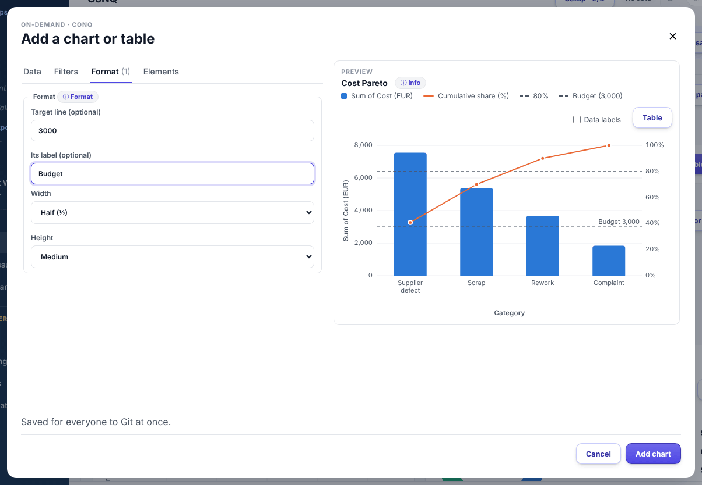

A currency column is never converted or added up across currencies: a chart shows one currency at a time and says which currencies it found.

### Chart elements

**Chart elements** work like Excel's and are on the **Elements** tab: the page's owners set them for everyone.

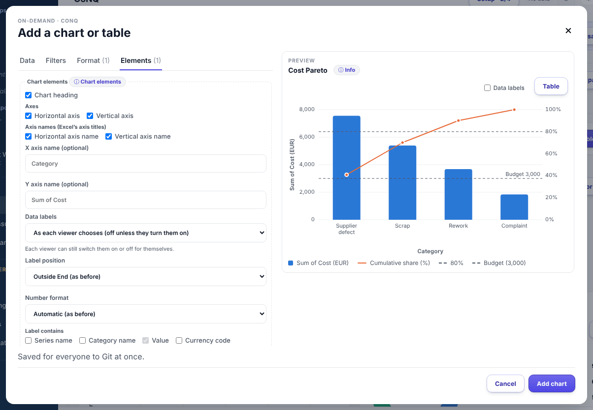

- **Chart heading** on or off; **Axes** and **Axis names**, horizontal and vertical.
- **Data labels**: On, Off, or each viewer's choice; **Label position**, **Label contains** (series, category, value, percentage) and **Number format**.
- **Data table** under the chart; **Gridlines**, major and minor; **Legend**: None, Top, Bottom, Left or Right; **Trendline**: Linear.

### KPI cards

A **KPI (one number)** shows one figure: a count, sum or average, optionally filtered (for example *Open issues*). As cards they sit in a row above the charts, four to a row, until the owners move them among the charts.

### Narratives

A **Narrative (text)** writes a few plain sentences about a measure, from the same rows as the charts. It is worked out in the app — no AI, nothing sent anywhere.

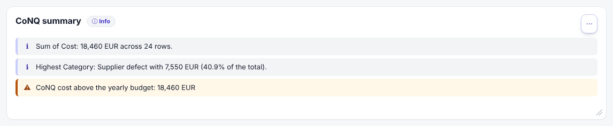

1. In ＋ Add chart / table, on **Data**, choose **Narrative (text)**.
2. Choose the **Measure** and, optionally, **Group by**.
3. Open the **Narrative** tab and tick the **automatic sentences**: Total, Highest category, Lowest category, Above / below a threshold, Change vs the previous period, Biggest mover.
4. Add **rules** of your own (up to 20) with **＋ Add rule**: *If* a figure *is* above, below or equal to a number, *then show* your sentence with a **tone** — Info, Good, Warning or Bad. Placeholders such as `{value}`, `{total}` and `{top}` are filled in.
5. Watch the **Preview** and press **Add chart**.

<video controls muted preload="none" src="user-guide/media/clip-narrative.webm" poster="user-guide/media/clip-narrative.png" title="Add a narrative with a warning rule"></video>

*Clip: a narrative of the total cost by category with the rule "If Total > 15000, Warning: CoNQ cost above budget".*

### Sizes, the grid and Arrange charts

Charts sit on a grid of 12 columns. Their sizes read like "6 × 8" (columns × rows).

**Your own size** (everyone, also read-only roles): drag a chart's **bottom-right corner**, or focus it with Tab and use the arrow keys, **Enter** to keep and **Escape** to cancel. Only you see it; **Reset to default** goes back to the owners' size.

**For everyone** (the page's owners):

1. Press **Arrange charts**. The grid lines and each chart's size show.
2. Drag a chart by **⠿** in its header to move it; drag its corner to size it. The others make room.
3. In a chart's **⋯**, **Match heights in this row** makes the charts of its row equally tall.
4. Each change is saved to Git with the page.

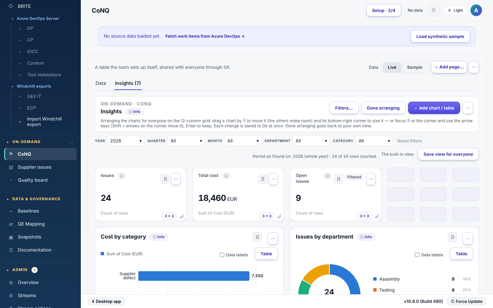

<video controls muted preload="none" src="user-guide/media/clip-arrange.webm" poster="user-guide/media/clip-arrange.png" title="Arrange charts: resize a chart and match the heights of its row"></video>

*Clip: in Arrange charts the donut is made larger by its corner, then Match heights in this row lines up its neighbours.*

## On-Demand Dashboards

An **On-Demand Dashboard** is a read-only page of KPI tiles, charts and summary tables built from the rows of one or more table pages, or from the Time Writing hours.

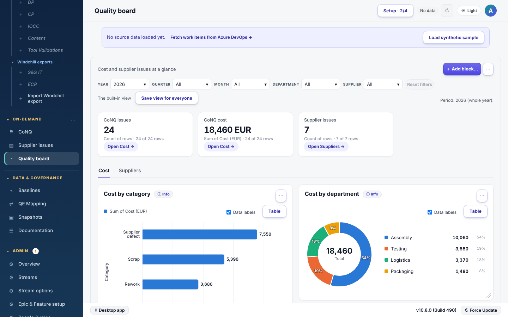

**Reading it.** Use the filter row (Year / Quarter / Month and the owners' filters) and the tabs. **Open <tab> →** on a tile opens its tab. Click a bar to see its rows; **Table** shows the numbers. Your tab, period and filters are remembered for you.

**Building it** (Tool Owner and the dashboard's co-owners):

- **＋ Add block…** — type, title, data source, *Categories by*, the measure, the Date column the period applies to, the tab and filters, with a live preview.
- **Arrange blocks…** — Edit, Copy to…, ↑ ↓, Remove. **⋯ → Arrange on the page** sizes and moves blocks on the grid, as Arrange charts does.
- **Tabs and filters…** — the dashboard's tabs and its filter row.
- **Copy to…** in a block's ⋯ copies it to this or another dashboard.

Each change is saved to Git at once. Blocks over the Time Writing hours show only to people who may see Team overview.

## Sharing: PDF and interactive HTML

### Export PDF

1. Open **⋯** of the Insights heading (or the page ⋯ of a dashboard) and choose **Export PDF…**.
2. Choose the charts (all or some, KPI cards too), whether your filters apply, A4 or Letter, portrait or landscape, and whether the footer shows the date and time.
3. Press **Export PDF**. The desktop app saves the file where you choose; a browser opens its print dialog — choose **Save as PDF**.

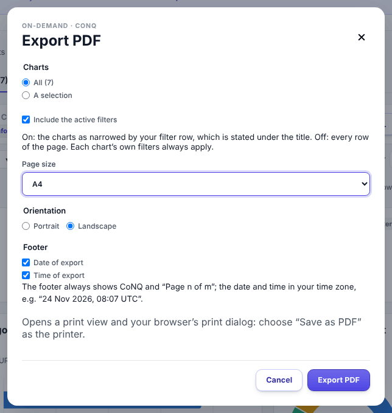

### Publish interactive HTML

**Publish interactive HTML…** (page ⋯ of a table page or a dashboard; the Tool Owner and the page's co-owners) writes **one self-contained `.html` file** that works like a small dashboard for colleagues without the app — from a folder, a share or an email attachment, in any current browser, offline.

1. Set the Insights filter row (or the dashboard's period and filters). **Only the rows that pass your filters are published**; hidden rows never are.
2. Open the page **⋯** and choose **Publish interactive HTML…**.
3. Read the warning — "This file contains the n rows of <page> that pass your filters. Anyone who receives it can read them." — and press **Publish now**.
4. Choose where the file goes (the first time). Each later publish overwrites it.

<video controls muted preload="none" src="user-guide/media/clip-publish.webm" poster="user-guide/media/clip-publish.png" title="Publish CoNQ as interactive HTML and open the file"></video>

*Clip: the Category filter narrowed to Scrap and Rework, Publish now, and the published file opened on its own — its header names the filters and the rows, a bar lists its rows, the Rows tab shows the table.*

- The file shows who published it and when, the filters and "n of m rows", the KPI cards and charts as in the app (tooltips, Table view, the rows behind a bar), its own filter row, a **Rows** tab and a Light / Dark switch.
- **Schedule**: Off, Daily or Weekly at a time, saved for this page on your computer only, with your filters at that moment. It runs while the app is open; a missed run runs at the next start.
- The file needs **JavaScript** turned on. It makes no request to the network and holds no token or Git address.
- In a browser, Chrome and Edge remember the file; Firefox and Safari download it instead. Never from Sample.

## Admin

The **Admin** group holds the shared setup, one page per area. You see the pages your roles may change; each section has a chip saying whom a change affects: *Only you · This computer*, *Everyone · Shared in Git*, *Everyone · Tool Owner only* and so on.

### Overview and Search settings

**Admin → Overview** lists what is left to set up (with a link to each setting), the shared changes not yet saved to Git (with **Save to Git**) and the latest changes. **Search settings** (**Ctrl K**) finds any setting by name.

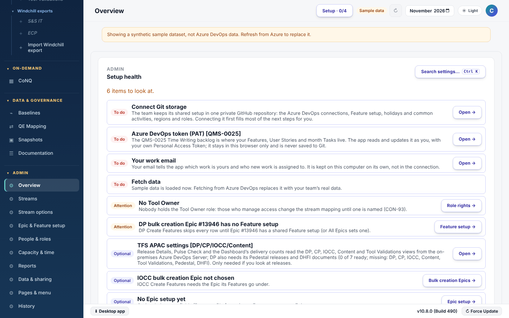

### Pages & menu

**Admin → Pages & menu** (Tool Owner) lists every menu group and every added page.

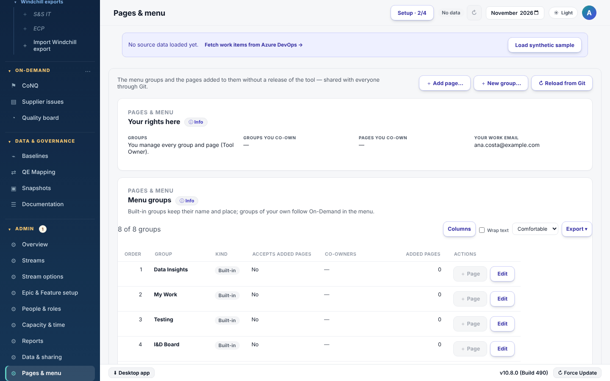

- **＋ Add page…** — choose the type (**Table**, **Table + Insights** or **On-Demand Dashboard**), a name, an optional description, an icon, the **menu group** (or **＋ New group…**) and optional **co-owners**. The page is created in Git at once and opens.
- **Menu groups** — the built-in groups keep their place; set whether a group **accepts added pages** and its **co-owners**. Your own groups can be renamed, reordered and removed once empty.
- **Pages** — **Edit**, **↑ ↓**, **Hide** / **Show** (a hidden page leaves everyone's menu; dashboards keep reading it) and **Delete** (Tool Owner; it asks first). The **Storage** column shows one file or row files, with **Convert…**.
- **Co-owners** are picked from a searchable list of the people the app knows. A group co-owner looks after the group's pages; a page co-owner sets up that page and edits its rows.
- Page names are unique across the whole menu.

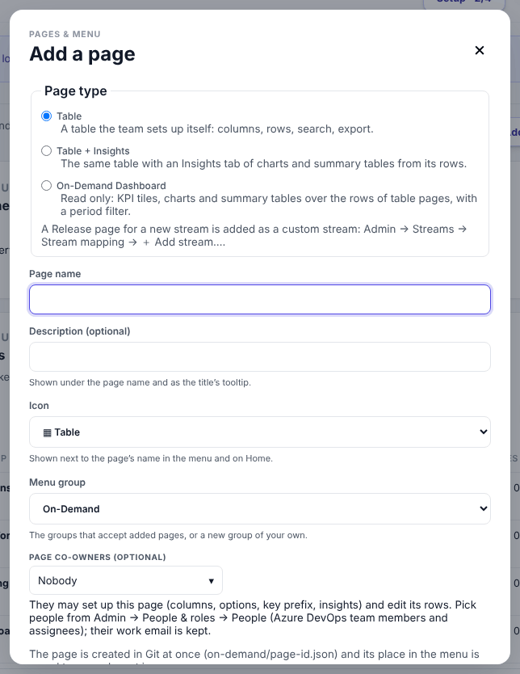

### People & roles

**Admin → People & roles → People** lists the people from Azure DevOps: the Time Writing team and everyone assigned to work. To add someone, add them to the team in Azure DevOps and refresh.

- Filter by **Region**, **Role**, **Access role** and **Status**, search, sort and export.
- **Click a person** to open their drawer: email and status, **Access**, **Profile** and **Employment**. **Edit** turns them into fields — app access roles, region, role, People manager, reports to, Time tracking started and Left on — and **Save** saves what changed. **‹ ›** go through the list.
- **Mark as left…**, **Not part of the team** and **Restore** are at the bottom of the drawer.

To change several people at once (**bulk edit**):

1. Tick the people (or the heading box for everyone shown).
2. In the bar that appears, choose **Set region…**, **Set role…** or **Set access role…**.
3. Choose the value and press **Save**. It is saved for everyone selected in one go; **Clear selection** ends it.

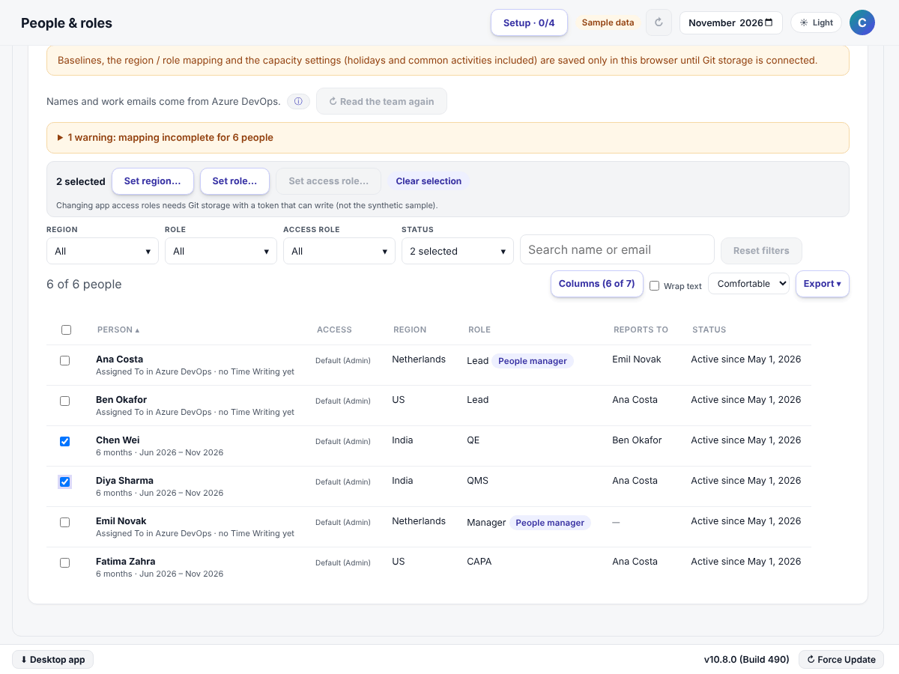

<video controls muted preload="none" src="user-guide/media/clip-people.webm" poster="user-guide/media/clip-people.png" title="Open a person, then set the region of two people at once"></video>

*Clip: Diya Sharma's drawer, the next person with ›, then Chen Wei and Diya Sharma ticked and their region set to Netherlands with Set region….*

The **Team tree** tab shows the reporting lines. **Capacity roles** sets which team roles count for capacity.

### Role rights

**People & roles → Role rights** is a matrix: every menu area and action is a row, and each role's cell is **Allow**, **Deny** or **Not set**.

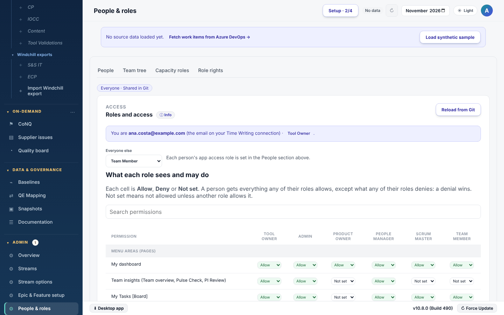

- **Members** lists who has each role (choose people by name).
- A **Deny** wins over any Allow from another role. *Not set* means not allowed unless another role allows it.
- **Check access** picks a person and a permission and says whether it is allowed and why.
- The roles are kept in Git as `access.json`, so changing them needs a GitHub token that can write. You cannot remove *Manage access* from yourself.

### Streams and custom streams

**Admin → Streams** (Tool Owner) maps each stream to its server, project and query: **Time Writing** (QMS-0025) and the release streams DP, CP, IOCC, Content, Tool Validations, S&S IT and ECP. **Set up** adds a stream from the team's defaults. The mapping is shared through Git and applied for everyone at their next start; your PAT is never part of it.

**＋ Add stream…** adds a **custom stream** with its own Release page. **Stream options** sets the Epics Features are matched in, the bulk creation Epics and the release counts.

Your own read-only views are in **My settings → My views**: they appear under **Other views** in your menu only, and never change a stream.

### Capacity & time

**Admin → Capacity & time** holds how capacity is worked out:

- **Capacity and absence** — who counts in the month's capacity, and why not.
- **Calculation profiles** — what counts as utilized and what comes off the capacity, as a sentence you change by ticking terms.
- **Bucket rules** — the words and tags that make an hour Absence, Training or Other NPRA.
- **Insight thresholds**, **Holidays and common activities**, **Period control** (the last day to update each month, and locking a month early) and **Historical hours** (hours from before Time Writing, from Excel).

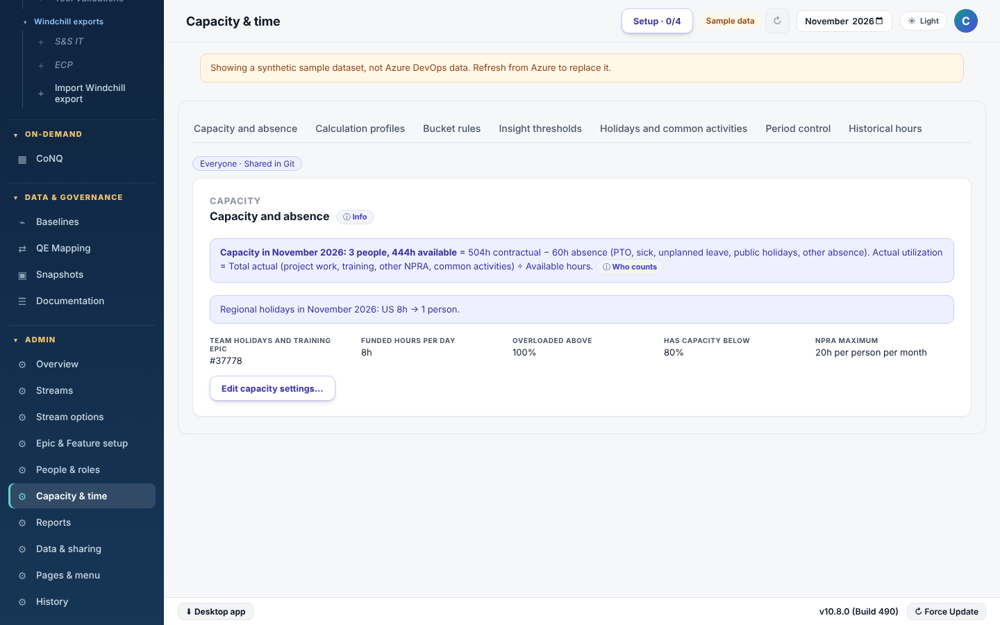

### Data & sharing

**Admin → Data & sharing** has **Git storage** (connect, change or disconnect; **Load latest**), **Load from Git** (**Load everything from Git**), **Shared setup in Git**, **Other views** and **Synthetic sample**.

### Look & feel

**Look & feel** (profile menu) has a tab each for **Page layout** (margins and border), **Theme and zoom**, **Start view and menu** and **Table and chart defaults** (the shared table and chart design, for the roles allowed to change it). The first three are yours, on this computer.

### History

**Admin → History** lists the changes to the shared setup; filter by area and text.

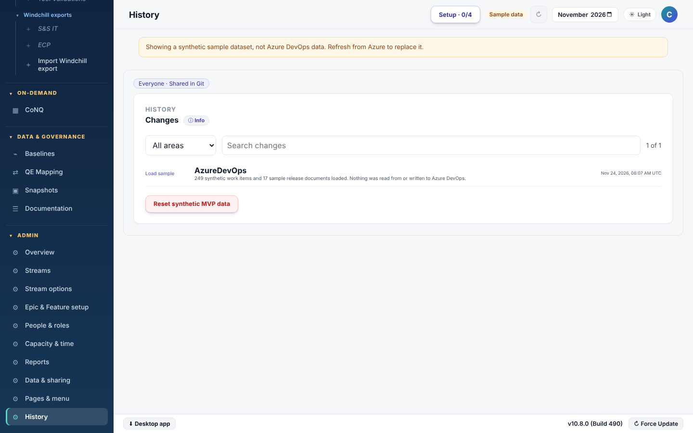

### Save view for everyone (tables)

Tool Owners and Admins set how tables and page filters look the first time for everyone with **Save view for everyone** in a table's **Columns** panel or beside a page's filters. See [Save view for everyone](#save-view-for-everyone).

## Troubleshooting and FAQ

**"Could not fetch from Azure DevOps" or a 401 / 403 error.** Your PAT is missing, wrong, expired or lacks a scope. Get started opens by itself with the reason: paste a new PAT for that server in **My settings → Servers and PATs** and press **Fetch now**. The Time Writing PAT needs Work Items (Read & Write) and Project and Team (Read).

**Every button is greyed out and a notice says the app is read only.** The roles have not been loaded. Connect Git storage (**Admin → Data & sharing**) with your GitHub token. If the repository has no roles yet, **Set up roles**.

**A button is greyed out.** Read the line next to it: it names the missing right, the missing Git storage, a read-only token or the sample data. Ask an Admin to change your role if needed.

**I cannot save to Git.** Your GitHub token is read only or expired, or the sample is loaded. Use a fine-grained token with **Contents: Read and write** for the team's repository.

**My changes are not written to Azure DevOps.** The synthetic sample is loaded (the banner says so): refresh from Azure first. On-premises servers are always read only.

**A row says "Being edited by …".** Someone else has its lock. Wait until they save or cancel, or until the lock times out (15 minutes without activity by default). A Tool Owner or page co-owner can **Release lock**.

**My edit closed and my changes seem gone.** After a lock timeout your text is kept as a draft in this browser for one day: press **Edit** on the same row and **Restore your draft**.

**"Newer data in Git".** A colleague saved data this page uses. Press **Load the newer data**.

**A published HTML file shows a blank page.** The file needs JavaScript: open it in a current browser with JavaScript turned on (some email previews and locked-down viewers block it). Save it to a folder and open it from there.

**The PDF has no page numbers.** Firefox and Safari cannot number pages when printing; use Chrome, Edge or the desktop app.

**Windows warns about the installer.** The installer is not code-signed: choose **More info → Run anyway**. On macOS, right-click the app and choose **Open** the first time.

#### Updates of the desktop app

The desktop app checks for a newer build when it starts and every four hours. When one is published, **Update available** appears at the bottom right: **Update now** opens the update dialog, **Later** hides it until the next build. **↻ Check for updates** in the footer checks at once. **Download and install** fetches only the installer for your computer from the team's fixed release and checks its size and SHA-256 checksum before installing; a mismatch deletes the file and installs nothing. Your data and PATs are kept.

**Force Update** (footer) reloads the newest version of the app's page. It never clears your data, tokens or settings; unfinished work is checked first.

**Where is my data kept?** In this browser or desktop app (the footer's **Force Update** window says where), plus what the team shares in the Git repository. Your tokens and work email are never shared.

## About this guide

This guide is `docs/USER-GUIDE.md`, bundled with every build and shown first on **Data & governance → Documentation** (also **User guide** in the profile menu). Its pictures are in `docs/user-guide/images/` and its clips in `docs/user-guide/media/`.

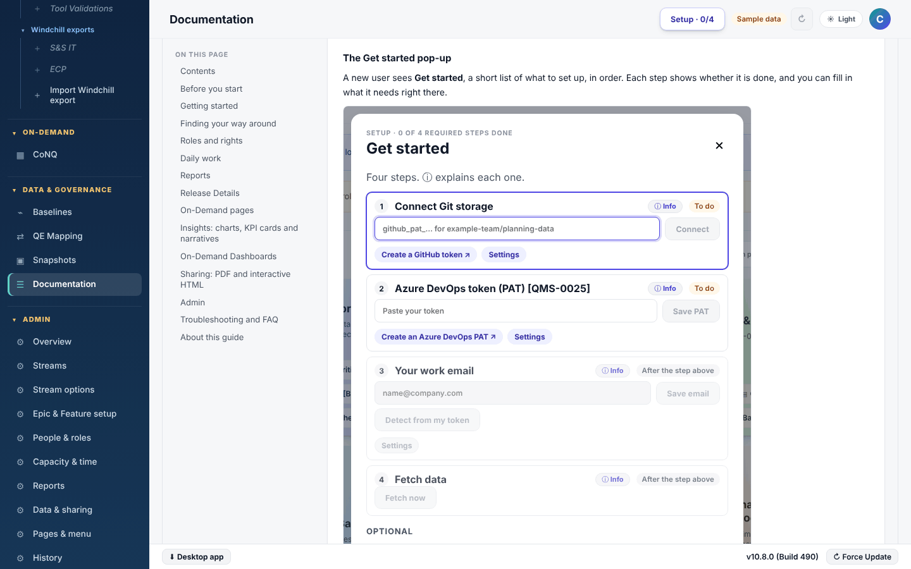

The screenshots and clips are made by a script from the built app, with synthetic data only:

1. `pnpm build:web`
2. `pnpm docs:shots` — the screenshots (1440 × 900, light theme; a few dark and phone ones).
3. `pnpm docs:videos` — the clips (1280 × 720 WebM). With ffmpeg installed they are trimmed and compressed, and the screenshots reduced to 256 colours.

`node scripts/user-guide-shots.mjs --only home,people` remakes some of them. The script stops if anything other than made-up data — a real server, organisation or repository name, a token or an email outside `example.com` — would be captured.
